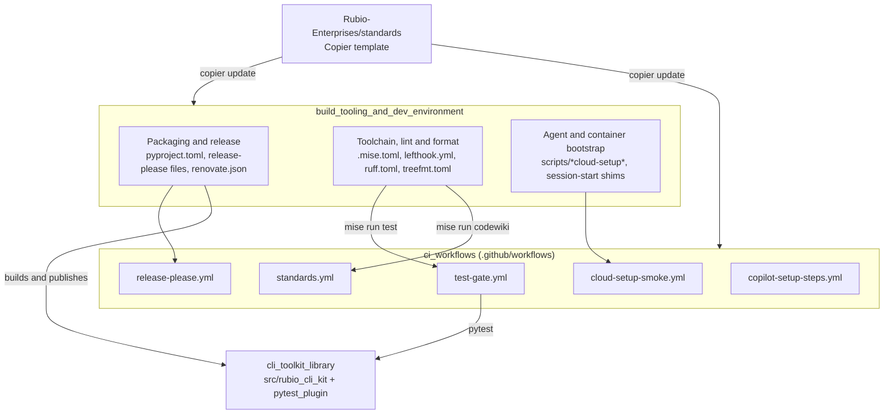

# Build, Release and CI Infrastructure

## Purpose

The `build_release_and_ci_infrastructure` module covers every repository file that is not runtime code. These files decide how the `rubio-cli-kit` library is packaged, versioned, linted, tested, scanned, documented and released. They also set up the developer and agent environments. The module contains no Python runtime code. Its job is to build, check and publish the library documented in [CLI Toolkit Library](cli_toolkit_library.md) the same way on a laptop, in a Claude Code session and in GitHub Actions.

Most of these files are rendered from the `Rubio-Enterprises/standards` Copier template and carry a `@generated by rubio-standards` banner. Don't edit those files by hand. Change the template, or put repository-specific changes in sidecar files such as `.mise.local.toml`, `lefthook-local.yml`, `*.local` lint sidecars and `scripts/repo-local/*.sh`. The one CI file this repository owns is `test-gate.yml`.

## Architecture

The module has two parts:

- **Build tooling and dev environment** holds the configuration: tool pins, tasks, packaging metadata, release settings, lint and format configs, and the bootstrap scripts.
- **CI workflows** are the GitHub Actions files that run that configuration on pull requests, in the merge queue, on pushes to `main` and on a schedule.



Every path goes through the `mise` task runner. A developer, an agent and CI all run the same commands:

```mermaid
sequenceDiagram
    participant Actor as Developer / agent / CI
    participant Mise as mise (.mise.toml)
    participant Uv as uv (frozen)
    participant GH as GitHub Actions
    Actor->>Mise: mise run setup
    Mise->>Uv: uv sync --frozen
    Actor->>Mise: mise run lint / mise run test
    Mise->>Uv: ruff, pyright, pytest
    GH->>Mise: test-gate runs mise run test
    GH->>GH: aggregate publishes the test-gate status
    GH->>GH: release-please opens the release PR, refreshes uv.lock and enables auto-merge
```

## Core Components

| Component | Responsibility | Documentation |
| --- | --- | --- |
| CI workflows | Required `test-gate` check, weekly trufflehog scan, CodeWiki Pages deploy, release-please automation, cloud-setup smoke test and Copilot runner pinning | [CI Workflows](build_release_and_ci_infrastructure/ci_workflows.md) |
| Build tooling and dev environment | mise tool pins and tasks, packaging metadata, release and Renovate configuration, lint and format configs, SessionStart and cloud-setup bootstrap scripts | [Build Tooling and Dev Environment](build_release_and_ci_infrastructure/build_tooling_and_dev_environment.md) |

## Key Conventions

- `.mise.toml` is the single entry point. The main tasks are `mise run setup`, `mise run lint`, `mise run test`, `mise run lint-config` and `mise run codewiki`.
- Every `uv run` call uses `--frozen`. If `uv.lock` is out of date, `uv lock --check` fails instead of re-locking it silently. After a version bump, the release workflow refreshes the lock on the release branch.
- Ruff comes only from the mise pin. It is never declared as a Python dependency.
- Workflow actions are pinned to full commit SHAs and get least-privilege permissions. Org-level governance workflows add lint, audit, secret-scan and PR-title checks.
