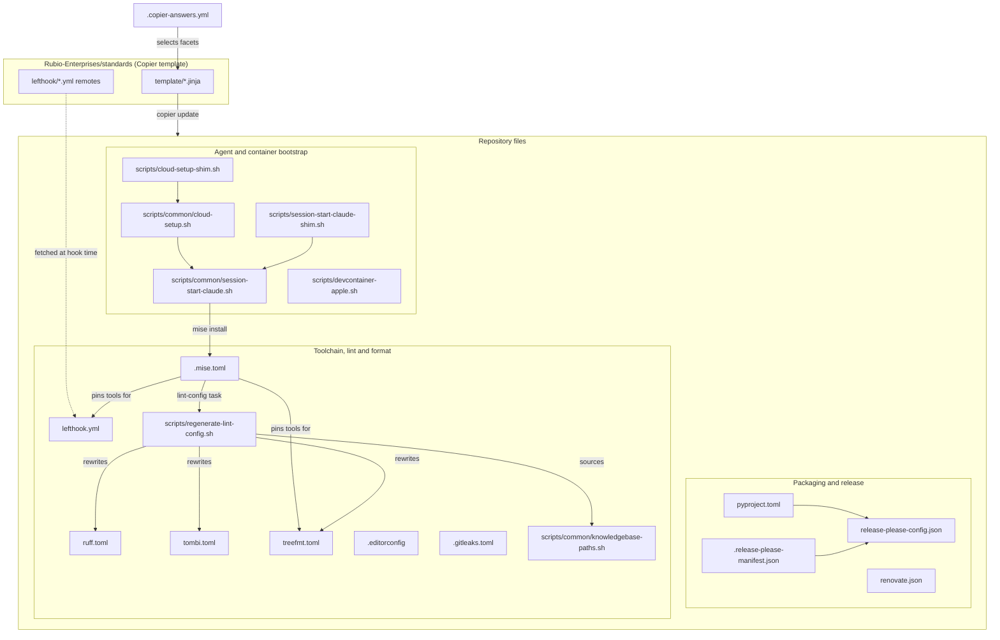
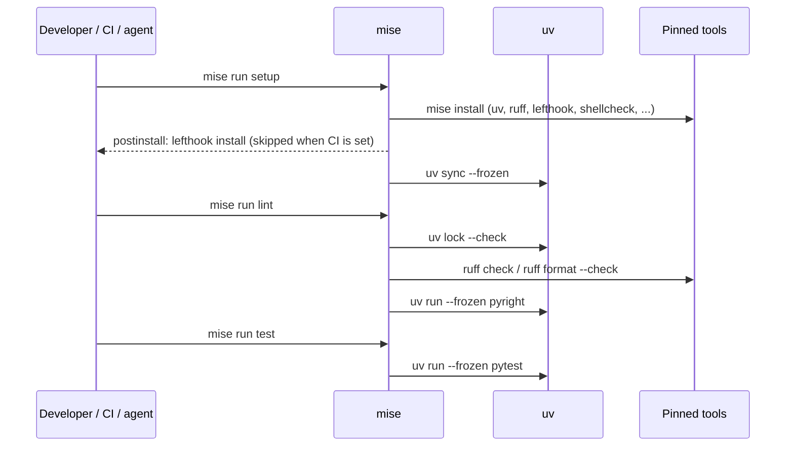

# Build Tooling and Dev Environment

## Introduction

The build tooling and dev environment module holds every non-Python file that decides how `rubio-cli-kit` is packaged, versioned, linted, formatted, scanned for secrets and set up on a developer laptop or in a Claude Code on the web cloud session. It contains no runtime code. Its job is to make sure that the library documented in [cli_toolkit_library](../cli_toolkit_library.md) is built, checked and released the same way on every machine. The [ci_workflows](ci_workflows.md) module calls these same files from GitHub Actions.

Almost every file here is rendered by the `Rubio-Enterprises/standards` Copier template. `.copier-answers.yml` records which template version and which facets this repository uses. Files that carry a `@generated by rubio-standards` banner must not be edited by hand. Repo-specific changes go in sidecar files instead: `.mise.local.toml`, `lefthook-local.yml`, `*.local` lint sidecars and `scripts/repo-local/*.sh`.

## Architecture Overview

The files fall into three groups:

- **Packaging and release**: the Python distribution metadata, the release-please version stream and the Renovate dependency policy.
- **Toolchain, lint and format**: the mise tool pins and task runner, the Git hook stub, the formatter and linter configs, and the script that regenerates those configs.
- **Agent and container bootstrap**: the shim/common/repo-local scripts that install the pinned toolchain when a Claude Code session starts or a cloud snapshot is built, plus the Apple-silicon Dev Container launcher.

## The Task Runner Contract

`.mise.toml` is the single entry point for local work and for CI. The tasks below are the template contract:

| Task | What it runs |
| --- | --- |
| `mise run setup` | Every `setup:*` subtask: `mise install` (`setup:tools`) and then `uv sync --frozen` (`setup:py`) |
| `mise run lint` | `uv lock --check`, `ruff check .`, `ruff format --check .`, `uv run --frozen pyright` |
| `mise run test` | `uv run --frozen pytest --strict-markers --junitxml=reports/unit/junit.xml` |
| `mise run lint-config` | `bash scripts/regenerate-lint-config.sh` (pass `-- --check` to check without writing) |
| `mise run codewiki` | Generates or updates `docs/codewiki/` with CodeWiki and the `claude` CLI |

Two rules show up across the whole module:

- Ruff comes only from the mise pin (`pipx:ruff`). It is never a dependency in `pyproject.toml`, and hooks and tasks call it as `mise exec -- ruff`.
- Every `uv run` uses `--frozen`, so a stale `uv.lock` is reported by `uv lock --check` and is never quietly re-locked.

## Sub-modules

### Packaging and Release

`pyproject.toml` declares the `rubio-cli-kit` distribution (version `1.2.4`, Python `>=3.14.6`, built with hatchling). It depends on `rich`, `structlog` and `typer` and registers the `rubio_cli_kit.pytest_plugin` entry point under `pytest11`, which is how consumer repositories pick up the [contract_testing](../cli_toolkit_library/contract_testing.md) harness. The release-please config and manifest keep the version and `CHANGELOG.md` in step. `renovate.json` extends the org preset and stops Renovate from bumping the pinned Python 3.14.6 floor. `.copier-answers.yml` records the template inputs. See [Packaging and Release](build_tooling_and_dev_environment/build_tooling_and_dev_environment_packaging_and_release.md).

### Toolchain, Lint and Format

`.mise.toml` pins uv, Node, Ruff, Biome, treefmt, tombi, lefthook, gitleaks, shellcheck, shfmt, markdownlint-cli2, prettier, yamllint, yq, copier, commitlint and CodeWiki. `lefthook.yml` is a thin stub that fetches the hook bodies from the standards `stable` channel. `treefmt.toml` sends each file type to its formatter. `ruff.toml` and `tombi.toml` are generated configs (the org floor merged with the repo's `*.local` sidecars), and `scripts/regenerate-lint-config.sh` rebuilds them with the same recipe the CI drift gate uses. See [Toolchain, Lint and Format](build_tooling_and_dev_environment/build_tooling_and_dev_environment_toolchain_and_lint.md).

### Agent and Container Bootstrap

The SessionStart hook chain (`scripts/session-start-claude-shim.sh` and then `scripts/common/session-start-claude.sh`) installs the mise toolchain, adds it to `PATH` through `$CLAUDE_ENV_FILE`, and prints one line of context. The cloud Setup chain (`scripts/cloud-setup-shim.sh` and then `scripts/common/cloud-setup.sh`) builds the cached cloud snapshot. `scripts/devcontainer-apple.sh` starts the Dev Container on Apple silicon. See [Agent and Container Bootstrap](build_tooling_and_dev_environment/build_tooling_and_dev_environment_agent_bootstrap.md).

## Relationship to Other Modules

- [ci_workflows](ci_workflows.md): `test-gate.yml` runs the mise tasks above, `release-please.yml` reads the release-please files, and `cloud-setup-smoke.yml` runs `scripts/common/cloud-setup.sh` with `CLOUD_SETUP_SMOKE` set.
- [cli_toolkit_library](../cli_toolkit_library.md): the Python package that this tooling builds, lints, tests and publishes.
- [build_release_and_ci_infrastructure](../build_release_and_ci_infrastructure.md): the parent overview.

## Documentation Map

| Page | Files covered |
| --- | --- |
| [Packaging and Release](build_tooling_and_dev_environment/build_tooling_and_dev_environment_packaging_and_release.md) | `pyproject.toml`, `release-please-config.json`, `.release-please-manifest.json`, `renovate.json`, `.copier-answers.yml` |
| [Toolchain, Lint and Format](build_tooling_and_dev_environment/build_tooling_and_dev_environment_toolchain_and_lint.md) | `.mise.toml`, `lefthook.yml`, `ruff.toml`, `tombi.toml`, `treefmt.toml`, `.editorconfig`, `.gitleaks.toml`, `scripts/regenerate-lint-config.sh`, `scripts/common/knowledgebase-paths.sh` |
| [Agent and Container Bootstrap](build_tooling_and_dev_environment/build_tooling_and_dev_environment_agent_bootstrap.md) | `scripts/cloud-setup-shim.sh`, `scripts/common/cloud-setup.sh`, `scripts/session-start-claude-shim.sh`, `scripts/common/session-start-claude.sh`, `scripts/devcontainer-apple.sh` |
