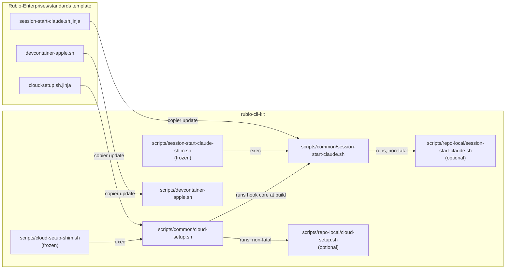
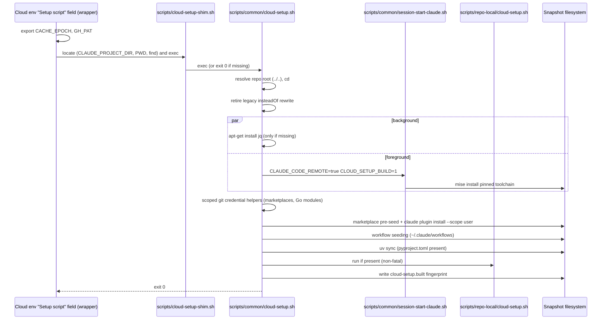
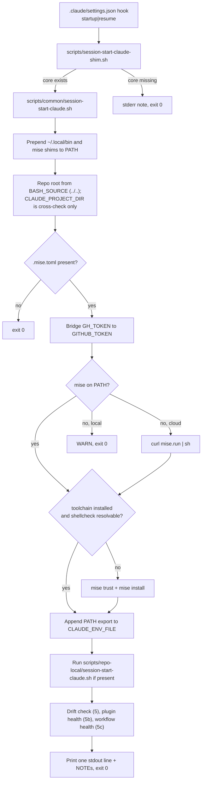
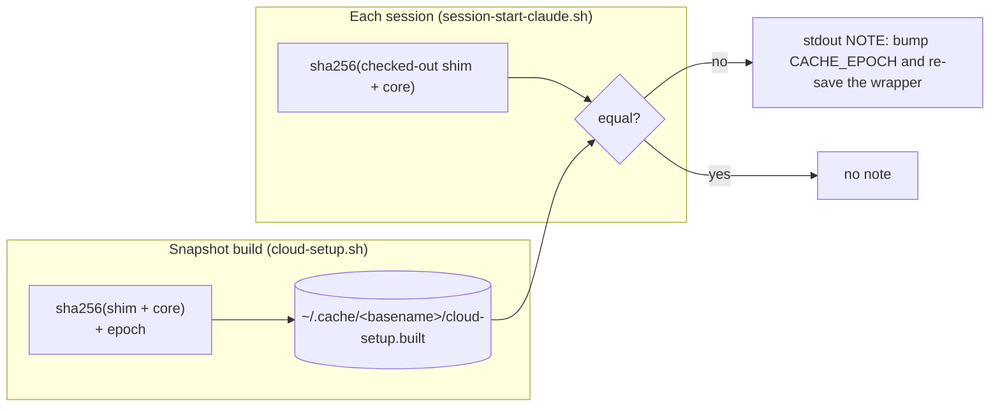
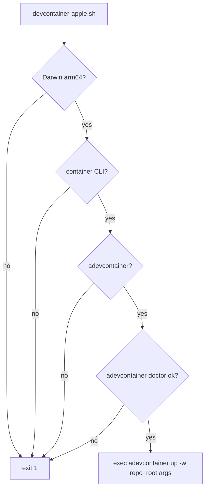

# Agent Bootstrap (Cloud Setup, SessionStart Hook, Apple Devcontainer)

The agent bootstrap module is the set of shell scripts that gets a working `rubio-cli-kit` development environment ready for AI coding agents and for human developers. It covers three entry points:

- **Claude Code on the web Setup script.** `scripts/cloud-setup-shim.sh` hands off to `scripts/common/cloud-setup.sh`. This chain runs as root before the session starts, and only when the environment snapshot has to be rebuilt.
- **Claude Code SessionStart hook.** `scripts/session-start-claude-shim.sh` hands off to `scripts/common/session-start-claude.sh`. This chain runs at the start of every local or cloud session (matcher `startup|resume`).
- **Apple silicon devcontainer launcher.** `scripts/devcontainer-apple.sh` starts the repo devcontainer with the Apple `container` runtime.

These scripts do not build or test the library. They install the pinned toolchain from `.mise.toml`, which is described in [Toolchain and Lint](build_tooling_and_dev_environment_toolchain_and_lint.md). They also prepare the uv virtualenv for `pyproject.toml`, described in [Packaging and Release](build_tooling_and_dev_environment_packaging_and_release.md). Commands such as `mise run lint/test` then work right away. The CI parity check for this chain is the `cloud-setup-smoke` workflow, documented in [CI Workflows](../ci_workflows.md).

## Ownership Model: Shim, Common and Repo-Local

Every bootstrap chain uses the rubio-standards **shim/common/repo-local** layout. The layout decides who may edit each file and how changes reach consumer repos.

| Layer | File(s) | Owner | Changes via |
| --- | --- | --- | --- |
| Shim | `scripts/cloud-setup-shim.sh`, `scripts/session-start-claude-shim.sh` | Consumer, frozen (`_skip_if_exists`) | Never meant to change |
| Common core | `scripts/common/cloud-setup.sh`, `scripts/common/session-start-claude.sh` | Template (`@generated`, DO NOT EDIT) | Weekly copier-sync PR (`copier update`) |
| Repo-local | `scripts/repo-local/cloud-setup.sh`, `scripts/repo-local/session-start-claude.sh` (optional; not present in this repo) | Repo | Normal PRs |
| Standalone | `scripts/devcontainer-apple.sh` | Template (`@generated`, no per-repo override) | PR against the template |

The shims contain no logic on purpose. Each one does only three things:

- Resolves the repo root from its own location (`BASH_SOURCE`, one directory up, with `CDPATH` unset).
- Uses `exec` to run the matching core under `scripts/common/` if that core exists.
- Otherwise prints a note to stderr and runs `exit 0`, so a branch without the core degrades instead of failing.

The template version these files come from is recorded in `.copier-answers.yml`.

## Abort-Proof Contract

All bootstrap scripts except the devcontainer launcher are **abort-proof**:

- If the cloud Setup script exits non-zero, the cloud session cannot start.
- If a SessionStart hook fails, the session it fires in fails.

So every step that touches the network, installs something, or calls the toolchain is guarded with `|| true` or a `__warn` call, and each script always ends in `exit 0`. The one exception is the CI smoke mode described below. `scripts/devcontainer-apple.sh` runs in an interactive terminal, so it uses `set -euo pipefail` and stops with an error when a prerequisite is missing.

## Execution Chains

### Cloud Setup Script Chain

#### The Web Wrapper

The cloud environment's Setup-script field does not hold the core itself. It holds a short, repo-agnostic wrapper kept as an inert heredoc (`: <<'CLOUD_SETUP_WEB_WRAPPER'`) between the `8<` COPY markers in `scripts/common/cloud-setup.sh`. The wrapper:

- Exports `CACHE_EPOCH`. Increase it and re-save the field to force a snapshot rebuild.
- Exports `GH_PAT`, the org-wide read-only fine-grained PAT. It has to be set here, because the "Environment variables" field only reaches sessions and never the snapshot build.
- Finds `scripts/cloud-setup-shim.sh` (or `Scripts/...`) under `CLAUDE_PROJECT_DIR`, then `$PWD`, then with a bounded `find` over `/home`, `/root` and `/workspace`. It needs to search because the Setup script does not start in the repo root, and a bare relative path would fail with exit 127.

#### When the Snapshot Rebuilds

The platform rebuilds the snapshot only when one of these happens:

- The wrapper text changes.
- The allowed network hosts change.
- The snapshot reaches its roughly 7-day expiry.

The platform cannot see edits to the core itself. That is why the drift fingerprint described below exists.

#### Steps in the Core

1. **Repo root and smoke banner.** The core resolves the root two levels up from `scripts/common/`. It logs either the smoke level or the cache epoch.
2. **HTTPS preference and legacy cleanup.** It exports `CLAUDE_CODE_PLUGIN_PREFER_HTTPS=1`. It also removes the old `url.https://github.com/.insteadOf git@github.com:` rule. Git exit code `5` (rule already absent) is accepted.
3. **Guarded apt.** It installs `jq` in the background, and only if `jq` is missing. `gh` is deliberately not installed.
4. **Toolchain bootstrap.** It runs the SessionStart hook core with `CLAUDE_CODE_REMOTE=true`, `CLOUD_SETUP_BUILD=1`, and `GITHUB_TOKEN` taken from `GH_TOKEN`, then `GITHUB_TOKEN`, then `GH_PAT`. This puts the mise toolchain into the snapshot, so later sessions skip the install.
5. **Scoped credential helpers.** It reads `.claude/settings.json` `extraKnownMarketplaces` once with `jq`, and parses `go.mod`, if present, with `awk`. It registers a `credential.https://github.com/<owner>/<repo>[.git].helper` entry for each private `Rubio-Enterprises/*` repository only. It never registers an org-wide or global helper, because that would hand the read-only token to the working repo. `GOPRIVATE` is set to `github.com/Rubio-Enterprises/*`.
6. **Marketplace pre-seed.** This step works around cloud sessions starting with `SKIP_PLUGIN_MARKETPLACE=true`. For each marketplace it:
    - Clones the marketplace (shallow, HTTPS only, `GIT_CONFIG_GLOBAL=/dev/null`), honouring a pinned `ref` or the remote default branch.
    - Merges an entry into `~/.claude/plugins/known_marketplaces.json`.
    - Runs `claude plugin install <plugin> --scope user` (60 s timeout) for each enabled plugin. User scope is used so that multi-repo sessions still resolve plugins.
7. **Workflow seeding.** For opt-in plugins (an empty `.claude-plugin/seed-workflows` marker), it copies `workflows/*/*.js` from the plugin cache into `~/.claude/workflows/`. A file that already exists is kept (first wins), and duplicate `meta.name` values trigger a warning.
8. **Cache warming.** Each warm step runs only when its committed manifest exists. For this Python repo that means `uv sync` when `pyproject.toml` exists and `uv` is available.
9. **Repo-local tail.** It runs `scripts/repo-local/cloud-setup.sh` if present, under the same non-fatal contract.
10. **Drift fingerprint.** It writes `epoch=` and `sha256=` (the hash of the shim and core concatenated) to `${XDG_CACHE_HOME:-$HOME/.cache}/<repo-dir-basename>/cloud-setup.built`.

### SessionStart Hook Chain

The hook core implements the numbered rubio-standards §6.1 contract, which `check.sh` enforces against the file content:

1. **Abort-proof.** `set -euo pipefail` stays for convention, but every fallible step is guarded, and the script always ends in `exit 0`.
2. **Token bridge.** It sets `GITHUB_TOKEN` from `GH_TOKEN` so that mise's aqua/GitHub backends are not rate-limited.
3. **PATH persistence.** It writes `export PATH="<mise bin dir>:~/.local/share/mise/shims:$PATH"` to `$CLAUDE_ENV_FILE`. That file is the only way to expose tools to the session's later Bash calls.
4. **Repo-root resolution.** The repo root comes from `BASH_SOURCE`, not `CLAUDE_PROJECT_DIR`, which can point at a parent directory in multi-repo workspaces.
5. **Drift and health NOTEs.** These checks run in the cloud only:
    - (5) **Drift.** It compares the snapshot fingerprint with a fresh hash of the checked-out shim and core. A mismatch means `CACHE_EPOCH` needs a bump.
    - (5b) **Plugin health.** It checks that every marketplace declared in `.claude/settings.json` has a `marketplace.json` file and a registry entry, and that every enabled plugin has a cache directory.
    - (5c) **Workflow health.** It checks that every seeded workflow `.js` file is present in `~/.claude/workflows/`.

    5b and 5c are skipped when `CLOUD_SETUP_BUILD` is set, because during the snapshot build the pre-seed has not run yet.
6. **Single stdout line.** The hook's stdout becomes Claude's context, so it prints one line: `rubio-cli-kit dev toolchain ready (mise): ruff, yamllint, lefthook, shellcheck, shfmt, gitleaks, yq on PATH. ...`, followed by any NOTEs. All other output goes to stderr.
7. **Idempotent.** It runs `mise install` only when `mise ls --installed` fails or `shellcheck` does not resolve. On a warm environment the hook takes well under a second.
8. **Repo-local startup.** After the warmup it runs `scripts/repo-local/session-start-claude.sh` with `|| true`. That script inherits the repo-root working directory, the toolchain on PATH, `$CLAUDE_ENV_FILE`, and the bridged token.

Locally, the hook never installs mise without asking. If mise is missing, it prints a warning and exits cleanly.

### Drift Fingerprint Coordination

The two cores have to agree exactly on where the marker lives and how the hash is computed. The marker path uses the **runtime checkout directory name** (`$(basename "$repo_root")`), not the copier `project_name`. The hash is `cat shim core | sha256sum`, with the files in that same order.

## CI Smoke Mode

The abort-proof contract means an exit code from the cloud chain tells you nothing. `CLOUD_SETUP_SMOKE` reverses this, but only in CI. Every step still runs, failures are collected by `__warn` and `__smoke_check_failed`, and the core exits `1` at the end if any step failed.

| Level | Toolchain bootstrap | Cache warm and repo-local | Cloud-only sections |
| --- | --- | --- | --- |
| `warm` | Skipped | Run (missing tools are not reported) | Skipped |
| `1` | Run | Run (a manifest without its tool is a failure) | Skipped |

Cloud-only sections are skipped at both levels:

- apt
- the marketplace credential helper and pre-seed
- plugin cache materialization
- workflow seeding
- the fingerprint marker

There is one exception. The private-Go credential helper is registered in smoke mode when a token is present.

The consumer-side caller is `.github/workflows/cloud-setup-smoke.yml`:

- It delegates to the reusable `Rubio-Enterprises/.github` workflow, pinned by SHA.
- It runs on pull requests that touch `scripts/**`, `.mise.toml`, `.tool-versions`, `pyproject.toml`, `uv.lock`, or the workflow file itself, and on manual dispatch.
- It is not a required check, because a paths-filtered run may never report.

For details, see [CI Workflows](../ci_workflows.md).

## Apple Silicon Devcontainer Launcher

`scripts/devcontainer-apple.sh` is a strict, fail-fast wrapper for local development on macOS. It checks four prerequisites in order and exits `1` with a specific message at the first one that fails:

1. The host is `Darwin` on `arm64`.
2. The Apple `container` CLI is on PATH.
3. `adevcontainer` is on PATH.
4. `adevcontainer doctor` succeeds. If it fails, the message suggests running `container system start`.

It then resolves the repo root (one directory up from `scripts/`) and runs `exec adevcontainer up -w <repo_root> "$@"`, passing any extra arguments through.

## Environment Variables Reference

| Variable | Consumed by | Purpose |
| --- | --- | --- |
| `CACHE_EPOCH` | Wrapper, cloud core | Increased to force a rebuild; recorded in the fingerprint marker |
| `GH_PAT` | Cloud core, credential helpers | Read-only org PAT for private marketplaces and Go modules (build time only) |
| `GH_TOKEN` and `GITHUB_TOKEN` | Both cores | Lift the GitHub API rate limit for mise; fallback credentials |
| `CLAUDE_CODE_REMOTE` | Hook core | `true` turns on cloud behaviour (installs mise, runs health checks) |
| `CLOUD_SETUP_BUILD` | Hook core | Marks the snapshot-build invocation; skips the 5b and 5c health checks |
| `CLOUD_SETUP_SMOKE` | Cloud core | `warm` or `1`; CI-only fail-loud mode |
| `CLAUDE_ENV_FILE` | Hook core | Persists PATH for later Bash calls in the session |
| `CLAUDE_PROJECT_DIR` | Wrapper, hook core | Hint for finding the shim; cross-check only in the hook |
| `XDG_CACHE_HOME` | Both cores | Base directory for the drift marker |

## Related Documentation

- [Build Tooling and Dev Environment](../build_tooling_and_dev_environment.md): parent overview.
- [Toolchain and Lint](build_tooling_and_dev_environment_toolchain_and_lint.md): the `.mise.toml` toolchain and lefthook hooks that this module installs.
- [Packaging and Release](build_tooling_and_dev_environment_packaging_and_release.md): `pyproject.toml` (the target of `uv sync`) and `.copier-answers.yml` (the template version).
- [CI Workflows](../ci_workflows.md): the `cloud-setup-smoke` and `copilot-setup-steps` workflows.
- [Build, Release and CI Infrastructure](../../build_release_and_ci_infrastructure.md): top-level infrastructure overview.
