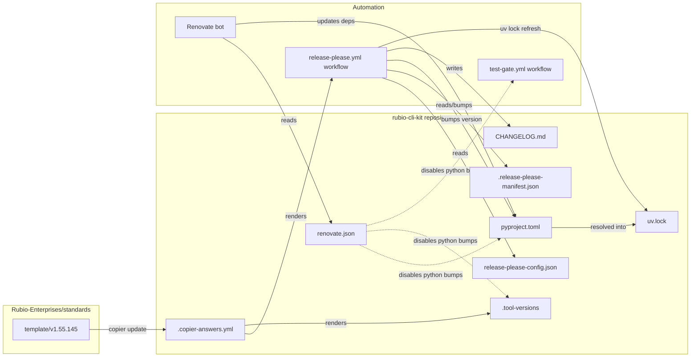
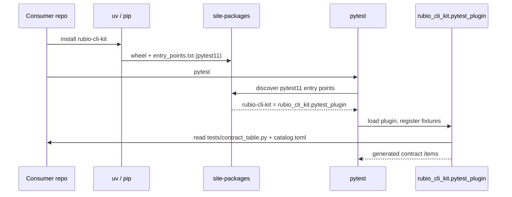
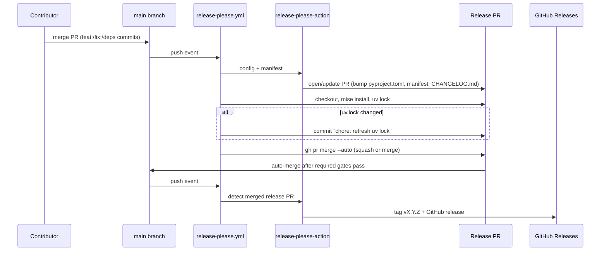
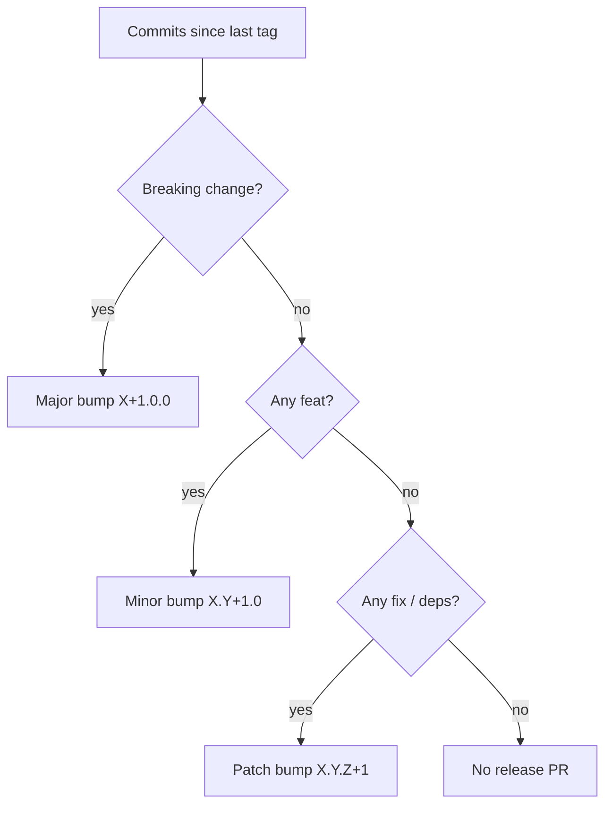
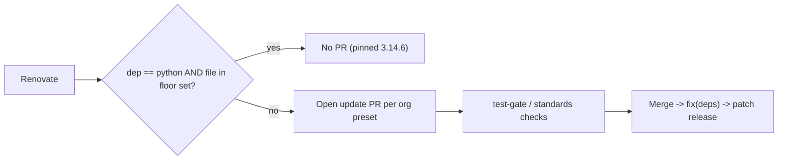
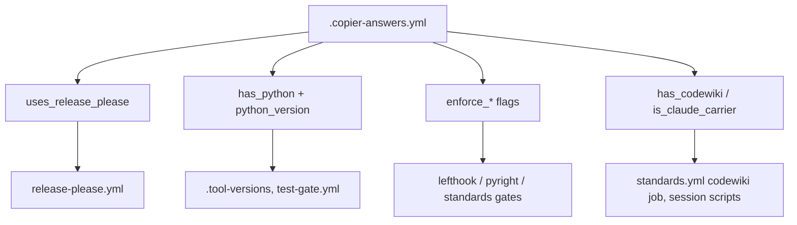

# Packaging and Release

## Introduction

This sub-module covers the files that define what `rubio-cli-kit` is as a Python distribution, how its version number moves forward, how its dependencies stay current, and which organisation template the repository is generated from. It contains five files:

- `pyproject.toml`: the PEP 621 project manifest. It sets the distribution name, version, Python floor, runtime and dev dependencies, the build backend, the `pytest11` entry point and pytest defaults.
- `release-please-config.json`: tells release-please how to version and tag the single root package.
- `.release-please-manifest.json`: the version release-please last released. It must match `[project].version` in `pyproject.toml`.
- `renovate.json`: the Renovate dependency-update policy, including a rule that keeps the Python 3.14.6 support floor pinned.
- `.copier-answers.yml`: the Copier answers that tie this repository to the `Rubio-Enterprises/standards` template and turn shared files and gates on or off.

Toolchain and lint configuration are documented in [Toolchain and Lint](build_tooling_and_dev_environment_toolchain_and_lint.md). Agent and container bootstrap scripts are documented in [Agent Bootstrap](build_tooling_and_dev_environment_agent_bootstrap.md). The workflows that use these files are documented in [CI Workflows](../ci_workflows.md#release-pleaseyml).

## Architecture



## pyproject.toml

`pyproject.toml` is the only packaging manifest in the repository. The Copier answers set `python_packaging: packaged` and `python_project_layout: root`, so the project sits at the repository root and builds as a real wheel.

### Project metadata

| Field | Value | Notes |
| --- | --- | --- |
| `name` | `rubio-cli-kit` | Distribution name. The import package is `rubio_cli_kit` under `src/`. |
| `version` | `1.2.4` | Updated only by release-please. Do not edit it by hand. |
| `requires-python` | `>=3.14.6` | The support floor. It must stay in sync with `.tool-versions` and `test-gate.yml`. See [Python floor pinning](#python-floor-pinning). |
| `description` | Shared CLI-contract helpers and pytest11 contract harness | |

### Runtime dependencies

| Dependency | Constraint | Used by |
| --- | --- | --- |
| `rich` | `>=15.0.0` | Terminal output in `_output.py` |
| `structlog` | `>=26.1.0` | Structured diagnostics in `_logging.py` |
| `typer` | `>=0.27.1` | CLI construction in `_cli.py` |

The runtime constraints are lower bounds only, with no upper bound. The kit is installed into the same environment as each consumer CLI, so tight upper bounds would cause resolver conflicts with consumers. The kit owns Rich and structlog: consumer command modules must not import them. Consumers declare and import Typer directly. See [CLI Runtime](../../cli_toolkit_library/cli_runtime.md) for how these libraries are wrapped.

### Development dependency group

The PEP 735 `[dependency-groups].dev` group pins exact versions so local and CI runs are reproducible:

- `pytest==9.1.1`
- `pytest-cov==7.1.0`
- `pyright==1.1.414`

These packages are not installed for consumers. The exact versions are resolved into `uv.lock`, which the release workflow keeps up to date. See [Release flow](#release-flow).

### The pytest11 entry point

```toml
[project.entry-points.pytest11]
rubio-cli-kit = "rubio_cli_kit.pytest_plugin"
```

This entry point is the main packaging contract for consumers. Installing `rubio-cli-kit` into a consumer repository's test environment makes pytest load `rubio_cli_kit.pytest_plugin` automatically. The consumer does not need a `conftest.py` import or a `-p` flag. The plugin then finds the consumer's `tests/contract_table.py` and `src/<package>/catalog.toml` and generates the contract tests. See [Contract Testing](../../cli_toolkit_library/contract_testing.md#collection-flow).

The kit must never ship a `catalog.toml` itself. The installed wheel shares site-packages with every consumer, so a catalog inside the kit would be picked up as if it belonged to the consumer.



### Build backend

```toml
[build-system]
requires = ["hatchling"]
build-backend = "hatchling.build"
```

Hatchling's default discovery finds `src/rubio_cli_kit` from the project name, so no extra `[tool.hatch]` configuration is needed. The version string is static in `pyproject.toml`. At runtime, `--version` in consumer CLIs reads it through `importlib.metadata.version(...)` in `src/rubio_cli_kit/_cli.py`, which derives the distribution name from the importing package. The kit's metadata is therefore the only place a version is defined.

### Pytest defaults

```toml
[tool.pytest.ini_options]
testpaths = ["tests"]
addopts = "--strict-markers"
```

`--strict-markers` makes an unregistered marker a collection error instead of a warning. `testpaths` limits default collection to the repository's own `tests/` directory.

## Release flow

Releases are fully automated by release-please, which is driven by Conventional Commit messages on `main`.

### release-please-config.json

| Key | Value | Effect |
| --- | --- | --- |
| `packages."."` | single root package | One release stream for the whole repository |
| `release-type` | `python` | Updates `version` in `pyproject.toml` |
| `package-name` | `rubio-cli-kit` | Name used in release PR titles and notes |
| `changelog-path` | `CHANGELOG.md` | Where release notes are added |
| `include-v-in-tag` | `true` | Tags look like `v1.2.4` |
| `include-component-in-tag` | `false` | No `rubio-cli-kit-` prefix in tags |
| `bump-minor-pre-major` | `false` | Breaking changes bump the major version normally |
| `bump-patch-for-minor-pre-major` | `false` | `feat:` bumps the minor version normally |

The project is already past 1.0, so the two `pre-major` flags have no effect today. Setting them to `false` makes standard SemVer behaviour explicit.

### .release-please-manifest.json

```json
{ ".": "1.2.4" }
```

This file records the last released version of the root package. release-please uses it as the base for the next bump and updates it in the same release PR that changes `pyproject.toml` and `CHANGELOG.md`. The two version values must always match.

### End-to-end sequence



Points to note, from `.github/workflows/release-please.yml`:

- The workflow uses a GitHub App token, not `GITHUB_TOKEN`, so the checks on the release PR start right away.
- `uv lock` runs on the release branch after the version bump. This keeps the lockfile's entry for the project itself in sync with the new version.
- Auto-merge is enabled only after the lock refresh succeeds. If the refresh fails, the release PR is not armed.
- Each step finds the open release PR by itself (using the `autorelease: pending` label). Re-running the workflow, or the next push to `main`, finishes any step a failed run left undone.

The workflow's job-level details are in [CI Workflows](../ci_workflows.md#release-pleaseyml).

### Version bump rules



For example, `1.2.4` came from a single `fix(deps): update dependency typer to >=0.27.1` commit (see `CHANGELOG.md`).

## Dependency updates (renovate.json)

`renovate.json` inherits the organisation preset `github>Rubio-Enterprises/.github` and adds one local rule.

### Python floor pinning

```json
{
  "matchDepNames": ["python"],
  "matchFileNames": [
    ".github/workflows/test-gate.yml",
    ".tool-versions",
    "pyproject.toml"
  ],
  "enabled": false
}
```

The Python support floor `3.14.6` appears in three places:

- `requires-python` in `pyproject.toml`
- `python 3.14.6` in `.tool-versions` (rendered by the template)
- the interpreter version in `test-gate.yml`

The floor is a deliberate support statement, not a version to keep moving up. Renovate is therefore stopped from bumping the `python` dependency in exactly these files. Other Python-related updates elsewhere, and every library update (`rich`, `structlog`, `typer`, the dev group, pinned actions), still follow the organisation preset. To raise the floor, edit all three locations together. `python_version` in `.copier-answers.yml` should also be updated so that template-rendered files agree.



## Template provenance (.copier-answers.yml)

The repository is generated from `https://github.com/Rubio-Enterprises/standards.git` at `template/v1.55.145`. Do not edit this file by hand: `copier update` rewrites it, together with every file marked `@generated by rubio-standards` (for example `release-please.yml` and `.tool-versions`).

The answers fall into a few groups:

| Group | Keys | Effect in this repo |
| --- | --- | --- |
| Identity | `project_name: rubio-cli-kit`, `default_branch: main`, `is_public: true`, `repo_type: native` | Naming and visibility. Public repos fall back to hosted runners in workflows. |
| Stack | `has_python: true`, `python_version: 3.14.6`, `python_packaging: packaged`, `python_project_layout: root`; all other `has_*` language flags `false` | Only Python tooling is rendered |
| Release | `uses_release_please: true` | Renders `release-please.yml` and the release-please config files |
| Enforcement | `enforce_tests`, `enforce_typecheck`, `enforce_pyright_hook`, `enforce_lint_config`, `enforce_lint_hooks`, `enforce_audit` all `true`; `enforce_e2e: false`; `enforcement_tier: internal` | Turns on the required gate set that makes release-PR auto-merge safe |
| Workload | `lint_hooks_workload_class: light`, `typecheck_workload_class: light` | Runner tier selection |
| Extras | `has_codewiki: true`, `is_claude_carrier: true`, `has_knowledgebase: false` | Renders the codewiki pages job and agent bootstrap scripts |
| Upstream | `upstream_url: ''`, `upstream_branch: ''` | Not a fork |



## Maintenance checklist

- Do not hand-edit `version` in `pyproject.toml` or `.release-please-manifest.json`. Use Conventional Commits and let release-please change both.
- To add a runtime dependency, give it a lower bound only and consider the effect on consumers. Rich and structlog stay internal to the kit.
- To raise the Python floor, update `pyproject.toml`, `.tool-versions`, `test-gate.yml` and the Copier `python_version` together.
- To change template-owned files, open a PR against `Rubio-Enterprises/standards`, then run `copier update`.
- Never add a `catalog.toml` to the kit's package data.

## Related pages

- [Build Tooling and Dev Environment](../build_tooling_and_dev_environment.md): parent overview
- [Toolchain and Lint](build_tooling_and_dev_environment_toolchain_and_lint.md): `.mise.toml`, lefthook, ruff, treefmt
- [Agent Bootstrap](build_tooling_and_dev_environment_agent_bootstrap.md): cloud and session setup scripts
- [CI Workflows](../ci_workflows.md): release-please, test-gate and standards workflows
- [Contract Testing](../../cli_toolkit_library/contract_testing.md): what the `pytest11` entry point loads
- [CLI Runtime](../../cli_toolkit_library/cli_runtime.md): how the runtime dependencies are used and how `--version` reads package metadata
