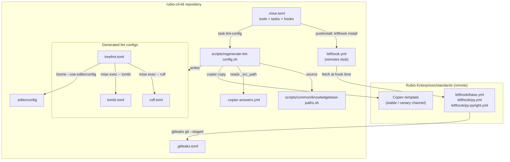
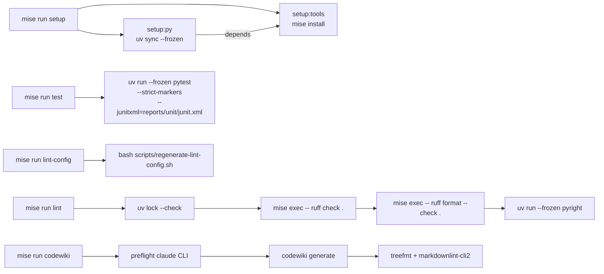
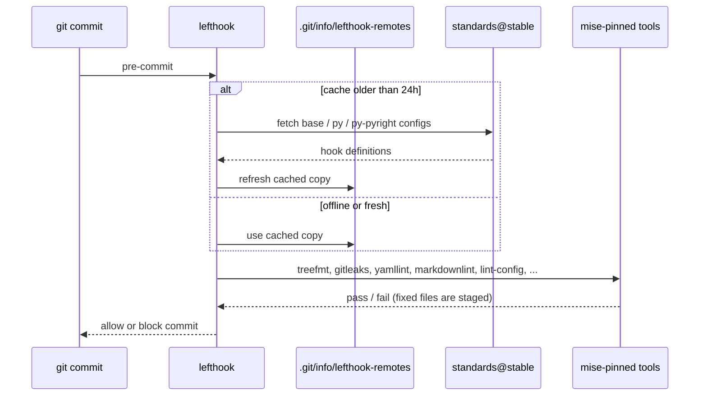
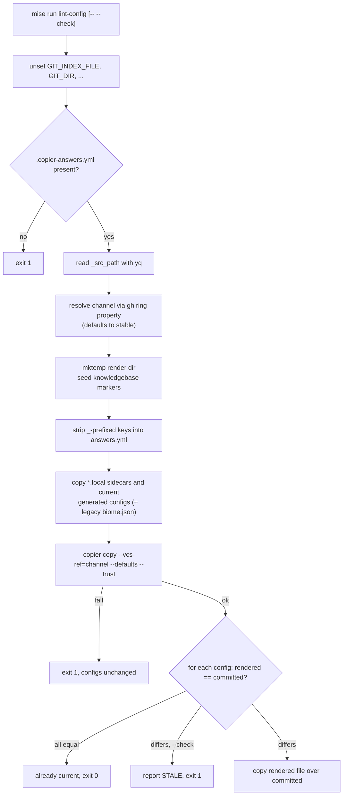
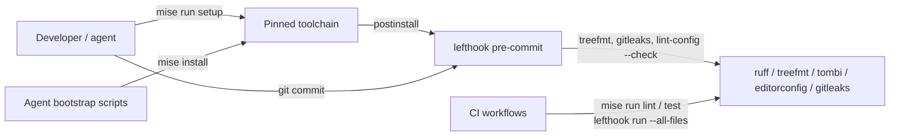

# Toolchain and Lint

This module is the developer toolchain and code-quality layer of the `rubio-cli-kit` repository. It pins every tool the repository uses, defines the standard task runner contract (`mise run setup`, `mise run lint`, `mise run test`, `mise run codewiki`, `mise run lint-config`), wires up Git hooks, and holds the formatter, linter and secret-scanner configuration.

Almost every file here is generated by the org-wide `Rubio-Enterprises/standards` Copier template and carries a `@generated` banner. Do not edit these files in place: repo-specific changes go into sidecar files (`.mise.local.toml`, `lefthook-local.yml`, `*.local`), and the generated files are rebuilt from the template.

Related pages:

- Parent overview: [Build Tooling and Dev Environment](../build_tooling_and_dev_environment.md)
- Packaging, versioning and Copier answers: [Packaging and Release](build_tooling_and_dev_environment_packaging_and_release.md)
- Agent and cloud bootstrap scripts that call into this toolchain: [Agent Bootstrap](build_tooling_and_dev_environment_agent_bootstrap.md)
- CI jobs that run these tasks and hooks: [CI Workflows](../ci_workflows.md)
- The Python code being linted and tested: [CLI Toolkit Library](../../cli_toolkit_library.md)

## Components at a Glance

| File | Role | Ownership |
| --- | --- | --- |
| `.mise.toml` | Tool pins, post-install hook, task runner contract | Template-owned (overrides in `.mise.local.toml`) |
| `lefthook.yml` | Git hook stub that pulls hook bodies from the standards repo | Template-owned (overrides in `lefthook-local.yml`) |
| `ruff.toml` | Python lint and format rules | Generated: floor merged with `ruff.toml.local` |
| `treefmt.toml` | Multi-language formatter dispatcher | Generated: floor merged with `treefmt.toml.local` |
| `tombi.toml` | TOML formatter settings | Generated: floor merged with `tombi.toml.local` |
| `.editorconfig` | Editor charset, line endings and indentation | Copier-synced |
| `.gitleaks.toml` | Secret-scanning allowlist | Copier-synced |
| `scripts/regenerate-lint-config.sh` | Rebuilds the generated lint configs locally | Template-owned |
| `scripts/common/knowledgebase-paths.sh` | Shared shell library for knowledgebase path handling | Template-owned |

## Architecture



`.mise.toml` is the hub: it provisions every binary the other files refer to, and every formatter in `treefmt.toml` is invoked through `mise exec --` so hooks, CI and coding agents resolve the same pinned versions.

## Toolchain Pins (`.mise.toml`)

The `[tools]` table pins every tool. Key entries:

| Tool | Pin | Why it is pinned |
| --- | --- | --- |
| `uv` | `0.12.15` | Declared first: the `pipx:` backend installs through `uvx`, and every task uses `uv` |
| `node` | `24.21.0` | Org-wide Node runtime for the `npm:` tools |
| `pipx:ruff` | `0.16.5` | The only source of Ruff; it must never be added to `pyproject.toml` |
| `npm:@biomejs/biome` | `2.5.14` | Owns JSON and JSONC formatting |
| `aqua:numtide/treefmt` | `2.6.0` | Formatter dispatcher |
| `aqua:tombi-toml/tombi` | `1.7.3` | TOML formatter |
| `aqua:evilmartians/lefthook` | `2.1.12` | Git hook runner, needed on PATH in CI |
| `aqua:gitleaks/gitleaks` | `8.30.1` | Pre-commit secret scan |
| `aqua:koalaman/shellcheck`, `aqua:mvdan/sh` | `0.11.0`, `3.14.0` | Shell lint and `shfmt` |
| `npm:markdownlint-cli2`, `npm:prettier`, `pipx:yamllint` | `0.23.1`, `3.9.6`, `1.38.0` | Markdown and YAML hooks |
| `npm:@commitlint/cli` and config | `21.2.2` | Conventional-commit linting |
| `aqua:mikefarah/yq` | `4.53.6` | YAML merging in Copier tasks and scripts |
| `pipx:copier` | `9.18.1` | Template sync and lint-config regeneration |
| CodeWiki (Git pin) | commit `f0975ea…` | Backs the `codewiki` task, built on Python 3.12 |

Pinning `uv` in mise means provisioning is mise's job. The `astral-sh/setup-uv` steps in the workflows (see [CI Workflows](../ci_workflows.md)) are only a backup.

### Post-install hook

```toml
[hooks]
postinstall = 'test -n "${CI:-}" || mise exec -- lefthook install'
```

On a developer machine, `mise install` also installs the per-repo Git hooks. In CI (`CI` is set) this step is skipped, because CI runs hooks explicitly with `lefthook run`.

## Task Runner Contract



| Task | What it does |
| --- | --- |
| `setup` | Runs every `setup:*` subtask. To extend setup, add `setup:<name>` tasks in `.mise.local.toml`. Every step can safely run more than once. |
| `setup:tools` | `mise install` of the pinned toolchain. |
| `setup:py` | `uv sync --frozen` from `uv.lock`. |
| `lint` | Checks that the lockfile is current, runs Ruff lint and format checks through mise, then pyright through `uv run --frozen`. |
| `test` | Runs pytest from the project venv with strict markers and a JUnit report. |
| `lint-config` | Regenerates the generated lint configs (see [Lint Config Regeneration](#lint-config-regeneration)). |
| `codewiki` | Generates or updates `docs/codewiki/` (supports `--full` and `--dry-run`). |

Design rules written into the task comments:

- Every `uv run` uses `--frozen`, so a stale lock cannot be quietly re-locked and hide the drift that `uv lock --check` is meant to report.
- Ruff always runs through `mise exec`, never `uv run`, so a second Ruff version from `.venv/bin` cannot be picked up.
- Test-runner flags such as marker filters go in `[tool.pytest.ini_options]` in `pyproject.toml`, not on the task's `run` line. The template rewrites that line on every re-render. See [Packaging and Release](build_tooling_and_dev_environment_packaging_and_release.md) for the manifest.

For this repository, `mise run test` also runs the contract tests provided by the kit's own pytest plugin, described in [Contract Testing](../../cli_toolkit_library/contract_testing.md).

### The `codewiki` task

The task checks that the `claude` CLI is installed, is version `2.1.280` or newer, and is logged in. It then writes the provider and model into `~/.codewiki/config.json` and runs `codewiki generate --output docs/codewiki --github-pages`, adding `--update` when `metadata.json` already exists. The model, effort and extra instructions can be overridden with `CODEWIKI_MODEL`, `CODEWIKI_EFFORT` and `CODEWIKI_EXTRA_INSTRUCTIONS`. `CAW_AUTOWAIT=0` turns off a usage-limit detector that gave false positives. After generation, the task deletes the `*.prev.json` scratch graphs, runs `treefmt` over the output, and fails if `markdownlint-cli2` still reports errors.

## Git Hooks (`lefthook.yml`)

`lefthook.yml` is a small stub. It contains no hook bodies. Those are fetched from the standards repository:

```yaml
remotes:
  - git_url: https://github.com/Rubio-Enterprises/standards.git
    ref: stable
    refetch_frequency: 24h
    configs:
      - lefthook/base.yml
      - lefthook/py.yml
      - lefthook/py-pyright.yml
```



Behaviour to know about:

- The remote configs set `stage_fixed: true`, so formatter rewrites are staged automatically. Overrides, such as fork repos turning this off for `treefmt`, go in `lefthook-local.yml`, which has the highest priority.
- `lefthook install` forces a refresh of the remote configs. Repo-local `.githooks/` directories are not allowed.
- lefthook must come from mise or PATH, never from npm.

## Formatting and Lint Configuration

### `treefmt.toml` — formatter dispatcher

`treefmt.toml` sends each file type to one formatter. All formatters run from the tree root (`tree-root-file = "treefmt.toml"`):

| Formatter | Command | Files |
| --- | --- | --- |
| `markdownlint` | `markdownlint-cli2 --fix` | `*.md` |
| `yaml-prettier` | `prettier --write` | `*.yml`, `*.yaml` |
| `shfmt` | `shfmt -w` | `*.sh`, `*.bash` |
| `biome` | `biome check --write --use-editorconfig=true` | `*.json`, `*.jsonc` |
| `tombi` | `tombi format` | `*.toml` |
| `ruff-fix` (priority 0) | `ruff check --fix` | `*.py` |
| `ruff-format` (priority 1) | `ruff format` | `*.py` |

The two Ruff formatters run in order, `ruff-fix` before `ruff-format`, and never in parallel. The `excludes` list skips lockfiles (`uv.lock`, `package-lock.json` and others), templates, Xcode asset manifests, composite action files, `.copier-answers.yml`, and CodeWiki's `docs/codewiki/*.json` state. Files that match no formatter are only logged at debug level (`on-unmatched = "debug"`).

### `ruff.toml` — Python rules

- Target `py313`, line length 100.
- Rule families: `E`, `F`, `W`, `I`, `N`, `UP`, `B`, `S`, `T20`, `RUF`, plus a fixed list of exact rule codes that flag verbose code (`ARG`, `C4`, `FURB`, `PERF`, `PIE`, `PL`, `RET`, `SIM`, `TRY`). Listing exact codes means the gate does not grow when Ruff adds new rules to a family.
- `T20` (no `print`) is an org rule: output goes through the output helpers. In this repo those are the `rubio_cli_kit` helpers documented in [CLI Runtime](../../cli_toolkit_library/cli_runtime.md).
- `S101` is ignored globally. Under `tests/`, `test/` and `conftest.py`, `S`, `T20` and `ARG` are also ignored, so tests can use `assert`, `print` and unused fixture arguments.
- The formatter uses single quotes (`quote-style = "single"`) and space indentation.

### `tombi.toml` — TOML formatting

Turns off schema-driven formatting (`[schema] enabled = false`), so TOML formatting never sorts keys based on a schema and never needs network access.

### `.editorconfig`

Sets UTF-8, LF line endings, a final newline, trimmed trailing whitespace, and 2-space indentation by default. Python, Go and Rust use 4 spaces, and `Makefile` uses tabs. Biome reads this file through `--use-editorconfig=true`.

### `.gitleaks.toml` — secret scanning

Extends the default gitleaks rules (`useDefault = true`) and allowlists only `.copier-answers.yml` and `docs/codewiki/temp/`, which holds copies of analysed source. It uses the singular `[allowlist]` form on purpose, so older gitleaks binaries used in audits still apply it. The pre-commit hook runs `gitleaks git --staged`, and CI also runs a TruffleHog scan (see [CI Workflows](../ci_workflows.md)).

## Lint Config Regeneration

The generated configs are the template floor merged with this repository's committed `*.local` changes. `scripts/regenerate-lint-config.sh` rebuilds them without a full `copier update`. It uses the same steps as the org CI drift gate, so a config regenerated locally passes the gate.



Details:

- **Managed files:** `ruff.toml`, `biome.jsonc`, `.yamllint`, `.markdownlint-cli2.jsonc`, `treefmt.toml`, `tombi.toml`, with matching sidecars (`ruff.toml.local`, `biome.json.local`, and so on). A config the render does not produce for this repo is skipped.
- **Git environment cleanup:** the script runs as a pre-commit hook, so it inherits `GIT_INDEX_FILE` and related variables. If those leaked into Copier's nested `git clone`, the clone would overwrite this repository's index. If that has already happened, recover with `git read-tree --reset HEAD`.
- **Seeding:** both the sidecars and the existing generated configs are copied into the scratch render, so the template's divergence guards see the same files they would see during a real `copier update`.
- **Channel:** canary-ring repos (`ring` custom property) render from `canary`. Everything else, including runs where `gh` is missing or offline, uses `stable`.
- **Tool lookup:** `yq` and `copier` are used from PATH, or through `mise exec --` if they are not on PATH.

### `scripts/common/knowledgebase-paths.sh`

This bash-3.2-compatible library is sourced by the regeneration script. Its functions do nothing unless `.copier-answers.yml` sets `has_knowledgebase: true`.

- `knowledgebase_excludes` prints NUL-delimited treefmt exclude globs (`.copier-answers.knowledgebase.yml`, `.vscode/**`, `assets/**`) for each knowledgebase marker directory. Glob metacharacters in folder names are escaped.
- `seed_knowledgebase_markers DEST` creates empty marker files in a separate scratch render directory. It never overwrites existing files, never follows symlinks, and refuses to seed into the source tree.
- Markers are found with `git ls-files`, or with `find` outside a work tree. `fixtures/` and `testdata/` are skipped. Git calls run with the hook-exported Git variables unset.

## How It Fits Together



Developers, coding agents (through the [Agent Bootstrap](build_tooling_and_dev_environment_agent_bootstrap.md) scripts) and CI (through [CI Workflows](../ci_workflows.md)) all use the same `.mise.toml` pins and the same generated configs, so local, agent and CI results match.
