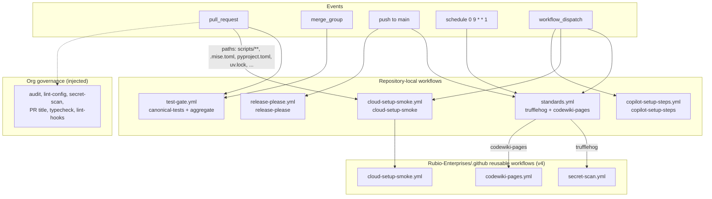
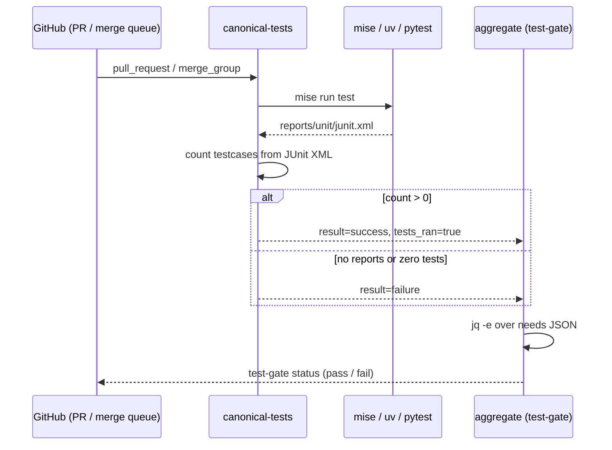
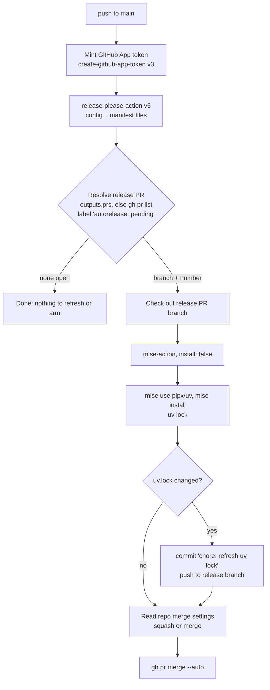
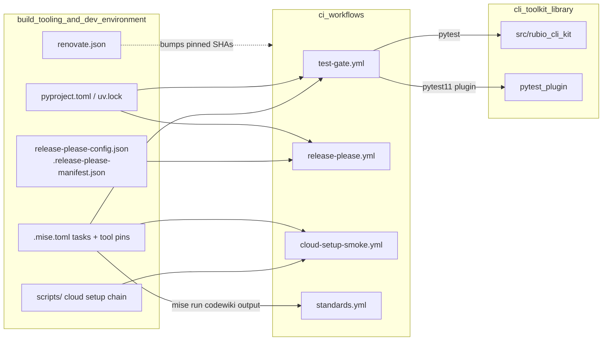

# CI Workflows

The `ci_workflows` module is the set of GitHub Actions workflow files under `.github/workflows/`. They test, scan, document and release the `rubio-cli-kit` library. Most of them are rendered from the `Rubio-Enterprises/standards` Copier template and carry a `@generated by rubio-standards. DO NOT EDIT` header. To change one of those, open a PR against the template. The one exception is `test-gate.yml`, which this repository owns.

The workflows depend on the toolchain, task runner and release configuration described in [Build Tooling and Dev Environment](build_tooling_and_dev_environment.md). The tests they run are the library and contract tests described in [CLI Toolkit Library](../cli_toolkit_library.md). For the parent overview, see [Build, Release and CI Infrastructure](../build_release_and_ci_infrastructure.md).

## Overview

| Workflow file | Workflow name | Jobs | Triggers | Owner |
| --- | --- | --- | --- | --- |
| `test-gate.yml` | `test-gate` | `canonical-tests`, `aggregate` | `pull_request`, `merge_group` | This repository (standards ADR 0020) |
| `standards.yml` | `standards` | `trufflehog`, `codewiki-pages` | push to `main`, weekly schedule, `workflow_dispatch` | Standards template |
| `release-please.yml` | `release-please` | `release-please` | push to `main` | Standards template |
| `cloud-setup-smoke.yml` | `cloud-setup smoke` | `cloud-setup-smoke` | path-filtered `pull_request`, `workflow_dispatch` | Standards template |
| `copilot-setup-steps.yml` | `Copilot Setup Steps` | `copilot-setup-steps` | `workflow_dispatch` | Standards template (public-repo variant) |

These files do not run lint, typecheck, audit, secret-scan, PR-title checks or `lint-hooks`. Org-level required governance workflows inject those checks, so a repository cannot edit or skip them. The comment block in `standards.yml` documents this split.

## Architecture



## Shared conventions

The workflows share these conventions:

- Quoted `"on":` key. YAML 1.1 parsers turn a bare `on` into the boolean `On`, which fails the `yaml[truthy]` rule in yamllint and ansible-lint. GitHub Actions and actionlint accept both forms.
- SHA-pinned actions. Every `uses:` reference pins a full 40-character commit SHA and adds a trailing `# vN` comment. Renovate's `helpers:pinGitHubActionDigests` reads that comment to track the major line (see `renovate.json` in [Build Tooling and Dev Environment](build_tooling_and_dev_environment.md)).
- Least-privilege permissions. The workflow-level default is `contents: read`. Only `release-please.yml` (`contents: write`, `pull-requests: write`) and the `codewiki-pages` job (`pages: write`, `id-token: write`) ask for more.
- Concurrency groups keyed by workflow. `group: ${{ github.workflow }}-${{ github.ref }}` keeps cancellation inside one workflow. In `standards.yml` and `cloud-setup-smoke.yml`, `cancel-in-progress` is on only for `pull_request` events, so push, schedule and manual runs are never cancelled. `test-gate.yml` groups by PR number, or by SHA for merge-queue runs, and always cancels superseded runs.
- Runner routing. Jobs that set their own runner read the org variable `vars.RUNNERS` and choose its `light` tier, for example `fromJSON(vars.RUNNERS || '{}').light`. If the variable is missing they fall back to a hosted label: `ubuntu-slim` for the test gate and `ubuntu-latest` for release-please. Public repositories cannot see the private org variable, so they always use the hosted fallback.
- 120-minute timeout floor. Jobs that run directly declare `timeout-minutes: 120`, the org-wide limit that stops a wedged self-hosted runner. A job that calls a reusable workflow cannot set a timeout, so the called workflow sets it.

## test-gate.yml

`test-gate.yml` is the repository-local required test check (standards ADR 0020). It runs only canonical non-E2E tests and then publishes a single aggregate status context named `test-gate`.

### canonical-tests job

The job runs under the display name `canonical tests` and goes through these steps:

1. Check out the repository with `actions/checkout` v7.
2. Install uv (`astral-sh/setup-uv` v10.2.0) and Python `3.14.6` (`actions/setup-python` v7).
3. Install the pinned toolchain from `.mise.toml` with `jdx/mise-action` v4.
4. Run `mise run test`. In `.mise.toml` this task is `uv run --frozen pytest --strict-markers --junitxml=reports/unit/junit.xml`. The registered `rubio_cli_kit.pytest_plugin` also runs inside this session (see [Contract Testing](../cli_toolkit_library/contract_testing.md)).
5. Run an inline Python script that parses every `reports/unit/*.xml` JUnit report and adds up the `tests` attribute of each `testsuite`. The total goes to `$RUNNER_TEMP/test-gate-count`, the path held in `RUBIO_TEST_GATE_COUNT_OUTPUT`. The step fails if there are no reports or if the total is not greater than zero.
6. Set the step output `tests_ran=true`. The job publishes it as a job output.

The non-empty check stops the gate from passing when the test run collected nothing, for example when a marker filter or a misconfigured `testpaths` deselects every test.

### aggregate job

The job's display name is `test-gate`, and that is the required status context. It runs with `if: always()` and `needs: [canonical-tests]`, so it reports a result even when the upstream job fails or is skipped. It loads `toJSON(needs)` and checks it with `jq -e`:

```text
length > 0 and all(.[]; .result == "success" and .outputs.tests_ran == "true")
```



## standards.yml

`standards.yml` keeps the template-owned jobs that are not required checks. Both jobs call reusable workflows in `Rubio-Enterprises/.github`.

### trufflehog job

- Runs only for the workflow's own weekly cron (`0 9 * * 1`, Mondays at 09:00 UTC) or for a manual `workflow_dispatch`, which is meant for incident-response re-runs.
- Calls `secret-scan.yml` with `mode: trufflehog` to run an entropy-based secret scan over the whole tree. It complements the per-commit gitleaks hook configured by `.gitleaks.toml` and `lefthook.yml`.

### codewiki-pages job

- Publishes `docs/codewiki/`, minus CodeWiki's `temp/` state, to GitHub Pages (`has_codewiki`, ADR-0026). The pages you are reading are deployed this way.
- Runs on every push to `main`, and on `workflow_dispatch` only when the ref is `refs/heads/main`. It deliberately has no paths filter, because a filter on the shared push trigger would also gate the other jobs.
- The job raises its permissions to `pages: write` and `id-token: write`. The org Settings Plane enables Pages with `build_type=workflow`; this job only deploys.
- The content comes from the `mise run codewiki` task in `.mise.toml`.

## release-please.yml

This workflow runs on every push to `main`. It keeps a release PR open and current. When that PR merges, release-please creates the tag and the GitHub release. Release settings come from `release-please-config.json`: release type `python`, package `rubio-cli-kit`, `CHANGELOG.md`, and `v`-prefixed tags. The current version is in `.release-please-manifest.json`.



The steps work as follows:

- App token. The job mints a GitHub App token from `RELEASE_PLEASE_APP_ID` and `RELEASE_PLEASE_APP_PRIVATE_KEY` and uses it instead of `GITHUB_TOKEN`. Events created with `GITHUB_TOKEN` do not trigger other workflows, so the release PR's checks would wait for a manual "Approve workflows". Events created with the App token start them straight away.
- Release PR resolution. Earlier versions gated the follow-up steps on `prs_created`, which is true only on the run that opens the PR, so one transient failure left the PR stranded. The current workflow first reads the action's `prs` output, which can be empty. If that gives no PR, it searches for an open PR labeled `autorelease: pending`. A re-run, or the next push, therefore finishes any step that an earlier run left undone. The workflow assumes one package per repository.
- Lockfile refresh. On the release branch the job pins `pipx` and `uv` through mise and runs `uv lock`. If `uv.lock` changed, it commits and pushes the update as `github-actions[bot]`. The release bumps the version in `pyproject.toml`, which leaves `uv.lock` stale. Without the refresh, the `uv lock --check` in `mise run lint` and the `lint-hooks` gate would fail. If the branch value is empty, the step fails loudly so that it never ships a stale lock.
- Auto-merge. The job reads the repository's merge settings, prefers `--squash` and falls back to `--merge`, then runs `gh pr merge --auto`. This is safe only because the repository's required-check set is the full gate floor: `gate_tests`, `gate_lint_config`, `gate_audit`, `gate_secret_scan` and `gate_pr_conventions`. The step runs after the lock refresh, so a PR whose lock could not be refreshed is never armed. Arming is idempotent and happens whenever a release PR is open.

## cloud-setup-smoke.yml

This workflow smoke-tests the Claude Code on the web setup chain on a Linux runner: `scripts/cloud-setup-shim.sh`, then `scripts/common/cloud-setup.sh`, then `scripts/repo-local/cloud-setup.sh`. Those scripts are documented in [Build Tooling and Dev Environment](build_tooling_and_dev_environment.md).

- Why it exists. The standards render canary tests the template half against freshly rendered fixtures. Only this repository can test its real manifests (`pyproject.toml`, `uv.lock`) together with its repo-owned `cloud-setup.sh` tail.
- Abort-proof contract. In a real cloud session every setup step swallows its own failure and the chain ends with `exit 0`, so a bad step cannot stop the session from starting. In CI, `CLOUD_SETUP_SMOKE` inverts this: all steps still run, but recorded failures produce a non-zero exit code at the end.
- Path filter. The workflow runs only when a PR touches `scripts/**`, `.mise.toml`, `.tool-versions`, the workflow file itself, `pyproject.toml` or `uv.lock`. The reusable workflow cold-bootstraps the toolchain on a hosted x64 runner, which costs too much to run on every PR. `workflow_dispatch` lets you reproduce snapshot-build failures by hand.
- Not a required check. A path-filtered workflow does not report on every PR, so making it required would leave those PRs blocked on "Expected — waiting for status". To promote it, move the call into the unconditional job set of `standards.yml` first.
- Safe rollout. The reusable workflow first checks for a smoke-capable core. If this repository has not been re-rendered yet, it does nothing and posts a notice.

## copilot-setup-steps.yml

The template renders this file only for public repositories (`is_public=true`). GitHub does not allow self-hosted runners on public repositories. Without this file, Copilot code review and the coding agent would use the org-default self-hosted `linux-x64` runner, wait about 24 hours in the queue, and then be cancelled. The `copilot-setup-steps` job declares `runs-on: ubuntu-latest`, and GitHub reads that to pin Copilot to a free hosted runner. Its only step checks out the repository with `actions/checkout` v6. The trigger is `workflow_dispatch` only, because GitHub uses the job definition and does not need a push or PR event.

## Relationship to the rest of the system



- [Build Tooling and Dev Environment](build_tooling_and_dev_environment.md) covers the `mise` tasks, tool pins, release-please configuration, Renovate rules and cloud-setup scripts that these workflows run.
- [CLI Runtime](../cli_toolkit_library/cli_runtime.md) and [Contract Testing](../cli_toolkit_library/contract_testing.md) cover the code and the pytest plugin that `test-gate.yml` tests.
