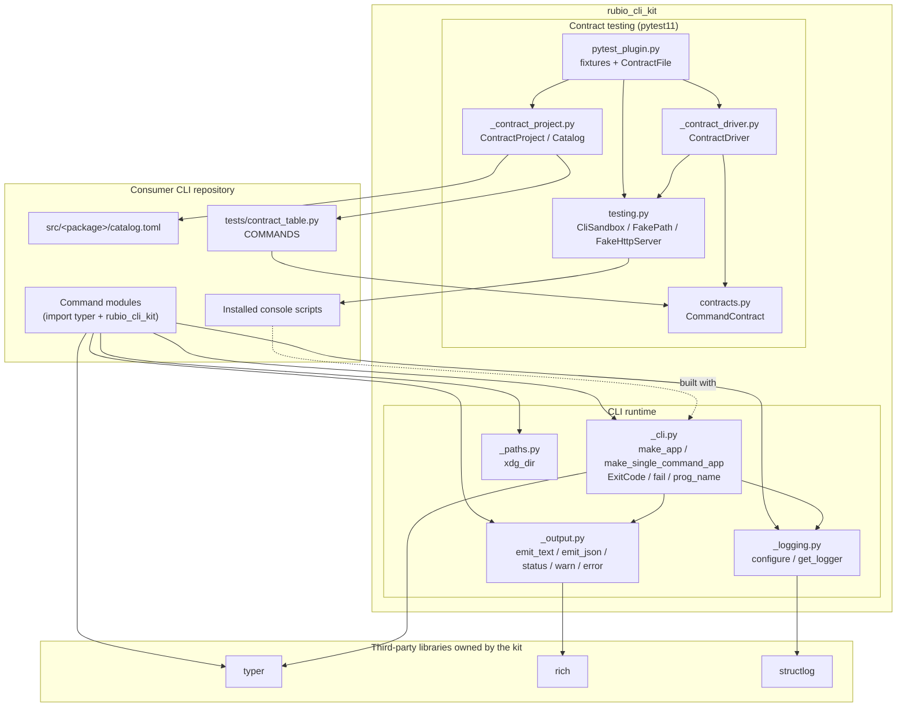
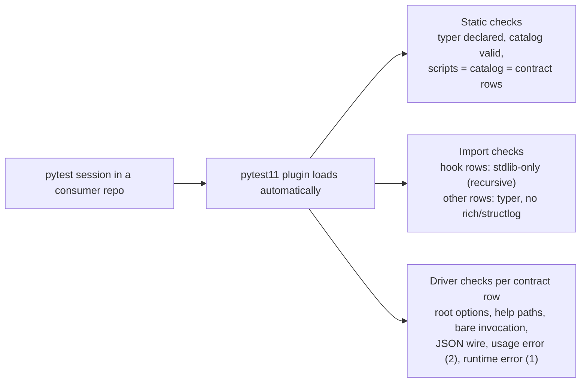

# CLI Toolkit Library

`rubio-cli-kit` (package `src/rubio_cli_kit`) is the public library that every per-tool CLI repository depends on at runtime. These repositories were split out of `Rubio-Enterprises/dotfiles` under dotfiles issue #316. The library has two jobs:

- **Runtime:** it provides the two sanctioned Typer application shapes, the exit codes, diagnostics, output rules, and XDG paths that consumer commands use.
- **Contract testing:** it registers a `pytest11` plugin that checks every consumer repository against the same external CLI contract. Consumers do not need to write any test code for this.

The kit owns Rich and structlog. Consumer command modules declare and import Typer directly, but they must not import Rich or structlog. The kit derives the distribution name from the importing package, so consumers never pass it as a parameter. The kit must never ship a `catalog.toml`, because the installed kit shares site-packages with every consumer.

## Architecture

The CLI runtime produces the external behaviour: help flags, `--version`, `--verbose`, exit codes, and the stdout/stderr split. The contract-testing plugin checks that behaviour from outside. It runs each installed console script in a hermetic subprocess sandbox.

## Core components

| Component | Files | Summary | Documentation |
| --- | --- | --- | --- |
| CLI runtime | `_cli.py`, `_logging.py`, `_output.py`, `_paths.py` | Application factories, `ExitCode` and `fail`, structlog configuration on stderr, stdout data helpers, and XDG directory resolution | [CLI Runtime](cli_toolkit_library/cli_runtime.md) |
| Contract testing | `contracts.py`, `testing.py`, `_contract_project.py`, `_contract_driver.py`, `pytest_plugin.py` | `CommandContract` rows, sandbox and fakes, project and catalog validation, the contract driver, and pytest fixtures | [Contract Testing](cli_toolkit_library/contract_testing.md) |

Key references:

- [The shared CLI contract](cli_toolkit_library/cli_runtime.md#the-shared-cli-contract) describes the behaviour that both `make_app` and `make_single_command_app` guarantee.
- [Distribution discovery](cli_toolkit_library/cli_runtime.md#distribution-discovery) explains how `--version` finds the consumer's distribution without a parameter.
- [Consumer inputs](cli_toolkit_library/contract_testing.md#consumer-inputs) covers the `catalog.toml` and `contract_table.py` files that a consumer provides.
- [Generated test items](cli_toolkit_library/contract_testing.md#generated-test-items) lists every synthetic contract test.
- [Fixtures](cli_toolkit_library/contract_testing.md#fixtures) lists `home`, `cli_env`, `cli`, `fake_path`, and `fake_http_server`, which consumers can use in their own tests.

## Related modules

- Build tooling and dev environment: `pyproject.toml` declares the runtime dependencies (`typer`, `rich`, `structlog`) and the `pytest11` entry point.
- CI workflows: they run the test gate and the release-please pipeline that publishes the kit. In the kit's own repository, the plugin generates only the `contract:kit:no-catalog` check.
