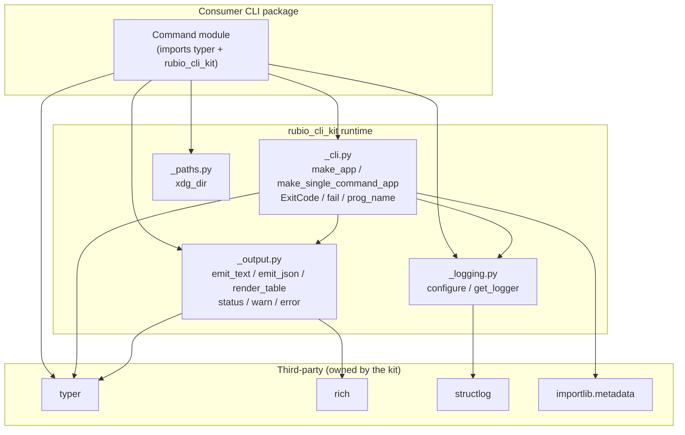
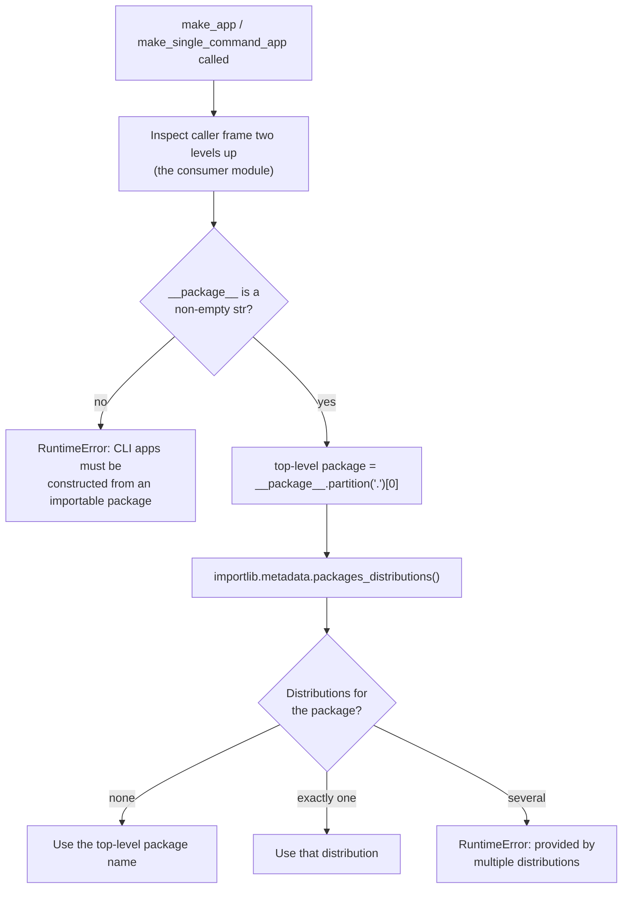
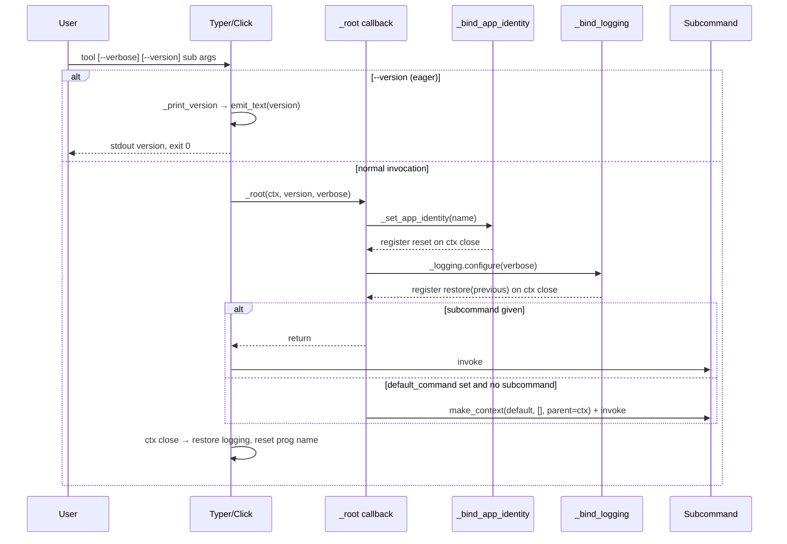
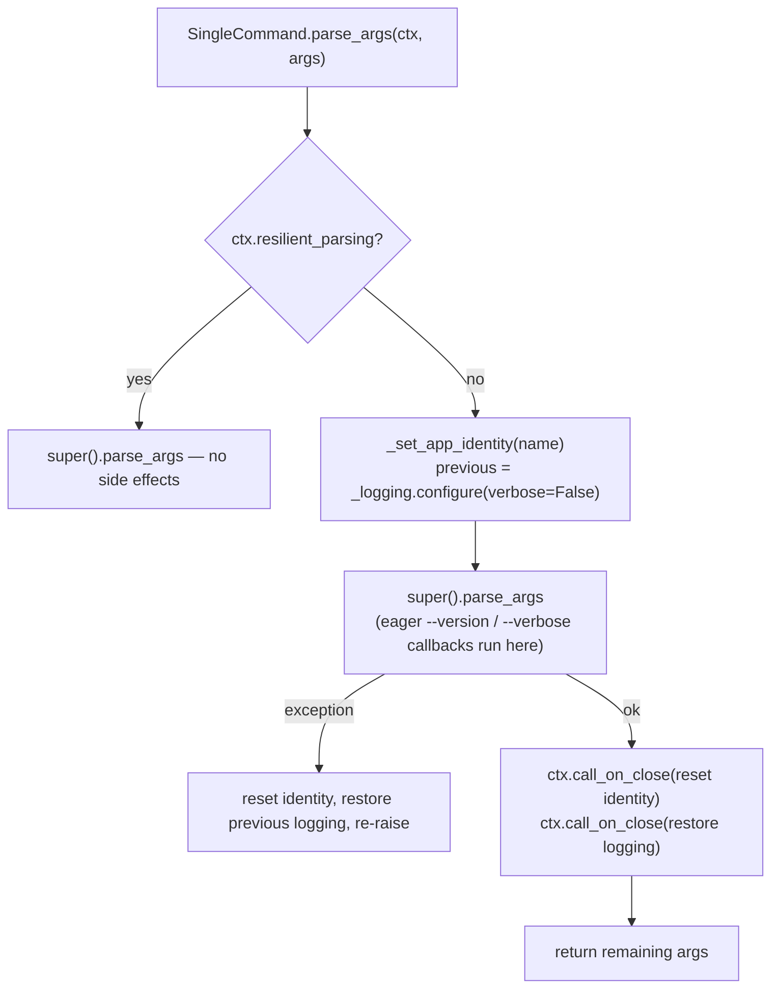
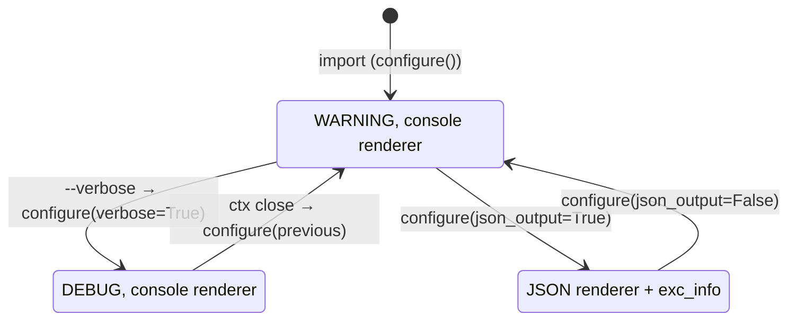
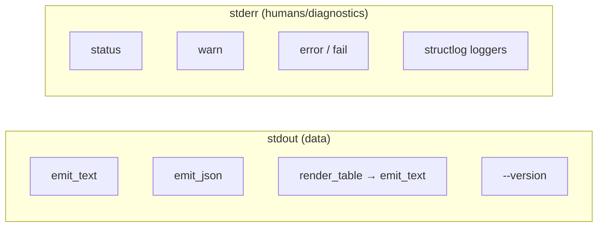

# CLI Runtime

The CLI runtime is the part of `rubio-cli-kit` that consumer command modules run. It provides the two sanctioned Typer application shapes, the shared exit-code contract, structlog-based diagnostics, the stdout/stderr output discipline, and XDG directory resolution.

The runtime came from the `local_bin_scripts` helpers in `Rubio-Enterprises/dotfiles`, at commit `aadd937066c508b47b1a0f3df9b7f22dfa4833e4`. It is now the shared dependency of every per-tool CLI repository. The kit owns Rich and structlog. Consumer modules declare and import Typer directly, but they must not import Rich or structlog themselves. They reach both libraries only through this module.

| File | Responsibility |
| --- | --- |
| `src/rubio_cli_kit/_cli.py` | Application factories, `ExitCode`, `fail`, `prog_name`, and per-invocation identity and logging binding |
| `src/rubio_cli_kit/_logging.py` | Process-wide structlog configuration (`configure`, `get_logger`) |
| `src/rubio_cli_kit/_output.py` | Helpers for writing data to stdout and status, warnings, and errors to stderr |
| `src/rubio_cli_kit/_paths.py` | XDG base-directory resolution (`xdg_dir`) |

The package `__init__.py` is empty. Consumers import from the submodules directly, for example `from rubio_cli_kit._cli import make_app`. The wire contract enforced here is verified from outside by the pytest plugin described in [Contract Testing](contract_testing.md). The parent page, [CLI Toolkit Library](../cli_toolkit_library.md), gives the library-wide overview.

## Architecture



`_cli.py` depends on `_logging` and `_output`. `_paths.py` is standalone and uses only the standard library. The runtime's third-party dependencies are declared in `pyproject.toml`: `typer>=0.27.1`, `rich>=15.0.0`, and `structlog>=26.1.0`, with `requires-python = ">=3.14.6"`.

## The shared CLI contract

Both application shapes guarantee the same external behaviour:

- `-h` and `--help` are both help flags (`context_settings={'help_option_names': ['-h', '--help']}`).
- `--version` prints the version of the distribution that built the app to stdout, then exits with code 0.
- `--verbose` lowers the diagnostic threshold from WARNING to DEBUG. Diagnostics always go to stderr.
- Shell-completion options are disabled (`add_completion=False`).
- Rich pretty exceptions are disabled (`pretty_exceptions_enable=False`).
- Exit codes follow `ExitCode`.

### ExitCode

```python
class ExitCode(IntEnum):
    OK = 0        # success
    RUNTIME = 1   # runtime or domain error
    USAGE = 2     # usage error (Click/Typer's own parse errors also use 2)
```

### prog_name and fail

`prog_name()` returns the console-script name of the app that is currently running. The name is stored in the `ContextVar` named `rubio_cli_kit_prog`, whose default is `'command'`. It is set when an invocation starts and reset when the Typer context closes (see the next section).

`fail(message, *, code=ExitCode.RUNTIME)` is the sanctioned way to report a domain error. It writes `"<prog>: <message>"` to stderr in bold red through `_output.error`, then raises `typer.Exit(code)`. Its return type is `NoReturn`.

```python
from rubio_cli_kit._cli import ExitCode, fail

if not config_path.exists():
    fail(f'config not found: {config_path}')            # exit 1
if args_conflict:
    fail('--foo and --bar are exclusive', code=ExitCode.USAGE)  # exit 2
```

## Distribution discovery

Neither factory takes a distribution or version parameter. `_importing_distribution_name()` works out the distribution from the call stack:



The resolved name is captured in a closure. When `--version` is used, the value is read lazily with `importlib.metadata.version(distribution)`. This design keeps the distribution name from becoming a consumer parameter. The project rules in `CLAUDE.md` require that, and the contract harness relies on it.

## Subcommand applications: make_app

```python
def make_app(*, name: str, help_text: str, default_command: str | None = None) -> typer.Typer
```

`make_app` returns a `_SubcommandTyper`, a `typer.Typer` subclass that allows only one `callback` registration. The factory registers the root callback `_root` itself, so any later `app.callback(...)` raises `TypeError('subcommand apps do not support additional callbacks')`. Consumers therefore cannot replace or drop the shared root options.

Behaviour:

- If `default_command` is `None`, `no_args_is_help=True` is set, so running with no arguments shows help.
- If `default_command` is set, the callback runs with `invoke_without_command=True`. When no subcommand is given, `_root` finds the named command through `ctx.command.get_command` and invokes it in a child context with no arguments.
- If the default command is not registered or cannot be invoked, `_root` raises `RuntimeError`.
- `--version` is an eager option. Its callback does nothing during resilient parsing (completion or help probing). Otherwise it delegates to `_print_version`.



## Single-command applications: make_single_command_app

```python
def make_single_command_app(*, name: str, help_text: str) -> typer.Typer
```

This shape is for tools whose root command takes the arguments directly, with no subcommands. It returns a `_SingleCommandTyper` with these constraints:

- `callback()` always raises `TypeError('single-command apps do not support callbacks')`.
- `command()` can be called only once. A second call raises `TypeError('single-command apps require exactly one command')`.
- Passing `cls=` to `command()` raises `TypeError`. The factory forces the command class to the type built by `_single_command_type`.
- If the decorator has no `help`, it defaults to `help_text`.
- `no_args_is_help=True`.

### The generated command class

`_single_command_type(name=..., distribution=...)` builds a `TyperCommand` subclass, `SingleCommand`, with these behaviours:

1. **Reserved option check.** The constructor rejects any consumer parameter that declares `--version` or `--verbose` and raises `TypeError('single-command apps have reserved root options: ...')`.
2. **Injected options.** It adds two eager, hidden-value (`expose_value=False`) `TyperOption` flags, `--version` and `--verbose`. The consumer's function signature therefore does not need to mention them.
3. **Scoped `parse_args`.** Before parsing, it sets the program identity and resets logging to `verbose=False`. The eager `--verbose` callback may then switch DEBUG on. If parsing raises, both are restored immediately. On success, the restore actions are registered with `ctx.call_on_close`. Resilient parsing skips all of this.



### Comparison of the two shapes

| Aspect | `make_app` | `make_single_command_app` |
| --- | --- | --- |
| Typer subclass | `_SubcommandTyper` | `_SingleCommandTyper` |
| Root options added by | Factory-owned `_root` callback | Injected `TyperOption`s on a custom `TyperCommand` |
| Consumer callbacks | Rejected (the root callback is already registered) | Always rejected |
| Number of commands | Any | Exactly one |
| No-args behaviour | Help, or `default_command` | Help |
| Identity/logging scope | Bound in `_root`, released on context close | Bound in `parse_args`, released on context close or parse failure |

## Logging: _logging

Logging state lives in a module-level `_LogState` dataclass with two fields, `verbose` and `json_output`, both defaulting to `False`. `configure()` is called once at import time, so the defaults apply even before any CLI runs.

`configure(*, verbose=None, json_output=None) -> _LogState`:

- Takes a snapshot of the current state with `dataclasses.replace` and returns it as the "previous" configuration. This snapshot makes the save/restore pattern used by `_cli` possible.
- Changes only the fields that are not `None`.
- Rebuilds the structlog configuration as follows:

| Setting | Value |
| --- | --- |
| Processors | `add_log_level`, followed by `ConsoleRenderer()` for humans, or by `format_exc_info` and `JSONRenderer()` when `json_output` is true |
| Level filter | `make_filtering_bound_logger(DEBUG if verbose else WARNING)` |
| Sink | `PrintLoggerFactory(file=sys.stderr)` |
| Caching | `cache_logger_on_first_use=False`, so loggers created earlier follow later reconfiguration |

`get_logger(name)` returns `structlog.get_logger(name)`. Consumers use this function instead of importing structlog:

```python
from rubio_cli_kit import _logging

log = _logging.get_logger('example')
log.debug('greeting', name=name)   # shown only with --verbose
log.warning('slow response', seconds=3.2)
```



## Output discipline: _output

stdout carries data only. stderr carries everything a human reads about progress and problems. Rich is used only for stderr. Its module-level `Console` has `stderr=True`, `highlight=False`, `markup=False`, and `soft_wrap=True`. With markup off, square brackets in messages are printed literally.

| Function | Stream | Behaviour |
| --- | --- | --- |
| `emit_text(text)` | stdout | `typer.echo(text)`, without Rich wrapping or styling |
| `emit_json(payload)` | stdout | `json.dumps(payload, indent=2, allow_nan=False)`. Raises `ValueError` on NaN or Infinity |
| `render_table(rows, columns)` | (returns `str`) | Plain-text aligned table. Pass the result to `emit_text` |
| `status(message)` | stderr | Unstyled informational chatter |
| `warn(message)` | stderr | `warning: <message>` in yellow |
| `error(message)` | stderr | Message in bold red. `fail` uses it |

`render_table(rows, columns)` takes `columns` as `(key, header)` pairs and `rows` as mappings, where missing keys render as empty strings. Column widths are measured with `rich.cells.cell_len`, so wide characters such as CJK and emoji line up correctly. Columns are separated by two spaces, and trailing whitespace is stripped from each line.

```python
from rubio_cli_kit._output import emit_text, render_table

emit_text(render_table(
    rows=[{'name': 'alpha', 'state': 'ok'}, {'name': 'beta'}],
    columns=[('name', 'NAME'), ('state', 'STATE')],
))
# NAME   STATE
# alpha  ok
# beta
```



## Paths: _paths

```python
def xdg_dir(env_var: str, *fallback: str) -> Path
```

`xdg_dir` follows the XDG Base Directory rules. It returns `Path(os.environ[env_var])` only when the variable is set, non-empty, and an absolute path, because the specification says relative paths must be ignored. In every other case it returns `Path.home().joinpath(*fallback)`.

```python
from rubio_cli_kit._paths import xdg_dir

config_home = xdg_dir('XDG_CONFIG_HOME', '.config')        # ~/.config
cache_dir = xdg_dir('XDG_CACHE_HOME', '.cache') / 'mytool'
```

`_paths` imports only `os` and `pathlib` from the standard library.

## Per-invocation state and reentrancy

Both factories treat program identity and logging configuration as values scoped to one invocation:

- Identity is a `ContextVar`. `_set_app_identity` returns a closure that resets the variable with its token.
- Logging is process-global, but every change saves the previous `_LogState` and restores it through `ctx.call_on_close`.

As a result, invoking several apps one after another in the same process, as happens with Typer's `CliRunner` or nested default-command invocation, leaves no leftover `--verbose` setting or wrong `prog_name()` prefix. The tests in `tests/test_cli.py` exercise this behaviour.

## Relationship to the rest of the system

- [Contract Testing](contract_testing.md): the `pytest11` plugin runs every consumer console script in a sandbox and checks the contract described on this page. It checks `-h`/`--help`, `--version`, `--verbose`, exit codes, and the stdout/stderr split. It also checks that commands are declared directly with Typer and that `hook = true` catalog rows import only the standard library.
- [Build Tooling and Dev Environment](../build_release_and_ci_infrastructure/build_tooling_and_dev_environment.md): `pyproject.toml` declares the runtime dependencies and the `pytest11` entry point.
- [CI Workflows](../build_release_and_ci_infrastructure/ci_workflows.md): the test gate and the release-please pipeline that publish this runtime.
