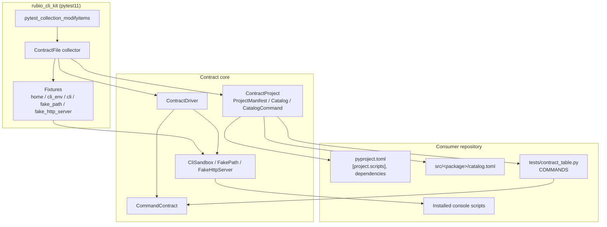
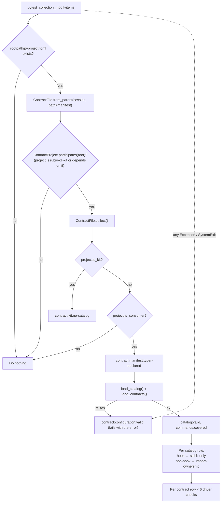
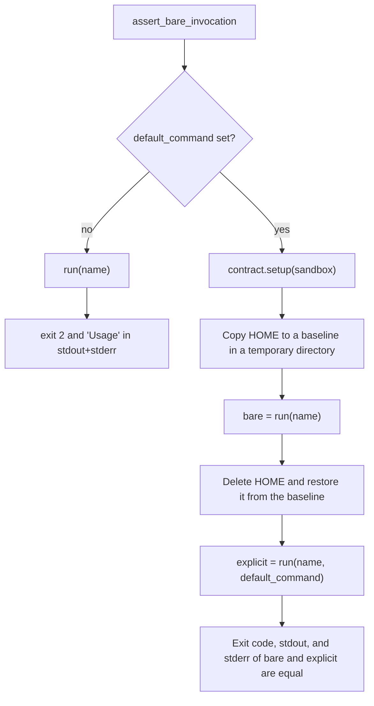
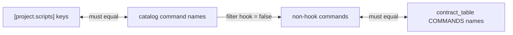
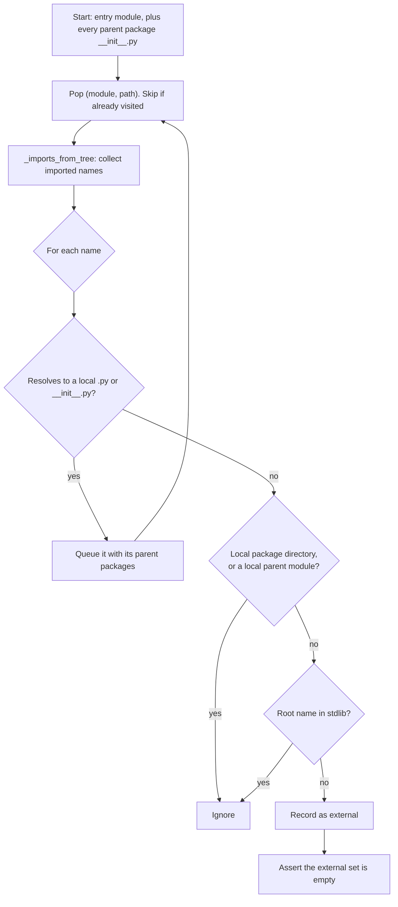
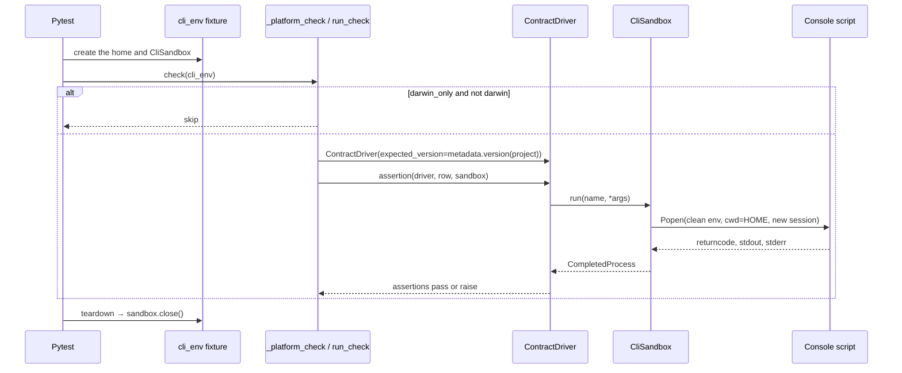

# Contract Testing

The contract-testing module is the part of `rubio-cli-kit` that checks every consumer CLI repository against the shared external CLI contract. It is a `pytest11` plugin. When a consumer installs the kit, pytest loads the plugin automatically. The plugin then adds synthetic contract tests to the session without any test code in the consumer repository.

A consumer repository supplies only two pieces of data:

- `tests/contract_table.py`, which defines `COMMANDS`, a sequence of `CommandContract` rows.
- `src/<package>/catalog.toml`, which lists every console script, its purpose, and whether it is a hook.

The kit owns everything else: the contract data type, the hermetic subprocess sandbox, the fixtures, the project and catalog validation, and the test driver. The plugin is registered in `pyproject.toml`:

```toml
[project.entry-points.pytest11]
rubio-cli-kit = "rubio_cli_kit.pytest_plugin"
```

| File | Responsibility |
| --- | --- |
| `src/rubio_cli_kit/contracts.py` | Public `CommandContract` row type and the default no-op `_empty_setup` |
| `src/rubio_cli_kit/testing.py` | `CliSandbox`, `FakePath`, `FakeHttpServer`, `HttpRequest`, `HttpResponse` |
| `src/rubio_cli_kit/_contract_project.py` | Reads `pyproject.toml`, `catalog.toml`, and `contract_table.py`, and runs static checks (`ContractProject`, `ProjectManifest`, `Catalog`, `CatalogCommand`) |
| `src/rubio_cli_kit/_contract_driver.py` | `ContractDriver`, which runs the installed console scripts and asserts on their external behaviour |
| `src/rubio_cli_kit/pytest_plugin.py` | Fixtures, the `ContractFile` collector, and the `pytest_collection_modifyitems` hook |

The behaviour being checked (help flags, `--version`, `--verbose`, exit codes, and the stdout/stderr split) is produced by the application factories described in [CLI Runtime](cli_runtime.md#the-shared-cli-contract). The parent page, [CLI Toolkit Library](../cli_toolkit_library.md), gives the library-wide overview.

## Architecture



The dependencies between modules go one way. `contracts.py` refers to `CliSandbox` only for type checking. `testing.py` uses only the standard library. `_contract_project.py` depends on `contracts.py`. `_contract_driver.py` depends on `contracts.py` and `testing.py`. `pytest_plugin.py` brings all of them together.

## Collection flow

The plugin does not rely on pytest finding a test file. The `pytest_collection_modifyitems` hook runs with `tryfirst=True`. It anchors a synthetic `ContractFile` collector to `<rootpath>/pyproject.toml` and appends the generated items. The contract therefore runs even when `testpaths` or command-line paths would not include it.



Errors during collection never become pytest `INTERNALERROR`s. Both the hook and `ContractFile.collect` catch `Exception` and `SystemExit`, including errors raised while importing the consumer's `contract_table.py`. They report the error as a failing `contract:configuration:valid` item, built with `_failure(error)`, which returns a callable that re-raises the error.

### Generated test items

`_function` wraps each check in a `pytest.Function`. It sets the callable's `__name__` to the item name with `:` and `-` replaced by `_`.

| Item name | When generated | What it asserts |
| --- | --- | --- |
| `contract:kit:no-catalog` | Only in the kit's own repository | No `catalog.toml` exists anywhere under `src/` |
| `contract:manifest:typer-declared` | Consumers | `typer` is listed directly in `[project].dependencies` |
| `contract:configuration:valid` | Only when loading fails | Always fails with the original error |
| `contract:catalog:valid` | Consumers | The catalog parses and passes the field rules |
| `contract:commands:covered` | Consumers | Catalog, scripts, and contract rows match (see [Coverage parity](#coverage-parity)) |
| `contract:<cmd>:stdlib-only` | Catalog rows with `hook = true` | The entry point imports only the standard library, followed recursively |
| `contract:<cmd>:import-ownership` | Catalog rows without `hook = true` | The entry module imports `typer` and does not import `rich` or `structlog` |
| `contract:<cmd>:root-options` | Each contract row | `ContractDriver.assert_root_options` |
| `contract:<cmd>:help-paths` | Each contract row | `ContractDriver.assert_help_paths` |
| `contract:<cmd>:bare-invocation` | Each contract row | `ContractDriver.assert_bare_invocation` |
| `contract:<cmd>:json-wire` | Each contract row | `ContractDriver.assert_json_wire` |
| `contract:<cmd>:usage-error` | Each contract row | `ContractDriver.assert_usage_error` |
| `contract:<cmd>:runtime-error` | Each contract row | `ContractDriver.assert_runtime_error` |

The driver checks are wrapped by `_platform_check`. The wrapped callable takes a `cli_env` parameter, so pytest gives every check its own fixture-provided `CliSandbox` with a fresh `HOME`. If a row has `darwin_only=True` and the platform is not macOS, the check is skipped. Each check builds a new `ContractDriver` whose `expected_version` is `importlib.metadata.version(<project name>)`. The consumer distribution must therefore be installed in the test environment.

## Consumer inputs

### catalog.toml

Exactly one `src/<package>/catalog.toml` must exist, matched by the glob `src/*/catalog.toml`. It must contain at least one `[[command]]` table:

```toml
[[command]]
name = "mytool"
purpose = "Summarise things"
use_when = "You need a summary of things"

[[command]]
name = "mytool-hook"
hook = true
```

The rules enforced by `ContractProject.load_catalog`:

- `name` must be a non-empty string, and names must be unique.
- `hook` is optional, defaults to `false`, and must be a boolean.
- Rows that are not hooks require non-empty `purpose` and `use_when` strings.
- Hook rows may leave out `purpose` and `use_when`. If either is present, it must be a non-empty string.

`_require_string` enforces the non-empty string rule. It raises `AssertionError("catalog command '<name>' requires non-empty <field>")`.

The kit itself must never ship a `catalog.toml`. The installed kit shares every consumer's site-packages, so a kit catalog would be discovered alongside every consumer's catalog. `contract:kit:no-catalog` guards against this.

### contract_table.py

`ContractProject.load_contracts` imports `tests/contract_table.py` under a unique module name, `_rubio_cli_contract_table_<sha256 prefix>`. During the import it temporarily puts `tests/` and `src/` at the front of `sys.path`. Afterwards it removes them and removes the module from `sys.modules`. The module must define `COMMANDS` as a tuple or list of `CommandContract` instances with unique names.

```python
from rubio_cli_kit.contracts import CommandContract


def _seed_config(sandbox):
    sandbox.xdg_config_path('mytool').mkdir(parents=True)
    sandbox.xdg_config_path('mytool', 'config.toml').write_text('key = "value"\n')


COMMANDS = (
    CommandContract(
        name='mytool',
        help_paths=(('list',), ('show',)),
        json_args=('list', '--json'),
        usage_error_args=('--no-such-flag',),
        runtime_error_args=('show', 'missing-item'),
        setup=_seed_config,
        default_command='list',
    ),
)
```

## CommandContract

`CommandContract` is a frozen dataclass that describes the external invocations needed to exercise one console script that is not a hook.

| Field | Type | Default | Used by |
| --- | --- | --- | --- |
| `name` | `str` | required | Console-script name, run as `scripts_dir / name` |
| `help_paths` | `tuple[tuple[str, ...], ...]` | required | Subcommand paths whose `--help` must succeed |
| `json_args` | `tuple[str, ...] \| None` | required | Arguments that produce JSON on stdout. `None` means the root must reject `--json` |
| `usage_error_args` | `tuple[str, ...]` | required | Arguments that must fail with exit code 2 |
| `runtime_error_args` | `tuple[str, ...]` | required | Arguments that must fail with exit code 1 |
| `setup` | `Callable[[CliSandbox], None]` | `_empty_setup` | Prepares the sandbox before the bare-invocation and JSON checks |
| `runtime_error_setup` | `Callable[[CliSandbox], None] \| None` | `None` | Prepares the sandbox before the runtime-error check |
| `darwin_only` | `bool` | `False` | Skips driver checks on platforms other than macOS |
| `default_command` | `str \| None` | `None` | Must match the `default_command` passed to `make_app` |

`_empty_setup` discards its argument and does nothing.

## ContractDriver

`ContractDriver` runs each installed console script through a `CliSandbox` and checks the observable behaviour. The exit codes follow [ExitCode](cli_runtime.md#exitcode): 0 means success, 1 means a runtime error, and 2 means a usage error.

| Method | Invocations | Assertions |
| --- | --- | --- |
| `assert_root_options` | `-h`, `--help`, `--verbose --help`, `--version` | Each help call exits 0, prints `Usage` to stdout, and writes nothing to stderr. The `--help` output mentions `-h`, `--help`, `--version`, and `--verbose`. `--version` prints exactly `<expected_version>\n` to stdout with empty stderr |
| `assert_help_paths` | `<path...> --help` for each path in `help_paths` | Exit 0, `Usage` on stdout, empty stderr |
| `assert_bare_invocation` | No arguments | See below |
| `assert_json_wire` | `json_args`, or `--json` | With `json_args`: runs `setup`, then expects exit 0, stdout that parses as JSON, and empty stderr. With `None`: expects exit 2, empty stdout, and a non-empty stderr |
| `assert_usage_error` | `usage_error_args` | Exit 2, empty stdout, non-empty stderr |
| `assert_runtime_error` | `runtime_error_args`, after the optional `runtime_error_setup` | Exit 1, empty stdout, non-empty stderr |

### Bare invocation



Restoring `HOME` between the two runs means that a default command which writes state, such as caches or config files, is compared from the same starting point.

## ContractProject

`ContractProject` is a frozen dataclass holding the repository `root` and a parsed `ProjectManifest`.

### Manifest parsing

`ContractProject.participates(root)` is a lenient check. It returns `True` when `[project].name` normalises to `rubio-cli-kit`, or when any dependency's leading name does. Otherwise it returns `False` and never raises because of an unexpected shape.

`ContractProject.from_root(root)` is strict. It requires a `[project]` table, a non-empty `name`, `dependencies` as an array of strings, and `[project.scripts]` as a mapping of strings to strings. If any of these is wrong, it raises `AssertionError`.

`ProjectManifest` provides these members:

- `dependency_names`: the normalised leading names of the dependency specifiers, matched with `^\s*([A-Za-z0-9][A-Za-z0-9._-]*)`.
- `declares(distribution)`: a membership test on those names.

`_normalize_distribution` follows PEP 503 style. It collapses runs of `-`, `_`, and `.` into `-` and lowercases the result. `is_kit` and `is_consumer` are both based on this normalisation and `KIT_DISTRIBUTION = 'rubio-cli-kit'`.

### Coverage parity

`assert_command_coverage(contract_names=...)` enforces two equalities and reports the difference on each side:



### Import ownership for commands that are not hooks

`assert_command_import_ownership` resolves the entry-point module from the `module:function` target in `[project.scripts]`. It looks for `<module>.py` or `<module>/__init__.py`, first under `src/` and then under the project root. It parses only that file with `ast`. The top-level names of its absolute imports must include `typer` and must not include `rich` or `structlog`. This check is not recursive. It confirms that the command declares its Typer interface directly and uses the kit helpers described in [CLI Runtime](cli_runtime.md) for output and logging.

### Stdlib-only hooks

`assert_hook_stdlib_only` follows imports recursively from a hook's entry point. Every import must resolve to a local module or to the standard library, which is `sys.stdlib_module_names`, `sys.builtin_module_names`, and `__future__`.



`_imports_from_tree` recognises these import forms:

- `import x` and `from x import y`. It records both `x` and `x.y`, so that importing a submodule is followed.
- Relative imports, resolved against the current module's package.
- Dynamic imports through `importlib.import_module`, `builtins.__import__`, and `__import__`. This includes aliased imports (`import importlib as il`, `from importlib import import_module as im`), `getattr(importlib, 'import_module')`, and names assigned from these references. The assignments are followed repeatedly until no new names are found.
- Constant string targets, including relative targets with `package=__package__` or a constant package. These are resolved with `importlib.util.resolve_name`.

A dynamic import whose target is not a constant is recorded as `<dynamic import>`. Because that is never a standard-library name, the check fails. This conservative choice keeps hooks quick to start and keeps them independent of third-party packages.

## Hermetic sandbox (testing.py)

`testing.py` imports only the standard library. Consumers can also use it directly in their own tests.

### CliSandbox

`CliSandbox` holds `home`, `scripts_dir`, `path_prepend`, `env_extra`, and `cleanup_callbacks`.

`environ()` builds the child process environment from scratch. The parent environment is not inherited.

| Variable | Value |
| --- | --- |
| `HOME` | `home` |
| `PATH` | Per-call `path_prepend`, then `self.path_prepend`, then `scripts_dir`, then `/usr/bin:/bin:/usr/sbin:/sbin` |
| `XDG_CONFIG_HOME` | `home/.config` |
| `XDG_DATA_HOME` | `home/.local/share` |
| `XDG_STATE_HOME` | `home/.local/state` |
| `XDG_CACHE_HOME` | `home/.cache` |
| `NO_COLOR` | `1` |
| Additional variables | `self.env_extra`, then per-call `env_extra`. Later entries override earlier ones |

`run(command, *args, path_prepend=(), env_extra=None, input_text=None, timeout=30.0)` runs `scripts_dir / command` with `cwd=home` and `start_new_session=True`, and captures stdout and stderr as text. If the timeout expires, it sends `SIGKILL` to the whole process group, collects whatever output was produced, and raises `subprocess.TimeoutExpired` with that output attached. It returns a `subprocess.CompletedProcess[str]`.

Other helpers:

- `xdg_config_path`, `xdg_data_path`, `xdg_state_path`, and `xdg_cache_path` join path parts under the matching XDG root, using `_join`.
- `fake_path(dirname='fake-bin')` returns a `FakePath` under `HOME` and adds it to `path_prepend` once.
- `fake_http_server()` starts a `FakeHttpServer` and registers its `close` for cleanup.
- `add_cleanup` and `close` manage cleanup callbacks. `close` runs the callbacks in reverse order and collects their errors. If any callback failed, it raises one `RuntimeError` that lists all the errors.

### FakePath

`FakePath` stands in for external binaries:

- `executable(name, body)` writes a `#!/bin/sh` script and makes it executable.
- `recording_executable(name, argv_log, exit_code=0, stdout='', stderr='')` writes a script that appends `$#` and then each argument to `argv_log`, separated by NUL characters. The script then prints the given stdout and stderr and exits with `exit_code`.

### FakeHttpServer

`FakeHttpServer` is a `ThreadingHTTPServer` bound to `127.0.0.1` on an ephemeral port. It runs in a daemon thread.

- `route(path, body, method='GET', status=200, headers=None)` registers a canned `HttpResponse` and returns its URL. Only `GET` and `POST` are allowed. Other methods raise `ValueError`.
- Requests to paths that are not registered get `404 not found`.
- Every request is recorded as an `HttpRequest` with method, path, body, and headers. The `requests` property returns them as a tuple.
- `url(path='/')` builds an absolute URL. `close()` shuts the server down, joins the thread with a 5-second timeout, and closes the socket.

## Fixtures

The plugin exposes these fixtures to every consumer test session:

| Fixture | Returns | Notes |
| --- | --- | --- |
| `home` | `Path` | An empty `tmp_path / 'home'` |
| `cli_env` | `CliSandbox` | `scripts_dir` is the directory that contains `sys.executable`, which is the virtualenv `bin`. `close()` runs at teardown |
| `cli` | `cli_env.run` | A shortcut for running a command |
| `fake_path` | `FakePath` | Created through `cli_env.fake_path()`, so it is already on the sandbox `PATH` |
| `fake_http_server` | `FakeHttpServer` | A standalone server that is closed at teardown |

```python
def test_sync_calls_git(cli, fake_path, home):
    log = home / 'argv.log'
    fake_path.recording_executable('git', log, stdout='ok\n')
    result = cli('mytool', 'sync')
    assert result.returncode == 0
    assert log.read_bytes().split(b'\0')[1:3] == [b'pull', b'--ff-only']
```

## Sequence of a driver check



## Relationship to the rest of the system

- [CLI Runtime](cli_runtime.md): produces the behaviour this module checks. `make_app` and `make_single_command_app` provide the root options, and `fail` and the `_output` helpers provide the exit codes and the stdout/stderr discipline.
- [Build Tooling and Dev Environment](../build_release_and_ci_infrastructure/build_tooling_and_dev_environment.md): `pyproject.toml` registers the `pytest11` entry point and pins `pytest` in the `dev` dependency group.
- [CI Workflows](../build_release_and_ci_infrastructure/ci_workflows.md): the test gate runs pytest. In the kit's own repository, the plugin generates only `contract:kit:no-catalog`.
