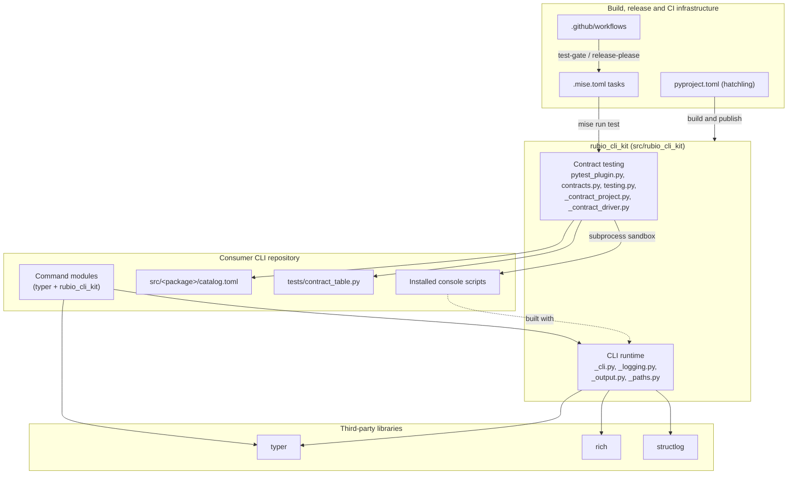
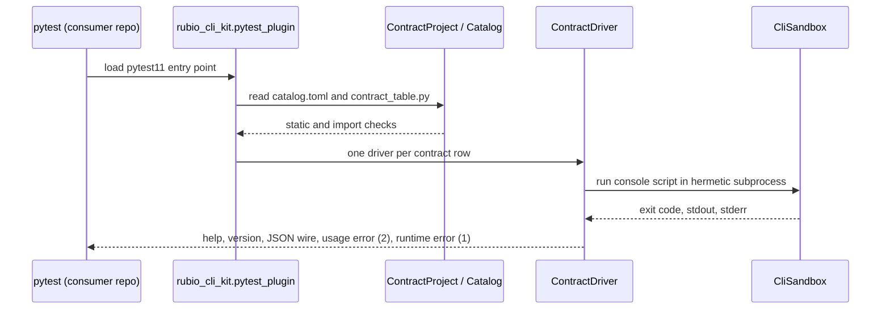

# rubio-cli-kit Repository Overview

## Purpose

`rubio-cli-kit` is a public Python library (version 1.2.4, Python 3.14.6 or later). Every per-tool CLI repository split out of `Rubio-Enterprises/dotfiles` under dotfiles issue #316 depends on it at runtime. The library has two parts:

- **CLI runtime:** two sanctioned Typer application shapes, `make_app` and `make_single_command_app`. Both keep `-h`/`--help`, `--version`, `--verbose`, structured diagnostics, exit codes, stdout/stderr output rules and XDG path resolution.
- **Contract testing:** the `rubio_cli_kit.pytest_plugin` module, registered as a `pytest11` entry point. In a consumer repository it checks the following:
  - console scripts, `catalog.toml` and contract rows match each other
  - the external CLI wire contract holds
  - Typer is declared directly
  - catalog rows marked `hook = true` import only the standard library, checked recursively

The kit owns Rich and structlog. Consumer command modules import Typer and the kit, but never Rich or structlog. Consumers do not pass the distribution name; the kit derives it from the importing package. Consumers supply only `tests/contract_table.py` and `src/<package>/catalog.toml`. The kit must never ship a `catalog.toml` of its own, because the installed kit shares site-packages with every consumer.

## End-to-end architecture

The following diagram shows what happens when `pytest` runs in a consumer repository:

## Core modules

| Module | Scope | Documentation |
| --- | --- | --- |
| CLI Toolkit Library | `src/rubio_cli_kit`: CLI runtime and contract-testing plugin | [CLI Toolkit Library](cli_toolkit_library.md) |
| Build, Release and CI Infrastructure | Packaging, mise toolchain, lint config, bootstrap scripts and GitHub Actions workflows | [Build, Release and CI Infrastructure](build_release_and_ci_infrastructure.md) |

Child module pages:

- [CLI Runtime](cli_toolkit_library/cli_runtime.md): application factories, `ExitCode`, logging, output and XDG paths.
- [Contract Testing](cli_toolkit_library/contract_testing.md): `CommandContract`, sandbox, fixtures and generated test items.
- [CI Workflows](build_release_and_ci_infrastructure/ci_workflows.md): `test-gate`, `release-please`, `standards`, `cloud-setup-smoke` and `copilot-setup-steps`.
- [Build Tooling and Dev Environment](build_release_and_ci_infrastructure/build_tooling_and_dev_environment.md): mise, packaging, release, lint and bootstrap.

## How it is built and run

- **Toolchain:** `.mise.toml` is the single entry point. Developers, agents and CI all run `mise run setup`, which calls `uv sync --frozen`, then `mise run lint` (ruff, pyright) and `mise run test` (pytest).
- **Packaging:** `pyproject.toml` builds the library with hatchling. It declares `typer`, `rich` and `structlog` as runtime dependencies and registers the `pytest11` entry point.
- **CI:** `test-gate.yml` runs `mise run test` and publishes the required status check. `standards.yml` runs trufflehog and deploys the CodeWiki pages.
- **Release:** `release-please.yml` handles versioning and releases, guided by `release-please-config.json` and `.release-please-manifest.json`. Renovate keeps dependencies current.
- **Template:** most configuration files are rendered from the `Rubio-Enterprises/standards` Copier template. Don't edit them by hand.

For details, see [Build, Release and CI Infrastructure](build_release_and_ci_infrastructure.md#key-conventions).
