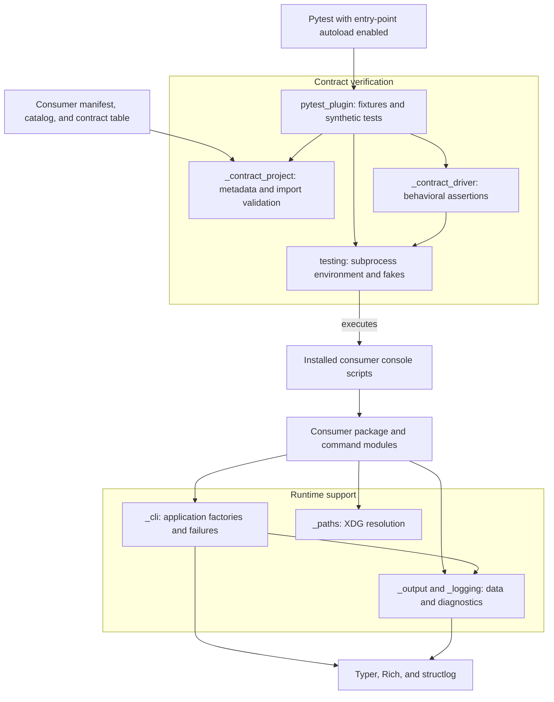
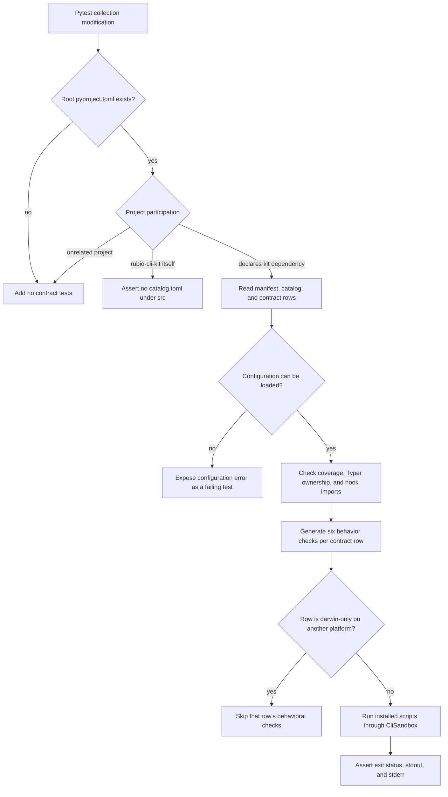

# rubio-cli-kit

## Purpose and scope

`rubio-cli-kit` standardizes how Rubio-Enterprises per-tool Python CLIs behave
and how their repositories prove that behavior. It provides two complementary
integration surfaces:

- Runtime helpers for Typer application construction, exit codes, structured
  diagnostics, stdout/stderr separation, and XDG directory resolution.
- A pytest plugin that validates consumer project metadata and generates
  external-behavior tests for installed console scripts.

The distribution is named `rubio-cli-kit`; its import package is
`rubio_cli_kit`. The inspected `pyproject.toml` declares version `1.2.4`, Python
`>=3.14.6`, and a Hatchling build backend. Runtime dependencies are
`typer>=0.27.1`, `rich>=15.0.0`, and `structlog>=26.1.0`. Pytest belongs to the
development dependency group, rather than the runtime dependencies.

This is a support library, not a console application: `pyproject.toml` defines
no `[project.scripts]`. Its executable entry-point integration is the
`pytest11` registration of `rubio_cli_kit.pytest_plugin`.
`src/rubio_cli_kit/__init__.py` is empty; consumers import helpers from their
individual modules. Although several helper module names begin with an
underscore, the repository documents them as consumer integration surfaces.

## Architecture overview

The runtime and test harness share the same behavioral contract but have
different responsibilities. Runtime helpers implement conventions inside a
consumer process. The harness checks project structure and observes installed
commands through subprocesses, rather than importing command callbacks to
exercise them.



The consumer owns command behavior, Typer parameter declarations, installed
script names, catalog descriptions, and test scenarios. The kit owns the
shared root options, output helpers, contract assertions, and reusable test
environment. Node.js and `@rubio-enterprises/standards` are repository-tooling
dependencies, not requirements of an installed Python CLI at runtime.

## Sub-module documentation

| Documentation | High-level functionality | Core source files |
| --- | --- | --- |
| [Runtime support](rubio-cli-kit_runtime.md) | Builds supported Typer app shapes and supplies version, exit, logging, output, and XDG conventions. | `_cli.py`, `_logging.py`, `_output.py`, `_paths.py` |
| [Contract harness](rubio-cli-kit_contract-harness.md) | Loads consumer inputs, checks metadata and import policies, and generates pytest assertions for installed commands. | `contracts.py`, `_contract_project.py`, `_contract_driver.py`, `pytest_plugin.py` |
| [Testing utilities](rubio-cli-kit_testing.md) | Runs subprocesses with controlled HOME/XDG/PATH settings and supplies fake executables, HTTP routes, and cleanup. | `testing.py` |
| [Repository tooling](rubio-cli-kit_repository-tooling.md) | Defines packaging, standards setup, Git hooks, formatting, lifecycle CI, and release maintenance. | `pyproject.toml`, `mise.toml`, hook/config files, `.github/workflows/` |

Python source filenames in this table are relative to `src/rubio_cli_kit/`;
configuration paths are relative to the repository root. Each page owns its
detailed APIs and maintenance procedures, rather than repeating them here.

Recommended starting points:

- [Application construction](rubio-cli-kit_runtime.md#application-construction)
  includes examples of both supported CLI shapes.
- [Consumer integration example](rubio-cli-kit_contract-harness.md#consumer-integration-example)
  connects a manifest, catalog, and contract table to a working runtime example.
- [CliSandbox](rubio-cli-kit_testing.md#clisandbox) explains environment
  precedence, executable selection, subprocess results, and timeouts.
- [Bootstrap lifecycle](rubio-cli-kit_repository-tooling.md#bootstrap-lifecycle)
  explains contributor and CI setup, including the standards dependency.

## Shared CLI behavior

Both supported application shapes expose `-h`, `--help`, `--version`, and
`--verbose`, disable generated completion options, and disable Typer's pretty
exception rendering.

- `make_app(name=..., help_text=..., default_command=...)` creates a subcommand
  application. Without a default command, a bare invocation displays usage and
  exits with code `2`. With a default command, the root invokes that registered
  child command using its own parsing context and default parameters.
- `make_single_command_app(name=..., help_text=...)` creates a root-argument
  application. The consumer registers one command without adding root version
  or verbosity parameters to its function signature. Additional command
  registrations, callbacks, custom command classes, and collisions with the
  reserved `--version` and `--verbose` options are rejected.
- `--version` writes only the installed constructing package's version and a
  newline to stdout. The factories infer the distribution from the importing
  package, rather than accepting a duplicated version or distribution name.
- Exit codes are `0` for success, `1` for runtime/domain errors, and `2` for
  usage errors. `fail(message)` emits a command-prefixed error on stderr and
  raises `typer.Exit`; it is not a catch-all exception handler.
- Stdout carries data. Status messages, warnings, errors, and diagnostic logs
  go to stderr. Logging defaults to WARNING and switches to DEBUG with
  `--verbose`.
- JSON data serialization and JSON diagnostic rendering are separate choices.
  The kit does not automatically add a `--json` option to consumer commands.
- XDG resolution accepts a non-empty absolute environment override; otherwise
  it returns a HOME-relative fallback. Resolution does not create directories.

These behaviors are implemented in `src/rubio_cli_kit/_cli.py`,
`src/rubio_cli_kit/_logging.py`, `src/rubio_cli_kit/_output.py`, and
`src/rubio_cli_kit/_paths.py`. Detailed lifecycle and API explanations belong in
the runtime reference listed above.

## Contract collection and execution

The `pytest11` entry point in `pyproject.toml` makes the plugin discoverable
when the distribution is installed and pytest plugin autoload is enabled.
The plugin inspects the `pyproject.toml` at pytest's configured root and appends
synthetic tests independently of the configured `testpaths`.



Participation is based on the normalized `[project].name` or a direct
`[project].dependencies` declaration of the kit. Merely installing the plugin
into an unrelated project's environment does not opt that project in.

For a valid consumer configuration, the generated tests check the following:

- The consumer declares Typer directly in `[project].dependencies`.
- Exactly one `src/<package>/catalog.toml` describes every console script.
  Non-hook rows require non-empty `purpose` and `use_when` strings.
- Catalog command names exactly match `[project.scripts]`, and
  `tests/contract_table.py` contains exactly one `CommandContract` row per
  non-hook script.
- Non-hook entry-point modules import Typer directly and do not directly
  import Rich or structlog. Hook entry points instead undergo recursive,
  AST-based validation of project-local imports for stdlib-only dependencies.
- Each contract row receives checks for root options, declared help paths,
  bare invocation, JSON behavior, usage errors, and runtime errors.

Successful JSON scenarios must produce a value accepted by `json.loads` and
no stderr. Unsupported JSON mode must reject root `--json` as a usage error.
The harness does not validate an application-specific JSON schema. When a
row declares a default command, bare and explicit invocations are compared
from identical HOME snapshots; external service state is not restored.

Configuration and contract-table import exceptions, including `SystemExit`,
are surfaced as test failures instead of pytest internal errors. Darwin-only
rows skip only their behavioral checks on other platforms; metadata and
import-policy checks still apply.

Sources: `src/rubio_cli_kit/pytest_plugin.py`,
`src/rubio_cli_kit/_contract_project.py`,
`src/rubio_cli_kit/_contract_driver.py`, and
`src/rubio_cli_kit/contracts.py`.

## Consumer integration checklist

- Declare `rubio-cli-kit` and Typer directly as project dependencies. The
  repository's `README.md` demonstrates pinning the kit's Git source to a
  released tag with `[tool.uv.sources]`.
- Construct the app from an importable consumer package using one of the
  supported factories. Let the consumer own its command parameters and
  application-specific behavior.
- Expose the app or hook through `[project.scripts]` and install the consumer
  into the same Python environment used to run pytest.
- Include one `src/<package>/catalog.toml` with a row for every script. Mark
  latency-sensitive, stdlib-only hook entry points with `hook = true`.
- Supply `tests/contract_table.py` with a `COMMANDS` list or tuple of
  `CommandContract` instances for non-hook scripts. Scenario setup can create
  sandbox configuration, fake binaries, or local HTTP routes.
- Run pytest with the plugin enabled. Use the exported `home`, `cli_env`,
  `cli`, `fake_path`, and `fake_http_server` fixtures for consumer-specific
  tests alongside the generated contract tests.

The contract reference and testing reference provide the complete field,
fixture, and setup semantics; the overview does not replace those APIs.

## Development and automation

Repository setup is driven by `mise.toml`, which requires mise `2026.10.19` or
newer and pins Node.js `24.21.0` and Python `3.14.6`. Provide `NODE_AUTH_TOKEN`
with access to the standards package registry before setup.

```bash
mise trust
mise run setup
mise run check
mise run test
```

`mise run setup` installs `@rubio-enterprises/standards` under `.standards/`,
installs missing tools and Git hooks, and runs any available `setup:*` tasks.
Shared conformance tasks are loaded through
`.config/mise/conf.d/standards.toml`. The repository's test task runs:

```bash
uv run --frozen pytest --junitxml=reports/test/junit.xml
```

`.github/workflows/test-gate.yml` runs on pull requests and merge groups. It
runs whichever lifecycle tasks exist, in `typecheck`, `build`, `test`, `e2e`
order. For each test or e2e task, it requires XML reports under `reports/test/`
with at least one test case and no failure or error elements. It clears the
report directory before each task, preventing reuse of stale evidence. An
explicit `STANDARDS_TEST_GATE=off` opt-out passes with a notice.

`.github/workflows/standards.yml` delegates release management, repository
images, CodeWiki publication, and scheduled/manual secret scanning to shared
organization workflows, subject to event and file-presence gates. Release
configuration is held in `release-please-config.json` and
`.release-please-manifest.json`; the inspected release baseline is `1.2.4`.
See the repository-tooling reference for hook precedence, formatting,
authentication, runner selection, and the exact automation gates.

## Operational boundaries

- Distribution metadata and installed scripts must be available in the test
  interpreter's environment. The driver compares `--version` to installed
  consumer metadata, not to a version string copied from the source manifest.
- The subprocess environment deliberately omits ambient variables. Pass
  required credentials, test endpoints, or configuration explicitly through
  sandbox overrides rather than depending on the developer's shell.
- The sandbox isolates HOME, XDG roots, working directory, and PATH defaults;
  it is not a security boundary or a network-blocking container. Its shell
  fakes, fixed system paths, and process-group termination are POSIX-oriented.
- Setup callbacks do not run before every contract assertion. The ordinary
  setup callback serves supported JSON and default-command parity checks;
  runtime failures have a separate optional setup callback.
- Logging configuration is process-global even though command identity uses a
  `ContextVar`. Context teardown restores previous logging settings for
  ordinary sequential or nested invocations, not independent concurrent
  logging configurations.
- The default standards installation follows the latest release unless
  `STANDARDS_VERSION` pins it. Formatting and conformance behavior therefore
  also depend on the installed standards release, not just this repository's
  small config stubs.
