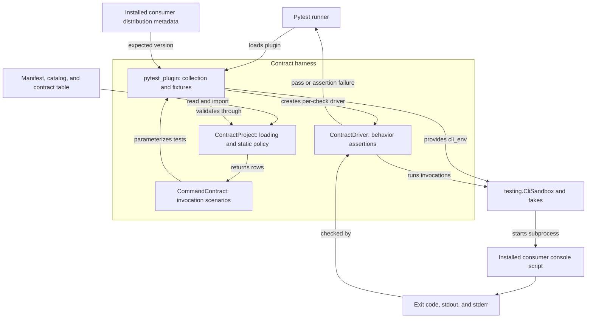
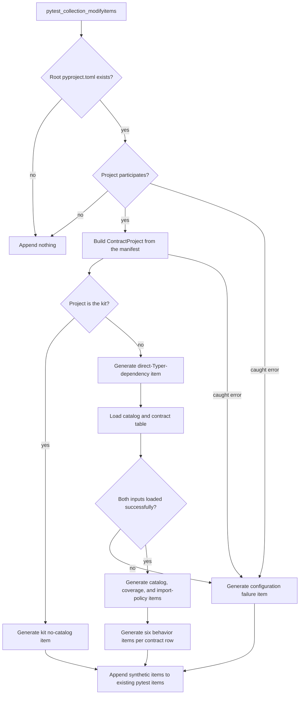
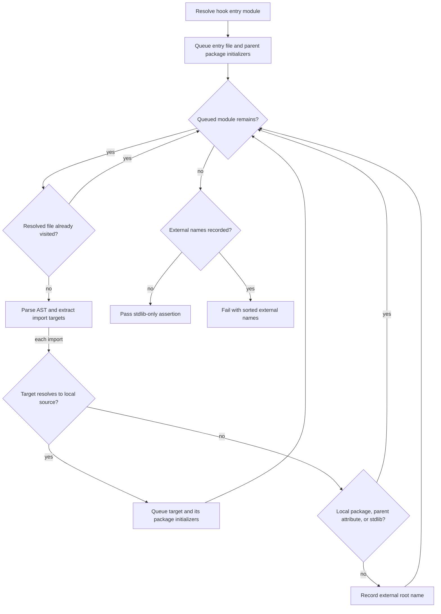
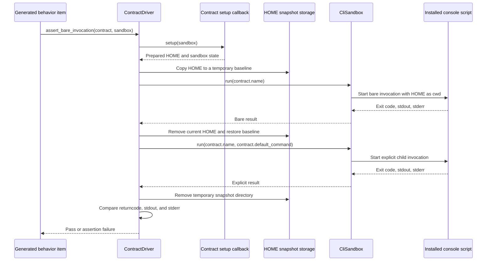

# Contract harness

The `rubio-cli-kit_contract-harness` module turns the shared CLI contract into
pytest tests for consumer repositories. It validates project metadata, command
catalogs, contract-table coverage, and import ownership, then exercises
installed console scripts in isolated subprocess environments.

The harness verifies observable behavior rather than importing and calling
command callbacks. Consumers supply command descriptions and representative
invocations; the kit supplies collection, execution, and assertions.

For the surrounding system, see the [system overview](overview.md).
The [runtime module](rubio-cli-kit_runtime.md) implements the CLI conventions
being checked. The [testing utilities](rubio-cli-kit_testing.md) own subprocess
sandboxes and fakes, while [repository tooling](rubio-cli-kit_repository-tooling.md)
owns build, test-task, and CI configuration.

## Architecture and dependencies

The implementation has four layers: a public scenario model, project-policy
validation, external-behavior assertions, and pytest integration.

| Source | Main components | Responsibility |
| --- | --- | --- |
| `src/rubio_cli_kit/contracts.py` | `CommandContract`, `CommandSetup`, `_empty_setup` | Describe one non-hook script's scenarios and setup callbacks. |
| `src/rubio_cli_kit/_contract_project.py` | `ContractProject`, `ProjectManifest`, `Catalog`, `CatalogCommand` | Read consumer inputs, validate coverage, and inspect source imports. |
| `src/rubio_cli_kit/_contract_driver.py` | `ContractDriver` | Assert subprocess exit codes, stdout, stderr, help, and version behavior. |
| `src/rubio_cli_kit/pytest_plugin.py` | `ContractFile`, fixtures, collection hook | Select participating projects and create ordinary pytest test items. |

All source and configuration paths on this page are relative to the repository
root unless stated otherwise.



The harness uses pytest and Python's standard library for TOML parsing, AST
inspection, dynamic table loading, and installed-metadata lookup. It depends on
`rubio_cli_kit.testing`, but not on the runtime factories to execute commands.
The command under test may use those factories in its own process.

## Plugin activation and project participation

### Packaging and runner requirements

The repository's `pyproject.toml` registers the plugin through the standard
pytest entry-point group:

```toml
[project.entry-points.pytest11]
rubio-cli-kit = "rubio_cli_kit.pytest_plugin"
```

Installing the distribution makes the plugin discoverable when pytest plugin
autoload is enabled. If autoload is disabled, the test runner must explicitly
load the plugin. No consumer `conftest.py` registration is needed with normal
autoloading.

The same manifest declares Python `>=3.14.6` and puts pytest `9.1.1` in the
kit's development dependency group, not its runtime dependencies. A consumer
must provide pytest in its own test environment. Its installed distribution
metadata and console scripts must be available to that test interpreter.

### Participation rules

`pytest_collection_modifyitems()` examines only
`Path(config.rootpath) / 'pyproject.toml'`. It does not search recursively for
projects or choose a project based on the current test file.

| Root project state | Synthetic contract behavior |
| --- | --- |
| No root `pyproject.toml` | Add no contract tests. |
| Normalized `[project].name` is `rubio-cli-kit` | Add the kit-only no-catalog check. |
| A direct `[project].dependencies` entry names `rubio-cli-kit` | Collect the consumer contract. |
| Neither condition applies | Add no contract tests. |
| Reading or parsing the root manifest raises a caught error | Add a failing configuration test. |

`_normalize_distribution()` lowercases names and replaces each run of hyphens,
underscores, or dots with one hyphen. For example, `Rubio_CLI.Kit` normalizes to
`rubio-cli-kit`. This normalization applies to distribution names, not console
script names.

Dependency recognition extracts the leading distribution name from each
requirement string. Version constraints, extras, and environment markers are
not evaluated. A matching conditional requirement therefore still counts as a
declaration. Optional dependencies, development groups, build requirements, and
transitively installed packages do not opt a consumer in.

The participation probe is deliberately less strict than full manifest
validation: an absent or non-table `[project]` is inactive, and a non-list
dependency field does not opt an otherwise unrelated project in. Once selected,
`ContractProject.from_root()` applies the stricter rules documented below.

The fixtures remain available whenever the plugin is loaded, even when the
current project does not participate in synthetic contract collection.

## Collection lifecycle

The collection hook is marked `tryfirst=True`. It creates a synthetic
`ContractFile` anchored to the root `pyproject.toml`, materializes its items,
and appends them to pytest's existing item list. The kit's configured
`testpaths = ["tests"]` in `pyproject.toml` does not control this synthetic
collection; neither does the location of ordinary test files.



This diagram describes item generation, not prerequisite execution. Static
checks are ordinary tests: a coverage or import-policy failure does not itself
suppress the already generated behavioral tests.

### Generated test inventory

Synthetic items have stable, descriptive names under the manifest collector,
for example `pyproject.toml::contract:acme-tool:root-options`.

| Item name | When generated | What it checks |
| --- | --- | --- |
| `contract:kit:no-catalog` | Kit repository only | No `catalog.toml` anywhere beneath `src`. |
| `contract:manifest:typer-declared` | Every consumer | Typer is a direct project dependency. |
| `contract:configuration:valid` | A caught configuration or collection error | Re-raise the original error as a test failure. |
| `contract:catalog:valid` | Consumer inputs loaded | Reload and validate the catalog. |
| `contract:commands:covered` | Consumer inputs loaded | Exact agreement among scripts, catalog, and contract rows. |
| `contract:<name>:import-ownership` | Each non-hook catalog command | Direct Typer import and no direct Rich or structlog import. |
| `contract:<name>:stdlib-only` | Each hook catalog command | Hook's statically discovered local import graph is stdlib-only. |
| `contract:<name>:<check>` | Each contract row, for each of six checks | External CLI behavior. |

For a valid consumer with `N` non-hook scripts and `H` hooks, the inventory is
`3 + 7N + H` items. Darwin-only skips do not change the number collected.
The kit itself receives only its one no-catalog item.

### Collection error handling

Catalog loading and contract-table imports can execute or encounter arbitrary
consumer code. Both `Exception` and `SystemExit` are caught at the relevant
collection boundaries and surfaced through `contract:configuration:valid`,
rather than escaping as pytest internal collection errors. Other
`BaseException` subclasses, such as `KeyboardInterrupt`, are not caught.

If catalog or table loading fails inside `ContractFile.collect()`, the
previously yielded Typer-declaration item is retained and no command-specific
items are generated. If the outer collection hook catches a failure while
materializing the collector, it appends a configuration-failure item instead
of the partially materialized synthetic collection. Existing ordinary tests
are left in place.

The small pytest adapters have distinct roles:

- `_function()` builds a `pytest.Function`; its displayed item name preserves
  colons and hyphens, while its callable name replaces them with underscores.
- `_failure()` captures an exception and returns a callable that raises it
  during test execution.
- `_platform_check()` requests `cli_env`, applies the row's Darwin-only skip,
  and invokes the behavioral check.

Loop-generated closures bind the current command, row, and assertion through
default arguments, preventing all items from accidentally using the final
loop value.

## Consumer inputs and data models

### Manifest validation

`ContractProject.from_root()` reads `pyproject.toml` using `tomllib` and creates
these frozen dataclass models:

| Model | Stored data |
| --- | --- |
| `ProjectManifest` | Distribution name, dependency-string tuple, and copied script-name-to-target dictionary. |
| `ContractProject` | Project root and its manifest. |
| `CatalogCommand` | Script name, hook flag, optional purpose, and optional usage guidance. |
| `Catalog` | Catalog path and command tuple. |

The required manifest shapes are:

- `[project]` must be a TOML table.
- `[project].name` must be a non-empty string.
- `[project].dependencies`, when present, must be an array of strings; it
  defaults to an empty array.
- `[project.scripts]`, when present, must map string names to string targets;
  it defaults to an empty table.

`ProjectManifest.dependency_names` extracts normalized requirement names, and
`declares()` tests membership using the same normalization. Neither method
checks installed versions or evaluates requirement markers.

`assert_typer_declared()` requires a direct `typer` dependency for every
consumer, including one whose catalog contains only hooks. The kit's
transitive dependency on Typer is explicitly insufficient.

### Catalog location and schema

A consumer must have exactly one file matching `src/*/catalog.toml`: one
package directory immediately beneath `src`. A root-level catalog or a file
nested more deeply does not satisfy that search.

The catalog must contain a non-empty `[[command]]` array. Each row follows
these rules:

| Field | Rule |
| --- | --- |
| `name` | Required non-empty string, unique within the catalog. |
| `hook` | Boolean, defaulting to `false`. |
| `purpose` | Required non-empty string for non-hooks; optional for hooks. |
| `use_when` | Required non-empty string for non-hooks; optional for hooks. |

When optional hook descriptions are supplied, they must also be non-empty
strings. `_require_string()` rejects strings containing only whitespace but
returns the original string without trimming it. Script names must therefore
match exactly; command-name comparison is case-sensitive and unnormalized.
Unknown catalog fields are not rejected by this loader.

The kit takes a different path: `assert_kit_has_no_catalog()` recursively
rejects every `src/**/catalog.toml`. Catalog ownership belongs to consumers,
not to the shared kit distribution.

### Coverage invariants

`assert_command_coverage()` enforces two set equalities:

```text
catalog command names == [project.scripts] names
contract row names == catalog names whose hook flag is false
```

Consequently:

- Every installed-script declaration needs a catalog row, including hooks.
- Every non-hook catalog command needs exactly one contract row.
- Hooks must not have contract rows and receive no behavioral contract tests.
- Catalog-only names, scripts-only names, extra rows, and missing rows fail
  with sorted difference lists in the assertion message.

Catalog and table loading happen during collection. The catalog-valid and
coverage test items read the catalog again when they execute; the already
loaded contract rows are reused.

## Public contract-table API

### CommandContract fields

`CommandContract` is a frozen dataclass describing one non-hook console script.
The first five fields are required constructor arguments. Argument tuples do
not include the executable name.

| Field | Type | Meaning and default |
| --- | --- | --- |
| `name` | `str` | Exact `[project.scripts]` key to execute. |
| `help_paths` | `tuple[tuple[str, ...], ...]` | Paths to check by appending `--help`; an empty outer tuple requests no additional help checks. |
| `json_args` | `tuple[str, ...] \| None` | Complete arguments for successful JSON output, or `None` to require rejection of root `--json`. |
| `usage_error_args` | `tuple[str, ...]` | Invocation expected to exit `2` with stderr and no stdout. |
| `runtime_error_args` | `tuple[str, ...]` | Invocation expected to exit `1` with stderr and no stdout. |
| `setup` | `CommandSetup` | Setup for default-command parity and supported JSON scenarios; defaults to `_empty_setup`. |
| `runtime_error_setup` | `CommandSetup \| None` | Optional setup specifically for the runtime-error scenario; defaults to `None`. |
| `darwin_only` | `bool` | Skip the row's six behavior checks outside Darwin; defaults to `False`. |
| `default_command` | `str \| None` | One child-command token to compare with a bare invocation; defaults to `None`. |

`CommandSetup` is `Callable[[CliSandbox], None]`. `_empty_setup()` is a no-op.
These callbacks receive the sandbox, not arbitrary pytest fixtures.

Dataclass annotations describe the API, but the dataclass does not perform
runtime validation of every field. The table loader checks row identity and
name uniqueness; incorrect argument shapes or callback values can fail later
when a check uses them.

A help path such as `("config", "show")` produces
`tool config show --help`. A supported JSON scenario must include its actual
flag and command tokens, for example `("show", "--json")`; the driver does not
append a JSON option. `default_command` is passed as one argument, not split
into a multi-token path.

### Loading tests/contract_table.py

Consumers must provide `tests/contract_table.py`, exposing `COMMANDS` as a
list or tuple of `CommandContract` instances. Duplicate names are rejected.
An empty sequence is accepted by the loader, but coverage permits it only
when every catalog command is a hook.

`ContractProject.load_contracts()` performs the following import procedure:

- Require the table file to exist.
- Build a synthetic module name from the first 16 hexadecimal characters of
  the SHA-256 hash of the table's path string, not its contents.
- Prepend `tests/` and `src/`, in that order, to `sys.path` so the table can
  import sibling helpers and consumer source modules.
- Execute the table through `importlib.util`, then remove the temporary search
  paths and synthetic table entry from `sys.modules` in a `finally` block.
- Validate `COMMANDS`, every row's class, and name uniqueness; return a tuple.

This is trusted Python execution inside pytest, not sandboxed subprocess
execution. Imports and module-level code can have side effects. Cleanup removes
the table's temporary import scaffolding, not every helper module imported by
the table or every side effect it caused. Keep module-level work lightweight
and place scenario resources in setup callbacks.

## Static import policies

### Resolving command entry points

Both import policies read the module portion of a script target before the
first colon. For `acme-tool = "acme_tool.cli:app"`, they inspect
`acme_tool.cli`.

Resolution checks `src/` before the project root. Within each source root it
tries the corresponding `.py` file before a package's `__init__.py`. If no
source file is found, the policy fails. These checks do not validate or invoke
the target attribute after the colon.

### Non-hook import ownership

`assert_command_import_ownership()` parses the entry-point file with `ast` and
collects top-level package names from ordinary `import` statements and absolute
`from ... import ...` statements.

The entry-point module must directly import `typer`. It must not directly
import `rich` or `structlog`; presentation and diagnostics should use kit
helpers instead. See the [runtime documentation](rubio-cli-kit_runtime.md) for
those helpers.

This is a source-level ownership rule, not a recursive dependency ban. The
check scans imports anywhere in the file, including conditional and
function-local imports, without evaluating their conditions. It does not
follow local helper modules or analyze dynamic imports for this policy.
Importing Typer only through a wrapper module does not satisfy the rule.

### Hook stdlib-only traversal

Hooks take the opposite route: they need no behavioral contract row or direct
Typer import, but `assert_hook_stdlib_only()` recursively checks their
statically discovered project-local imports for third-party dependencies.
Parent package initializers are included, because importing an entry-point
module also imports its containing packages.



The traversal uses resolved file paths to avoid cycles. It recognizes local
namespace-package directories and does not misclassify an imported attribute
of a resolvable parent module as a separate external package. The stdlib
allowlist comes from the running interpreter's `sys.stdlib_module_names` and
`sys.builtin_module_names`, plus `__future__`. Local source resolution happens
before that allowlist check.

`_imports_from_tree()` handles ordinary absolute and relative imports and
several common dynamic-import forms:

- `importlib.import_module()` and `builtins.__import__()`, including imported
  aliases and directly imported function aliases.
- Simple assignments and annotated assignments that alias recognized import
  functions, including chains resolved by repeated analysis.
- Literal `getattr()` references to `import_module` or `__import__` on the
  recognized module aliases.
- Constant-string targets, including supported relative imports whose package
  is a constant string or `__package__`.

A recognized dynamic import with an empty, computed, or otherwise unresolved
target becomes `<dynamic import>` and fails the external-import check. Imports
inside conditional or unreachable code still count because the AST is scanned
without executing it.

This is a conservative static policy, not a complete Python execution model or
security boundary. It does not prove that arbitrary `eval`, `exec`, unusual
aliasing, or runtime path manipulation cannot import something else. It also
does not inspect the implementation of allowed standard-library modules.

## Behavioral checks

Every contract row produces six independent pytest items. For each executed
item, the plugin constructs a new `ContractDriver` with
`importlib.metadata.version(project.manifest.name)` as `expected_version`.
Version identity comes from installed consumer metadata, not the kit version
or a copied `[project].version` value. This metadata lookup occurs before every
behavioral assertion, even checks that do not print a version.

| Check suffix | Invocations and assertions | Setup callback |
| --- | --- | --- |
| `root-options` | `-h`, `--help`, and `--verbose --help` exit `0`, contain `Usage` on stdout, and have empty stderr. Long help lists `-h`, `--help`, `--version`, and `--verbose`. `--version` exits `0` with exactly the installed version plus a newline on stdout and empty stderr. | None. |
| `help-paths` | Run each declared path with `--help`; require exit `0`, `Usage` on stdout, and empty stderr. | None. |
| `bare-invocation` | Without a declared default, require exit `2` and `Usage` somewhere in stdout plus stderr. With a default, compare bare and explicit invocations exactly. | `setup`, only when a default is declared. |
| `json-wire` | With `json_args`, require exit `0`, stdout accepted by `json.loads()`, and empty stderr. Without it, root `--json` must exit `2`, leave stdout empty, and produce stderr. | `setup`, only when `json_args` is not `None`. |
| `usage-error` | Run `usage_error_args`; require exit `2`, empty stdout, and non-empty stderr. | None. |
| `runtime-error` | Run `runtime_error_args`; require exit `1`, empty stdout, and non-empty stderr. | `runtime_error_setup`, if supplied. |

The `Usage` and help-option checks are substring checks, not exact help-layout
comparisons. `--verbose` is exercised together with help; this check does not
verify DEBUG logging during an ordinary command invocation. Help paths are
consumer-declared scenarios, not automatically discovered command coverage.

JSON validation accepts any JSON value parsed by `json.loads()`. It does not
check an application-specific schema, field names, object type, canonical
formatting, or a particular newline convention. Neither the harness nor the
runtime factories automatically add a `--json` option.

Usage and runtime error checks verify exit status and stream separation, not
exact diagnostic text, error prefixes, or the absence of a traceback. Consumer
behavior-specific tests can make those stronger assertions using the same
fixtures.

### Default-command equivalence

When `default_command` is set, the bare-invocation check runs `setup()` once,
snapshots HOME, runs the bare command, restores HOME, and runs the explicit
child command. It then compares all three result fields.



The temporary baseline is created beneath `sandbox.home.parent`. Setup is not
rerun between the two invocations. The comparison requires parity, not success:
two matching usage or runtime failures can satisfy this particular check.

Only HOME is restored. HTTP request history, external service state, files
outside HOME, and mutable Python objects are not rewound. Use deterministic
outputs and repeatable external fakes when testing a default command.

### Setup isolation and platform skips

`setup` is not a universal pre-test hook. It runs only for supported JSON and
default-command equivalence. `runtime_error_setup` is separate and does not
automatically call `setup`. Root options, additional help, unsupported JSON,
usage errors, and bare invocation without a default must work from the fresh
sandbox without ordinary setup.

Each generated item receives its own function-scoped `cli_env`. Setup state
from the JSON or bare-invocation item does not carry into the runtime-error
item.

For `darwin_only=True`, `_platform_check()` calls `pytest.skip()` on non-Darwin
platforms before the driver and metadata lookup run. Only the six behavioral
items are skipped. Manifest, catalog, coverage, hook, and non-hook import-policy
items still apply on every platform. The `cli_env` fixture is resolved before
the wrapper makes its skip decision.

## Pytest fixtures and resource ownership

The plugin exports five function-scoped fixtures for generated and
consumer-written tests.

| Fixture | Value | Ownership and cleanup |
| --- | --- | --- |
| `home` | `Path` | Creates an empty `tmp_path / 'home'` for the test. |
| `cli_env` | `CliSandbox` | Uses that HOME and `Path(sys.executable).parent` as the scripts directory; always calls `sandbox.close()` on teardown. |
| `cli` | Bound `cli_env.run` callable | Returns `subprocess.CompletedProcess[str]` for each invocation. |
| `fake_path` | `FakePath` | Adds a fake-binary directory to the sandbox's PATH. |
| `fake_http_server` | `FakeHttpServer` | Starts an independent local HTTP fake and closes it in a fixture finalizer. |

The sandbox supplies isolated HOME and XDG roots, uses HOME as the working
directory, builds a controlled environment with `NO_COLOR=1`, and captures
stdout and stderr separately. Ambient shell environment variables are not
inherited automatically; explicitly configure required test values through
the sandbox.

The primary script is launched by its absolute path under the test
interpreter's scripts directory. Prepending fake binaries to PATH affects
external commands launched by the CLI, not which primary script the driver
executes.

Setup callbacks can use `sandbox.fake_http_server()` to register server cleanup
with the sandbox. The standalone `fake_http_server` fixture owns its own
server instead; it is not automatically passed into contract-table callbacks.

These are process-environment controls, not network denial or a security
sandbox. See the [testing utilities](rubio-cli-kit_testing.md) for complete
sandbox, fake executable, HTTP routing, timeout, and cleanup semantics.

## Consumer integration example

This example targets the `acme-tool` group shown in the runtime module's
[subcommand example](rubio-cli-kit_runtime.md#consumer-example-a-subcommand-app).
That command exposes `show`, uses `show` as its default, has no JSON mode, and
fails `show --check` when its configuration directory is absent. The runtime
page owns the command implementation; only harness inputs are repeated here.

### Project layout and declarations

Place the catalog immediately inside the source package and the contract table
under the repository's `tests` directory:

```text
pyproject.toml
src/
  acme_tool/
    __init__.py
    cli.py
    catalog.toml
tests/
  contract_table.py
```

Relevant consumer `pyproject.toml` content is:

```toml
[project]
name = "acme-tool"
version = "0.1.0"
dependencies = ["rubio-cli-kit", "typer"]

[project.scripts]
acme-tool = "acme_tool.cli:app"
```

This is a manifest excerpt, not a complete packaging configuration. Install the
consumer with its test dependencies into the environment running pytest so its
console script and distribution metadata exist.

In `src/acme_tool/catalog.toml`:

```toml
[[command]]
name = "acme-tool"
purpose = "Inspect tool configuration."
use_when = "Use when locating or checking the configuration directory."
```

If the project also declares a hook script, add a catalog row for it with
`hook = true`, keep its entry-point import graph stdlib-only, and omit it from
`COMMANDS`.

### Contract table

In `tests/contract_table.py`:

```python
from rubio_cli_kit.contracts import CommandContract
from rubio_cli_kit.testing import CliSandbox


def configured_home(sandbox: CliSandbox) -> None:
    sandbox.xdg_config_path("acme-tool").mkdir(parents=True, exist_ok=True)


COMMANDS = (
    CommandContract(
        name="acme-tool",
        help_paths=(("show",),),
        json_args=None,
        usage_error_args=("--not-a-real-option",),
        runtime_error_args=("show", "--check"),
        setup=configured_home,
        default_command="show",
    ),
)
```

`configured_home()` prepares the default-command parity scenario. The separate
runtime-error item starts with a new empty HOME and does not run that callback,
so `show --check` exercises the missing-configuration failure. Root `--json`
is expected to be rejected, since this application does not implement it.

### Running and inspecting the contract

From the consumer root, with the plugin enabled and the consumer installed:

```bash
python -m pytest --collect-only -q
python -m pytest -q -k contract
python -m pytest -q
```

The first command exposes the synthetic inventory; the second selects contract
items; the third runs them alongside consumer tests. A valid one-script,
non-hook example produces ten synthetic items.

In the kit repository, `mise.toml` defines `mise run test` as:

```bash
uv run --frozen pytest --junitxml=reports/test/junit.xml
```

The repository's `.github/workflows/test-gate.yml` invokes the lifecycle tasks
that exist and requires test/e2e JUnit evidence under `reports/test/` with at
least one test case and no failures or errors. Generated contract items are
ordinary pytest results and contribute to that evidence. See
[repository tooling](rubio-cli-kit_repository-tooling.md) for setup, task
ownership, and the full CI gates.

## Failure diagnosis and maintenance

### Common failure patterns

| Observation | Likely cause and next check |
| --- | --- |
| No synthetic items | Verify plugin loading, pytest's root path, the root manifest, and a direct kit dependency or the kit's own project name. Installing the kit transitively is not participation. |
| `contract:configuration:valid` fails | Inspect the original exception: malformed TOML, missing catalog/table, invalid table rows, failed imports, or table-level `SystemExit` can all appear here. |
| `contract:manifest:typer-declared` fails | Declare Typer directly in `[project].dependencies`, even if it is already installed transitively. |
| `contract:commands:covered` fails | Reconcile the reported catalog-only, scripts-only, extra-row, or missing-row names, including hook flags. |
| `import-ownership` fails | Check the actual entry-point source file for a direct Typer import and forbidden direct Rich or structlog imports. |
| `stdlib-only` fails | Follow the reported external names through the hook, local helpers, and parent package initializers; unresolved recognized dynamic imports also fail. |
| Behavioral checks cannot start | Ensure consumer metadata and scripts are installed into the same interpreter environment as pytest; the driver does not fall back to source version strings or PATH lookup. |
| `json-wire` fails | Check for extra stdout text, invalid JSON, successful-command diagnostics on stderr, or incorrect placement of the JSON flag. |
| Default-command parity fails | Compare all result fields and look for nondeterministic output or state outside HOME that the snapshot does not restore. |
| Darwin behavior is skipped but static tests fail | Expected: `darwin_only` affects behavioral items, not repository policy. |

Because configuration validation is separate from coverage and import tests,
a coverage failure can be accompanied by secondary failures in generated
command checks. Start with configuration and name agreement before diagnosing
subprocess output.

### Extending the implementation

Keep changes aligned with the existing ownership boundaries:

- Add or change public scenario fields in `contracts.py`; document callback
  timing and defaults explicitly.
- Put manifest, catalog, coverage, and static import rules in
  `_contract_project.py` rather than the subprocess driver.
- Implement external behavior in `ContractDriver`, then register the new
  assertion in `ContractFile.collect()`'s `checks` tuple. Adding a driver
  method alone does not collect a new test.
- Preserve per-loop closure binding and the configuration-error adapters when
  changing synthetic collection.
- Add sandbox capabilities in the [testing module](rubio-cli-kit_testing.md),
  rather than duplicating process or fake-resource management in the plugin.
- Coordinate changes to shared CLI behavior with the
  [runtime module](rubio-cli-kit_runtime.md), while keeping the harness's
  assertions external and independently observable.
