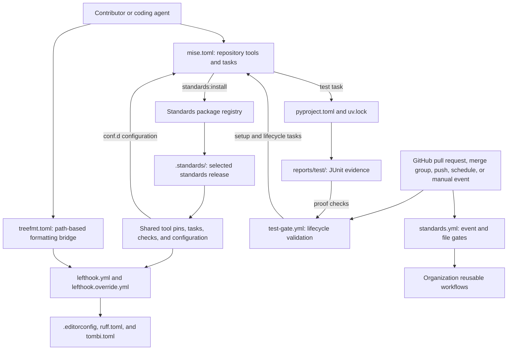
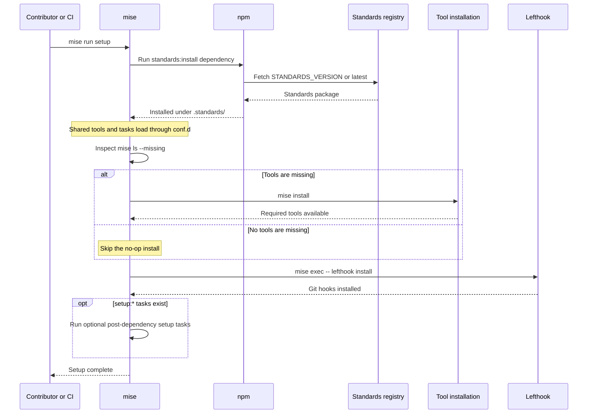
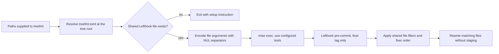
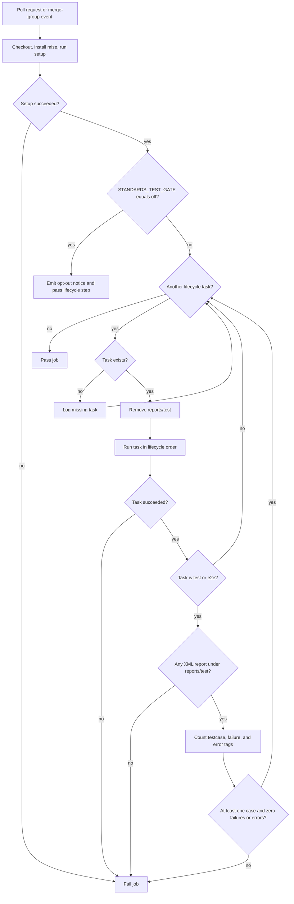
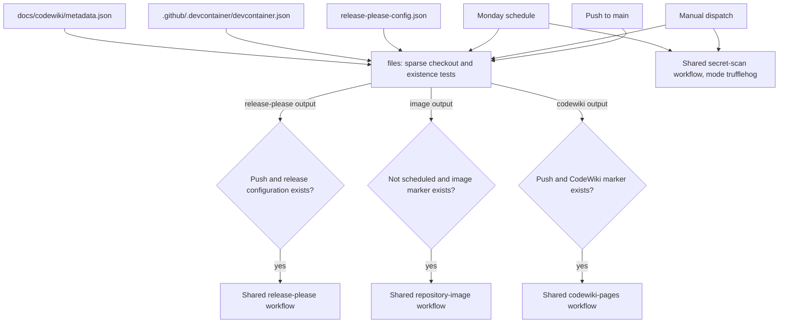

# Repository tooling

The `rubio-cli-kit_repository-tooling` module defines how contributors prepare,
format, validate, package, and release `rubio-cli-kit`. It is a declarative
integration layer: mise coordinates tools and tasks, Lefthook runs shared
checks, Python metadata defines the distributable library, and GitHub Actions
provides lifecycle validation and maintenance automation.

The central design is to keep repository-specific decisions small while loading
organization-wide checks and tool pins from `@rubio-enterprises/standards`.
Local commands and automation therefore depend on both the committed
configuration and the selected standards release.

## Scope and system boundaries

This module owns development and delivery mechanics, not CLI application
behavior or the implementation of contract tests.

| Related documentation | Relationship to repository tooling |
| --- | --- |
| [System overview](overview.md) | Explains the library's role in consumer CLI repositories. |
| [Runtime](rubio-cli-kit_runtime.md) | Implements the CLI, output, logging, and path helpers packaged by `pyproject.toml`. |
| [Contract harness](rubio-cli-kit_contract-harness.md) | Implements the pytest plugin registered through the distribution's `pytest11` entry point. |
| [Testing utilities](rubio-cli-kit_testing.md) | Provides subprocess sandboxes and fakes exercised by the Python test suite. |

Node.js, mise, Lefthook, treefmt, and the standards package are repository tools.
They are not declared Python runtime dependencies and are not required merely
to import the installed runtime helpers.

## Architecture and configuration ownership



### Ownership and precedence

- `mise.toml` owns language runtime pins, setup, and lifecycle tasks. Shared
  check-tool pins and conformance tasks are loaded through
  `.config/mise/conf.d/standards.toml`, a link into the installed standards
  package. Repository definitions take precedence over shared definitions of
  the same tool or task.
- Lefthook configuration is layered in the documented order: `lefthook.yml`,
  the shared `lefthook/standards.yml`, then `lefthook.override.yml`. Later
  fields win. Repository-only jobs should use names the shared file does not
  use; intentional patches belong in the override file.
- `ruff.toml` extends the installed shared Ruff configuration. `tombi.toml`
  carries settings locally because Tombi cannot extend the shared file.
- The three workflow files are repository-owned, even though they originated
  from organization standards. `standards.yml` delegates work to reusable
  workflows rather than implementing those jobs locally.

By default, `standards:install` selects the npm `latest` release. The available
installation inspected for shared task behavior identifies itself as standards
`2.0.0` in `.standards/node_modules/@rubio-enterprises/standards/package.json`.
That is an inspection snapshot, not a repository pin. The authoritative shared
policy is maintained in the
[Standards repository](https://github.com/Rubio-Enterprises/standards).

### Component map

All paths below are relative to the repository root.

| Configuration | Responsibility |
| --- | --- |
| `mise.toml` | Runtime pins, standards installation, setup, the Python test task, and an environment-entry warning. |
| `lefthook.yml` | Shared hook inclusion, installation guards, and best-effort standards refresh hooks. |
| `lefthook.override.yml` | Repository exceptions to shared checks; currently comments only. |
| `treefmt.toml` | Delegates formatting of supplied paths to Lefthook's fixer jobs. |
| `.editorconfig` | Editor-level encoding, whitespace, indentation, and newline conventions. |
| `ruff.toml` | Extends the shared Python lint and format policy without active local exceptions. |
| `tombi.toml` | Disables schema-driven TOML formatting behavior. |
| `pyproject.toml` | Distribution metadata, dependencies, build backend, pytest discovery, and plugin registration. |
| `.github/workflows/test-gate.yml` | Pull request and merge-group lifecycle validation with JUnit evidence checks. |
| `.github/workflows/standards.yml` | Release, image, documentation, and secret-scan dispatch. |
| `.github/workflows/copilot-setup-steps.yml` | GitHub-hosted runner selection for Copilot setup. |
| `release-please-config.json` | Single-package Python release strategy and tag/changelog conventions. |
| `.release-please-manifest.json` | Root package's tracked release version. |
| `renovate.json` | Organization dependency-update preset and a targeted Python support-floor exception. |

## Toolchain and setup

### Versions and environment controls

| Setting | Configured value | Meaning |
| --- | --- | --- |
| mise minimum | `2026.10.19` | Required by `mise.toml`; the inspected shared mise configuration has the same minimum. |
| Node.js | `24.21.0` | Repository runtime pin used by npm-based tooling. |
| Python | `3.14.6` | Repository development interpreter pin, not a test matrix. |
| Python support floor | `>=3.14.6` | Distribution requirement in `pyproject.toml`, also recorded in `uv.lock`. |
| `STANDARDS_VERSION` | Unset by default | Selects a standards release instead of `latest`. The example pin in `mise.toml` is commented out. |
| `STANDARDS_REGISTRY` | `https://npm.pkg.github.com` by default | Overrides the scoped package registry used for standards installation. |
| `NODE_AUTH_TOKEN` | Supplied by the environment | Authentication for the npm GitHub Packages host. The Test Gate supplies `github.token`. |
| `STANDARDS_TEST_GATE` | Unset by default | Only the exact value `off` bypasses lifecycle execution in the Test Gate. |

The scoped registry override changes the registry URL, but the installation
command's explicit token configuration remains scoped to `npm.pkg.github.com`.
An alternative host needs suitable authentication configuration of its own.
Do not commit registry tokens to repository configuration.

### Bootstrap lifecycle

Run from the repository root with a sufficiently recent mise installation and
registry access configured:

```bash
mise trust
mise run setup
mise run fmt
mise run check
mise run test
```

Trust the checkout before executing its task definitions. The setup command is
the common entry point for contributors and the Test Gate.



`mise.toml` implements this sequence with a `standards:install` dependency,
a conditional `mise install`, `lefthook install`, and optional
`depends_post` tasks matching `setup:*`. Avoiding a no-op tool installation
avoids unnecessary shim rebuilding on machines with many tracked configs.

The standards installer runs npm with these operational choices:

- Install under `.standards/` without saving the package as a project dependency.
- Prefer online metadata and use no fetch retries, so unavailable registries
  fail promptly rather than waiting through repeated fetch attempts.
- Disable package lifecycle scripts, audits, and funding output.
- Select `@rubio-enterprises/standards@${STANDARDS_VERSION:-latest}`.

The repository defines no active `setup:*` task and no explicit Python
`uv sync` setup step. Python environment preparation is left to the `uv run`
commands that execute project tools and tests. A setup-only success is not
proof that pytest or the project test suite has run.

The mise `enter` hook only checks whether the shared mise configuration exists.
If it is missing, it prints a recommendation to run `mise run setup`; it does
not install the package or block entry into the directory.

Sources: `mise.toml` and `.config/mise/conf.d/standards.toml`.

### Task interfaces

| Task | Owner | Behavior |
| --- | --- | --- |
| `setup` | Repository | Installs standards, missing tools, and Git hooks, then optional `setup:*` tasks. |
| `standards:install` | Repository | Refreshes the installed shared package from the selected registry and release. |
| `test` | Repository | Runs `uv run --frozen pytest --junitxml=reports/test/junit.xml`. |
| `check` | Shared standards | Runs the pre-commit checks on tracked files, or the relevant changed files in a fork with an upstream branch. Fixers can rewrite files; CI rejects rewrites. |
| `check:pr` | Shared standards | Checks a supplied commit range for secrets and applies pull request title and description conventions when the relevant context is supplied. |
| `fmt` | Shared standards | Runs fixer-tagged jobs over tracked files without staging fixes or automatically installing hooks. |

The inspected shared `check` task detects a fork through
`refs/remotes/origin/upstream`, using `BASE_SHA` or a merge base and
`HEAD_SHA` or `HEAD` to select changes. Without that upstream branch, it checks
all tracked files. It snapshots the working tree so that fixer rewrites fail
when `CI` is set.

`check:pr` requires `BASE_SHA`; its other inputs include `HEAD_SHA`, `PR_TITLE`,
and GitHub pull request context. Neither local workflow shown here explicitly
invokes `check` or `check:pr`. Do not assume the lifecycle Test Gate is also the
conformance-check workflow.

Only `test` is defined as a repository lifecycle task in the supplied
`mise.toml`. There is no local `typecheck`, `build`, or `e2e` task. In particular,
declaring a build backend or installing Pyright does not create those tasks.
The inspected shared Lefthook configuration does run Pyright as a checker when
Python files are selected and the root project declares Pyright, as this
project does. That is a check, not a lifecycle `typecheck` task.

Sources: `mise.toml`,
`.standards/node_modules/@rubio-enterprises/standards/mise/standards.toml`, and
`.standards/node_modules/@rubio-enterprises/standards/lefthook/standards.yml`.

## Hooks, checks, and formatting

### Hook behavior and failure boundaries

| Hook | Repository-owned behavior | Failure policy |
| --- | --- | --- |
| `pre-commit` | Extends shared checks and adds the `standards installed` guard. | Missing shared Lefthook configuration fails with an instruction to run setup. |
| `commit-msg` | Extends shared commit-message checks and adds the same installation guard. | Missing shared configuration fails rather than silently omitting shared checks. |
| `post-checkout` | Runs `mise run --quiet standards:install`. | Refresh failure prints a warning without failing the Git operation. |
| `post-merge` | Reuses the standards-refresh command through a YAML alias. | Same best-effort behavior. |
| `post-rewrite` | Reuses the standards-refresh command through a YAML alias. | Same best-effort behavior. |

The explicit pre-commit and commit-message guards are important because
Lefthook otherwise skips a missing `extends` file silently. The post-operation
hooks deliberately behave differently: an offline or untrusted checkout should
remain usable, with a warning telling the contributor to run setup later.
A refresh installs the package; it does not run the full setup or test lifecycle.

In the inspected shared configuration, fixers run sequentially inside the
`fixers` group, while read-only checkers can run in parallel. Normal pre-commit
fixers are configured to stage their fixes. The shared `fmt` task and the
treefmt bridge explicitly disable that staging behavior.

Sources: `lefthook.yml` and
`.standards/node_modules/@rubio-enterprises/standards/lefthook/standards.yml`.

### Repository exceptions

`lefthook.override.yml` currently contains instructions and examples only;
there are no active repository exclusions. When introducing an exception:

- Target a named shared job and change only the necessary fields.
- Remember that setting a list replaces the shared list rather than appending
  to it.
- Treat a `run` override as ownership of that command: subsequent standards
  releases cannot update the overridden command for this repository.
- Patch formatter jobs inside the shared `fixers` group.
- Use doublestar globs, where `**/` can match zero or more directories.
- Inspect the effective configuration with `lefthook dump`. The override file
  explicitly notes that no check validates the patch itself.

For example, after setup:

```bash
mise exec -- lefthook dump
```

Sources: `lefthook.yml` and `lefthook.override.yml`.

### Formatting data flow

`treefmt.toml` is a bridge to the existing fixers, not a second formatting
policy. It identifies the tree through `tree-root-file = "treefmt.toml"`,
accepts paths with `includes = ["*"]`, and logs unmatched paths at debug level.



The bridge's effective Lefthook invocation is:

```bash
mise exec -- lefthook run pre-commit \
  --tag fixer \
  --no-stage-fixed \
  --no-fail-on-changes \
  --no-auto-install \
  --files-from-stdin
```

The wrapper supplies NUL-delimited file arguments through stdin, preserving
filenames containing whitespace. These options select fixers rather than all
checkers, leave the Git index untouched, allow formatting changes without
failing merely because a file changed, and prohibit automatic hook
installation. Formatter errors can still fail the command.

Before invoking Lefthook, the wrapper explicitly rejects a missing standards
file with a setup instruction. For path-based formatting, use:

```bash
mise exec -- treefmt src/rubio_cli_kit/_cli.py pyproject.toml
```

Source: `treefmt.toml`.

### Editor and formatter policy

| File | Effective local policy |
| --- | --- |
| `.editorconfig` | Stops parent EditorConfig inheritance with `root = true`; defaults to UTF-8, LF, final newlines, trimmed trailing whitespace, spaces, and two-space indentation. |
| `.editorconfig` exceptions | Patch/diff files preserve trailing whitespace; Python and Rust use four-space indentation; Go and `Makefile` use tabs. These patterns do not imply the repository contains every listed language. |
| `ruff.toml` | Extends `.standards/node_modules/@rubio-enterprises/standards/config/ruff.toml`. A missing parent is a hard error, not a fallback to Ruff defaults. |
| `tombi.toml` | Sets `[schema].enabled = false`, avoiding schema-driven key/array sorting and network-dependent formatting. |

The Ruff stub contains no active local exceptions. To extend policy without
unintentionally replacing the shared selection, its comments recommend
`lint.extend-select`, `lint.ignore`, `lint.extend-per-file-ignores`, and
`extend-exclude` as appropriate. Scalars such as `target-version` can override
the shared value. Avoid replacing `lint.select` when the intent is only to add
rules.

Ruff configuration and Python compatibility metadata are separate controls.
For example, the inspected shared Ruff floor sets `target-version = "py313"`,
while this project's supported Python floor is `>=3.14.6`. Do not infer the
package's support floor from the formatter's target version.

Sources: `.editorconfig`, `ruff.toml`, `tombi.toml`, and
`.standards/node_modules/@rubio-enterprises/standards/config/ruff.toml`.

## Python packaging and pytest integration

`pyproject.toml` defines a support library rather than a standalone CLI. It has
no `[project.scripts]` section. Its executable integration surface is a pytest
plugin entry point.

| Area | Configuration |
| --- | --- |
| Distribution | `rubio-cli-kit`, version `1.2.4` in the inspected manifest. |
| Python compatibility | `requires-python = ">=3.14.6"`. |
| Runtime dependencies | `rich>=15.0.0`, `structlog>=26.1.0`, and `typer>=0.27.1`. |
| Development group | `pytest==9.1.1`, `pytest-cov==7.1.0`, and `pyright==1.1.414`. |
| Build backend | `hatchling.build`, with `hatchling` as the build requirement. |
| Pytest entry point | Group `pytest11`, name `rubio-cli-kit`, target `rubio_cli_kit.pytest_plugin`. |
| Test discovery | `testpaths = ["tests"]`. |
| Default pytest option | `--strict-markers`, which rejects unregistered marker use. |

The plugin is discoverable by pytest when the distribution is installed and
plugin autoload is enabled. Pytest itself is a development dependency, not a
runtime requirement. Plugin participation rules and generated contract tests
are documented in the [contract harness](rubio-cli-kit_contract-harness.md),
not in this tooling reference.

The repository test task adds JUnit output on top of the pytest configuration:

```bash
uv run --frozen pytest --junitxml=reports/test/junit.xml
```

This executes the project in uv's managed environment using the existing lock
without updating it. `uv.lock` also records the `>=3.14.6` Python requirement.
When intentionally changing dependencies, update the lock separately and commit
it with the metadata change. The inspected shared checks use `uv lock --check`
to detect manifest/lock drift; do not treat frozen execution as a lockfile
refresh operation.

A bare pytest invocation does not inherit the mise task's JUnit option.
Likewise, installing `pytest-cov` does not enable coverage collection or impose
a coverage threshold: the configured test command specifies neither.

Hatchling describes how Python artifacts are built. No repository `build`
lifecycle task, wheel-upload step, or Python package-index publication step is
defined by the local configuration shown here.

Sources: `pyproject.toml`, `mise.toml`, `uv.lock`, and the shared Lefthook
`uv lockfile drift` check. See the [runtime](rubio-cli-kit_runtime.md) and
[testing utilities](rubio-cli-kit_testing.md) for implementation details of the
code being packaged and exercised.

## Continuous integration

### Lifecycle Test Gate

`.github/workflows/test-gate.yml` runs on `pull_request` and `merge_group`.
The job ID and display name are both `test-gate`; the workflow comments identify
it as a required status check. Preserve that name when changing execution
steps so external branch-protection or ruleset configuration can continue to
refer to it.

The job has a 30-minute timeout and `contents: read` plus `packages: read`
permissions. It checks out without persistent credentials, installs mise with
the action's automatic tool installation disabled, then runs `mise run setup`
with `NODE_AUTH_TOKEN` set to `github.token`.



Lifecycle order is `typecheck`, `build`, `test`, then `e2e`. The gate checks
availability through `mise tasks info` and skips tasks that do not exist. The
repository currently supplies `test` only. Before each task that does exist,
the workflow deletes `reports/test`, preventing a later task from reusing
stale test evidence.

For each `test` or `e2e` task, the proof check requires:

- At least one `*.xml` report discovered recursively under `reports/test/`,
  including a report directly in that directory such as `junit.xml`.
- At least one `<testcase>` tag across the discovered reports.
- No `<failure>` or `<error>` tags across those reports.

The implementation uses `find`, concatenation, and regular-expression tag
counts rather than an XML parser. Counts are aggregate across all reports,
not a per-package minimum. It does not validate XML schemas, impose coverage,
or reject `<skipped>` cases. Task execution must also succeed independently
of the report content.

`STANDARDS_TEST_GATE = "off"` is an explicit exception, not an active default.
It is evaluated through `mise exec -- printenv` after setup has already run.
Consequently, opting out does not bypass checkout, registry authentication,
tool installation, or setup failures. The shown workflow does not upload the
JUnit files as artifacts.

Source: `.github/workflows/test-gate.yml`.

### Standards workflow dispatch and data flow

`.github/workflows/standards.yml` runs on pushes to `main`, manual dispatch,
and the cron schedule `0 9 * * 1`, meaning Mondays at 09:00 UTC. Its default
permission is `contents: read`.

The `files` job performs a sparse checkout of three marker/configuration paths.
For each existing file, it writes `name=true` to `GITHUB_OUTPUT`; missing files
leave the corresponding output unset. This small preparatory job avoids using
`hashFiles()` in a job-level condition, where GitHub does not allow it.



| Job | Event and file gate | Delegated workflow or local work | Permissions |
| --- | --- | --- | --- |
| `files` | Every standards workflow run. | Local sparse checkout and file tests; five-minute timeout. | Inherits `contents: read`. |
| `release-please` | Push and `release-please-config.json` exists. | `Rubio-Enterprises/.github/.github/workflows/release-please.yml@main`. | `contents: write`, `pull-requests: write`; explicitly inherits secrets. |
| `repository-image` | Not a scheduled event and `.github/.devcontainer/devcontainer.json` exists. | `Rubio-Enterprises/.github/.github/workflows/repository-image.yml@main`. | `contents: read`, `packages: write`. |
| `codewiki-pages` | Push and `docs/codewiki/metadata.json` exists. | `Rubio-Enterprises/.github/.github/workflows/codewiki-pages.yml@main`. | `contents: read`, `pages: write`, `id-token: write`. |
| `trufflehog` | Scheduled or manually dispatched event; no file gate. | `Rubio-Enterprises/.github/.github/workflows/secret-scan.yml@main`, with `mode: trufflehog`. | No job-specific override of the caller's `contents: read` default. |

The release, image, and CodeWiki jobs all depend on `files`. `trufflehog` does
not: it can run independently of file detection. A manual run can request an
image and a secret scan, but does not trigger the release or CodeWiki jobs. A
scheduled run performs file detection and secret scanning, not releases,
images, or documentation publication.

The inspected image marker is a minimal devcontainer configuration with a name
and empty `features`. It enables delegation; it does not describe a Python
application deployment. CodeWiki publication similarly depends on the marker
at checkout time, not merely on the presence of Markdown pages.

The internal steps and publication destinations of the organization reusable
workflows are outside these local files. Do not infer Python package uploads,
image build details, or full secret-scan behavior solely from the caller.

Sources: `.github/workflows/standards.yml` and
`.github/.devcontainer/devcontainer.json`.

### Runner selection and concurrency

| Location | Runner selection | Concurrency behavior |
| --- | --- | --- |
| Test Gate | `vars.RUNNERS` parsed as JSON, using its `small` value; fallback is `["ubuntu-slim"]`. | Grouped by workflow and pull request number, or SHA when there is no pull request number; cancels in-progress runs in the same group. |
| Standards `files` job | The same `small` runner override and fallback. | The standards workflow groups by workflow and ref, with `cancel-in-progress: false`. |
| Copilot setup | Fixed `ubuntu-latest`. | No concurrency configuration in the local workflow. |

The runner expression appears only on the local jobs that execute steps. The
reusable-workflow callers do not specify `runs-on`; their actual execution
runners are controlled by those workflows. Keep `vars.RUNNERS` valid JSON if
using the override.

Sources: all three files under `.github/workflows/` listed in the component map.

### Copilot runner override

`.github/workflows/copilot-setup-steps.yml` declares a manually dispatchable
workflow with the special job ID `copilot-setup-steps`, an `ubuntu-latest`
runner, and a 59-minute timeout. Its only step is checkout.

The comments explain that this is a public-repository Copilot override intended
to avoid the organization's self-hosted `linux-x64` Copilot runner selection.
GitHub uses the declared setup job to select the runner for Copilot code review
and the coding agent. Keep the special job ID intact when customizing setup.
This workflow does not run `mise run setup`, install Python dependencies, or
execute the Test Gate.

All three workflows quote the `"on"` key. This preserves GitHub Actions behavior
while avoiding YAML 1.1 truthy-key interpretation in YAML linters.

Source: `.github/workflows/copilot-setup-steps.yml`.

## Release and dependency maintenance

### Release metadata

`release-please-config.json` configures one Python package at repository root.

| Setting | Value or effect |
| --- | --- |
| Package path | `.` |
| Package name | `rubio-cli-kit` |
| Release strategy | `python` |
| Changelog | `CHANGELOG.md` |
| Component in tag | Disabled with `include-component-in-tag: false`. |
| Version prefix | Enabled with `include-v-in-tag: true`; tags follow a shape such as `v1.2.4`, without a package-name component. |
| Pre-major special bump flags | `bump-minor-pre-major` and `bump-patch-for-minor-pre-major` are both `false`. |
| Tracked root release | `.release-please-manifest.json` records `1.2.4`, matching the inspected `pyproject.toml`. |

The release job is eligible only on a push to `main` with the release
configuration present. Pull request checks and manual standards dispatch are
not release triggers in the local workflow. Release execution is delegated to
the organization workflow, which receives inherited secrets and repository/PR
write permissions.

When changing release setup, keep the root package path, project metadata, and
release manifest consistent. The configured tag shape is a naming convention,
not evidence that any particular tag has already been published.

Sources: `release-please-config.json`, `.release-please-manifest.json`,
`pyproject.toml`, and `.github/workflows/standards.yml`.

### Renovate scope

`renovate.json` extends `github>Rubio-Enterprises/.github`. Its sole local rule
disables updates matching dependency name `python` in `.tool-versions` and
`pyproject.toml`, with the stated intention of preserving the repository-owned
Python support floor at `3.14.6`.

This is a targeted exception, not a blanket ban on Python updates or dependency
maintenance. In particular, the rule does not name `mise.toml`, where the active
Python runtime pin lives. Review the runtime pin, package support floor, and
lockfile together when intentionally changing supported Python versions.
Other update behavior comes from the organization preset and is not specified
locally.

Source: `renovate.json`.

### Reproducibility and trust boundaries

- Repository Node.js and Python versions are exact pins. Runtime Python library
  requirements are lower bounds, while the development requirements are exact
  pins; the lockfile supplies the resolved project environment.
- Standards installation follows `latest` unless `STANDARDS_VERSION` pins a
  release. A dependency refresh can therefore change shared checks, formatters,
  or conformance tasks without changing the small local stubs.
- Local checkout and mise actions are pinned by commit SHA. The reusable
  organization workflows are referenced at `@main`, and thus remain mutable
  independently of a standards package release pin.
- npm installation disables lifecycle scripts, but running shared tasks and
  hooks still executes code from the installed standards package. Review and
  trust the selected package and checkout accordingly.
- Test Gate and standards file-detection checkouts set
  `persist-credentials: false`. The Copilot checkout does not explicitly set
  that option. Only the release caller explicitly declares `secrets: inherit`.

Sources: `mise.toml`, `pyproject.toml`, and the three workflow files.

## Maintainer workflows and troubleshooting

### Safe extension points

- Add project dependency preparation as a repository `setup:*` task; setup
  already discovers such tasks through its optional post-dependency pattern.
- Add lifecycle tasks under `typecheck`, `build`, `test`, or `e2e` when needed.
  The Test Gate discovers them without a workflow edit. A new `test` or `e2e`
  task must write fresh JUnit XML under `reports/test/`.
- Add repository-only hook jobs in `lefthook.yml` under unique names. Use
  `lefthook.override.yml` only for deliberate shared-check patches, then inspect
  the effective configuration with `lefthook dump`.
- Prefer additive Ruff exceptions over replacing the shared rule selection.
  Keep editor and formatter changes consistent with the intended local policy.
- If a standards release breaks the repository, use a documented
  `STANDARDS_VERSION` pin in `mise.toml`, refresh setup, and validate again.
  The example comments call for an issue link; remove the pin when no longer
  needed. Pinning standards does not pin reusable workflows at `@main`.
- Treat `STANDARDS_TEST_GATE = "off"` as a reasoned exception, not a fix for
  missing reports or failing tests. Its example comment calls for a reason.

### Common failure modes

| Symptom | Interpretation and response |
| --- | --- |
| Hook says standards is not installed | The shared Lefthook file is absent. Run `mise run setup` in a trusted checkout with registry access. |
| Ruff reports a missing extended configuration | The repository stub cannot load its shared parent. Restore the standards installation rather than removing `extend` to fall back to defaults. |
| treefmt exits with a setup instruction | Its explicit shared-file guard failed. Run setup; the bridge intentionally does not auto-install hooks or standards. |
| Standards refresh warns after checkout, merge, or rewrite | Refresh is best-effort and may have failed because of trust, network, or authentication. The Git operation is not intended to fail; rerun setup when access is available. |
| Setup fails fetching standards | Check `NODE_AUTH_TOKEN`, package-read access, registry selection, and network availability. CI uses `github.token`; local environments must supply suitable credentials. |
| Test Gate reports no JUnit XML | The task did not write fresh XML under `reports/test/`. Use the repository test task or add the required report argument to the new lifecycle runner. |
| Test Gate reports zero cases or failures/errors | Inspect the current task's reports and test output. A successful command alone is insufficient; the aggregate report proof must pass too. |
| An opt-out still fails before lifecycle execution | Setup precedes the opt-out check. Resolve setup/authentication failures independently. |
| `check` fails in CI after files are rewritten | Run `mise run fmt`, inspect the changes, commit them, and rerun checks. Shared fixers are not a read-only lint pass. |
| A release or CodeWiki job is skipped on manual dispatch | Those callers are push-only. Verify the intended event and the corresponding marker file rather than assuming dispatch runs every job. |
| Python support versions drift | The Renovate exception does not cover the runtime pin in `mise.toml`. Reconcile it deliberately with `pyproject.toml` and `uv.lock`. |

For local validation after a tooling change, rerun setup if the selected
standards release or tools changed, inspect hook merging when applicable, then
run formatting, checks, and tests. Verify both the command result and the fresh
`reports/test/junit.xml`; the CI proof contract depends on that output path.
