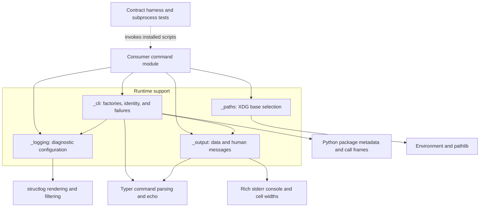
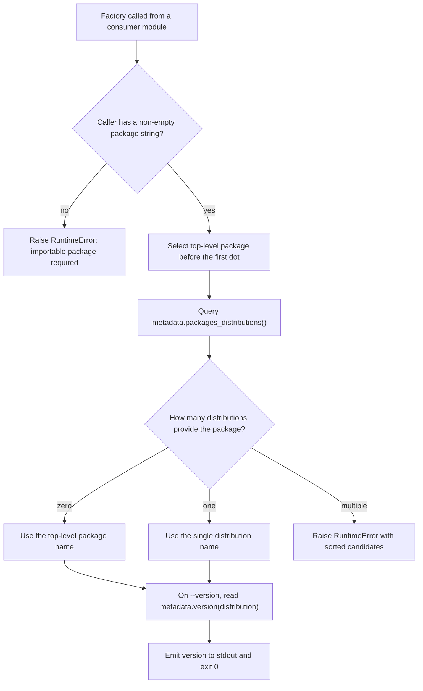
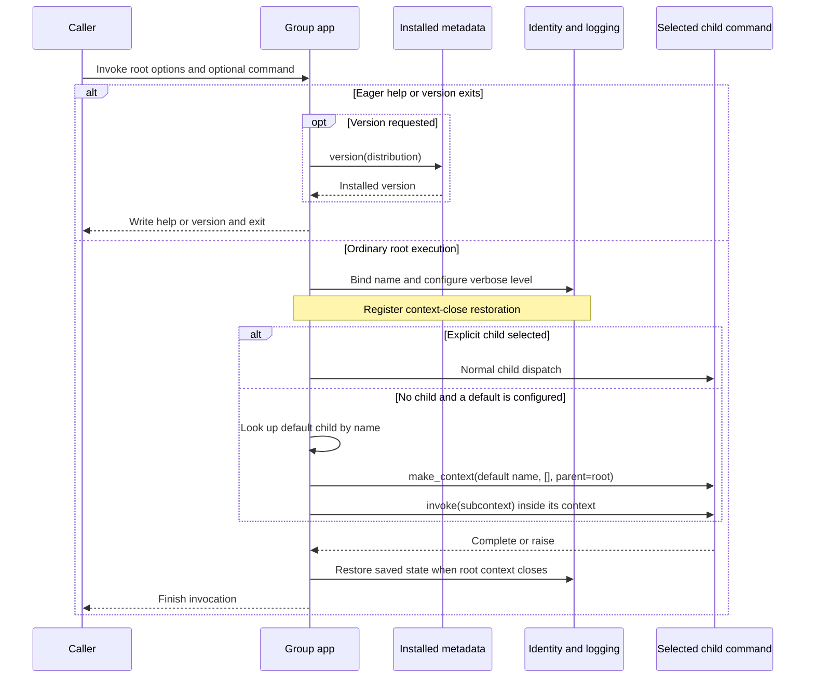
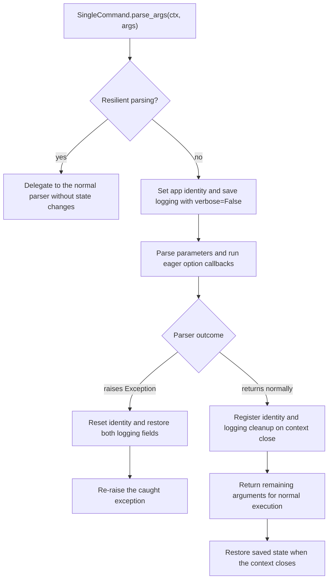
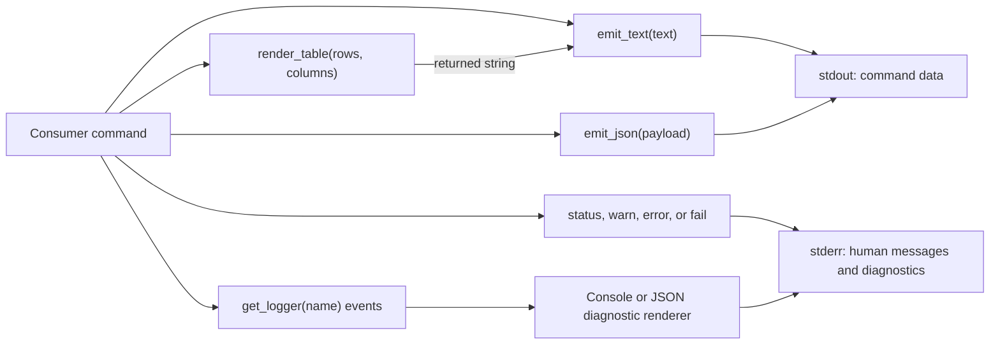

# Runtime support

The `rubio-cli-kit_runtime` module implements the shared behavior of consumer
Typer CLIs: application construction, version reporting, exit codes, diagnostic
logging, stdout/stderr separation, and XDG base-directory resolution. It lets
consumer packages own their commands without reimplementing the common CLI
contract.

This is a library layer, not an executable application. The kit's
`pyproject.toml` declares no console scripts; consumers register their own
installed entry points. For the broader system context, see the
[system overview](overview.md).

## Responsibilities and boundaries

The runtime owns:

- Two supported application shapes: a subcommand group and a single command
  whose arguments appear directly at the root.
- Shared `-h`/`--help`, `--version`, and `--verbose` behavior.
- A common exit-code vocabulary and a command-prefixed failure helper.
- Plain stdout data, human-facing stderr messages, and structlog diagnostics.
- Environment-aware XDG directory selection without filesystem mutation.

Consumer applications still own:

- Command registration, arguments, options, validation, and domain behavior.
- Console-script names, package metadata, and installation.
- Optional JSON-mode flags, payload schemas, and decisions about diagnostics.
- App-specific paths beneath XDG bases and any required directory creation.
- Handling expected exceptions and choosing when to call `fail()`.

The runtime does not import the contract harness or testing utilities. The
[contract harness](rubio-cli-kit_contract-harness.md) verifies the observable
CLI behavior, while the [testing utilities](rubio-cli-kit_testing.md) execute
installed consumer scripts in controlled subprocess environments.

## Architecture and dependencies



### Source map

All source paths are relative to the repository root.

| Source | Responsibility |
| --- | --- |
| `src/rubio_cli_kit/__init__.py` | Empty package initializer. |
| `src/rubio_cli_kit/_cli.py` | App shapes, identity, version, and failure. |
| `src/rubio_cli_kit/_logging.py` | structlog state, filtering, and rendering. |
| `src/rubio_cli_kit/_output.py` | Data emission, messages, and tables. |
| `src/rubio_cli_kit/_paths.py` | Environment-or-HOME path resolution. |

The empty initializer re-exports no helpers. Import functions from their
individual modules, for example `from rubio_cli_kit._cli import make_app`.
Importing `_cli` also imports `_logging`, which immediately configures
structlog; importing the empty package initializer alone does not do so.

### Packaging requirements

The repository's `pyproject.toml` declares the following runtime requirements:

| Requirement | Declared value | Runtime role |
| --- | --- | --- |
| Python | `>=3.14.6` | Interpreter and standard-library APIs. |
| Typer | `>=0.27.1` | CLI parsing, contexts, options, and exits. |
| Rich | `>=15.0.0` | Stderr presentation and display-cell widths. |
| structlog | `>=26.1.0` | Structured diagnostic logging. |

The distribution is named `rubio-cli-kit`, and its import package is
`rubio_cli_kit`. Hatchling builds the distribution. Pytest is a development
dependency, not a runtime dependency of these helpers. The `pytest11` entry
point belongs to the contract-harness integration rather than CLI startup.

Consumer projects participating in the contract must declare Typer directly
and import it in non-hook command entry-point modules. They use kit helpers
instead of directly importing Rich or structlog in those modules. See the
[contract harness](rubio-cli-kit_contract-harness.md) for the full policy and
[repository tooling](rubio-cli-kit_repository-tooling.md) for build and release
configuration.

## Application construction

Both factories in `src/rubio_cli_kit/_cli.py` return `typer.Typer` instances
backed by specialized subclasses.

```python
def make_app(
    *,
    name: str,
    help_text: str,
    default_command: str | None = None,
) -> typer.Typer: ...


def make_single_command_app(
    *,
    name: str,
    help_text: str,
) -> typer.Typer: ...
```

These signatures are reference declarations, not implementations.

### Shared root contract

Both shapes configure the following behavior:

- `-h` and `--help` are help aliases.
- `--version` is eager: it can exit before ordinary command execution and
  required-argument validation. It emits the installed consumer version and a
  newline to stdout, without a name prefix.
- `--verbose` enables DEBUG diagnostics on stderr. Without it, the factory
  establishes WARNING-level diagnostics for the invocation.
- Generated shell-completion options are disabled with `add_completion=False`.
- Typer's pretty exception rendering is disabled. This is not an exception
  recovery mechanism or an automatic conversion of exceptions to `fail()`.
- A bare invocation displays usage and exits with code `2`, unless a subcommand
  app has a configured default command.

Version callbacks do nothing during resilient parsing. The single-command
parser also bypasses its identity and logging changes in that mode. These
checks prevent those runtime effects during parser introspection; disabling
completion options is a separate factory setting.

### Choosing an application shape

| Concern | `make_app()` | `make_single_command_app()` |
| --- | --- | --- |
| Invocation | `tool [ROOT OPTIONS] COMMAND ...` | `tool [OPTIONS] ARGS...` |
| Registration | Consumer adds subcommands. | Consumer adds one command. |
| Root callback | Installed by the kit. | Not supported. |
| Bare invocation | Help, or a default child command. | Help and usage exit. |
| Shared options | Root callback parameters. | Injected command options. |

Use a group for multiple operations or a named default child. Use a single
command when its arguments should appear directly after the script name.
Neither factory accepts a version string or distribution-name override.

### Consumer example: a subcommand app

Construct the app inside an importable consumer module such as
`src/acme_tool/cli.py`:

```python
import typer

from rubio_cli_kit._cli import fail, make_app
from rubio_cli_kit._output import emit_text
from rubio_cli_kit._paths import xdg_dir

app = make_app(
    name="acme-tool",
    help_text="Inspect tool configuration.",
    default_command="show",
)


@app.command()
def show(check: bool = typer.Option(False, "--check")) -> None:
    directory = xdg_dir("XDG_CONFIG_HOME", ".config") / "acme-tool"
    if check and not directory.is_dir():
        fail(f"configuration directory does not exist: {directory}")
    emit_text(str(directory))
```

The consumer's `pyproject.toml` can expose the callable Typer app directly:

```toml
[project.scripts]
acme-tool = "acme_tool.cli:app"
```

After installing that consumer package, the supported forms include:

```bash
acme-tool --help
acme-tool --version
acme-tool
acme-tool show --check
acme-tool --verbose show
```

Here, a bare `acme-tool` invokes `show` with its defaults. Group-level options
belong before the subcommand, as in `--verbose show`; they are not automatically
added to every child's parameter list.

### Consumer example: a single-command app

In a separate consumer package, such as `src/acme_echo/cli.py`:

```python
from typing import Annotated

import typer

from rubio_cli_kit._cli import make_single_command_app
from rubio_cli_kit._output import emit_text

app = make_single_command_app(
    name="acme-echo",
    help_text="Write one value to stdout.",
)


@app.command()
def echo(value: Annotated[str, typer.Argument(help="Text to write.")]) -> None:
    emit_text(value)
```

Expose it as `acme-echo = "acme_echo.cli:app"` in the consumer's
`[project.scripts]`. The invocation is `acme-echo hello`, not
`acme-echo echo hello`. The command function declares only its own parameters;
`--version` and `--verbose` are injected without being passed into the function.
A bare invocation displays help with usage exit code `2`, while
`acme-echo --version` succeeds without the required `value` argument.

## Consumer identity and version resolution

The runtime separates the diagnostic program name from the installed
package's version identity.

- `name` is supplied by the consumer factory call. It becomes the error prefix
  during command execution; it is not derived dynamically from `argv[0]`.
- The distribution name is inferred at app construction from the package
  containing the factory call.
- The version string is fetched from installed metadata when `--version` is
  requested, not read from a copied constant or parsed from `pyproject.toml`.

### Distribution lookup process

`_importing_distribution_name()` inspects two frames above itself: its factory
caller, then the module calling that factory. It reads that module's
`__package__` and selects its top-level import package.



Important consequences:

- An import package such as `acme_tool` can resolve to an installed distribution
  such as `acme-tool`; the names need not be identical.
- Without a metadata mapping, the import name is only a fallback distribution
  name. It is not a fallback version, and the later version lookup can fail.
- Missing installed metadata propagates
  `importlib.metadata.PackageNotFoundError`. There is no source-manifest or
  development-version fallback.
- Calling a factory from a loose script without a non-empty `__package__`
  raises `RuntimeError`. Prefer an installed console entry point into an
  importable package.
- A shared wrapper that calls the factory changes which package is inspected.
  The resolver identifies the immediate factory-calling package, not an
  arbitrary outer application's package.
- Multiple distributions for the same top-level import package are rejected
  instead of selecting one arbitrarily.

`_print_version()` implements the group version exit through `typer.Exit`.
The generated single-command class uses its own callback and `ctx.exit()`.
Both emit only the metadata version followed by a newline and use exit code
`ExitCode.OK`.

## Subcommand application lifecycle

`make_app()` constructs `_SubcommandTyper` and immediately registers the kit's
root callback. That callback owns shared root options, invocation identity,
logging scope, and optional default-command dispatch.

`_SubcommandTyper.callback()` permits only the first callback registration.
Because the factory consumes that slot, a consumer's additional `@app.callback()`
raises `TypeError`. Put consumer behavior in commands rather than replacing
this shared root lifecycle.

### Invocation and default dispatch



For an ordinary root callback:

- `_bind_app_identity()` sets the `ContextVar` name and registers its reset with
  `ctx.call_on_close()`.
- `_bind_logging()` calls `configure(verbose=verbose)`, saves both previous
  logging fields, and registers their restoration on context close.
- If an explicit child is selected, the callback returns and normal Typer
  dispatch continues.
- If no default is configured, the callback does not perform manual dispatch.
  The factory's `no_args_is_help=True` supplies the bare-invocation behavior.

Help and version are eager parser paths, so the group root callback need not
run for those invocations. In particular, the group does not rely on root
identity or logging bindings to print a version.

### Default-command semantics

When `default_command` is not `None`, the factory sets
`invoke_without_command=True` and `no_args_is_help=False`. A bare invocation
then resolves that root child by name and invokes it with a newly parsed child
context, an empty argument list, and the root context as its parent.

This deliberately preserves normal child parsing:

- Optional child parameters receive their declared defaults.
- Required child arguments are still required and can produce usage errors.
- The default is a registered child name, not a Python function reference.
- No synthetic child arguments are forwarded. Root options remain root options.
- The child context is entered and closed around the explicit `invoke()` call.
- The root callback does not forward the child's return value to its caller.

A missing default child raises
`RuntimeError("default command is not registered: ...")`. A resolved object
without callable `make_context` and `invoke` methods raises
`RuntimeError("default command cannot be invoked: ...")`. These checks occur
when default dispatch is attempted, not during factory construction, and are
not converted to formatted `fail()` messages.

## Single-command application lifecycle

`make_single_command_app()` creates `_SingleCommandTyper` and a per-app
`TyperCommand` subclass returned by `_single_command_type()`. The generated
class closes over the consumer name and inferred distribution.

### Registration constraints

The consumer must register one command using `@app.command()`.
`_SingleCommandTyper` enforces these constraints:

- Additional command registrations after the first successful registration
  raise `TypeError`.
- Callbacks always raise `TypeError`.
- Passing `cls` to `.command()`, even to select a different command class, raises
  `TypeError`; the kit needs its generated class for parsing and root options.
- Command help defaults to the factory's `help_text`, unless explicitly supplied
  in the command decorator.

The factory initially returns an app with no consumer command; it does not
create a placeholder implementation. The consumer must complete registration
before invoking it.

When the generated Click/Typer command is constructed, it checks declared
option names for `--version` and `--verbose`. Collisions raise `TypeError`
before those shared options are appended. Because Typer materializes commands
later, this check may surface during invocation or help generation rather
than at the decorator line.

Both appended options are eager flags with `expose_value=False`. The version
callback exits after printing metadata; the verbosity callback updates logging.
Neither adds a keyword argument to the consumer command function.

### Parsing, early exits, and restoration

Unlike a group root callback, the generated command's `parse_args()` scopes
state around parsing itself. This covers eager options and parsing failures
that happen before the consumer function runs.



The initial `configure(verbose=False)` establishes the non-verbose baseline
while preserving the existing JSON-diagnostic setting. An eager `--verbose`
callback can then enable DEBUG. If parsing raises an `Exception`, state is
restored immediately before re-raising; on a normal parse, cleanup is attached
to the context instead. This is particularly important for repeated in-process
invocations and nested command execution.

The exception guard catches `Exception`, not every `BaseException`. It is not
a general cancellation, thread-safety, or arbitrary-failure guarantee.

## Exit codes, failures, and invocation identity

`ExitCode` is an `IntEnum` with the shared process-status vocabulary:

| Member | Value | Intended meaning |
| --- | --- | --- |
| `ExitCode.OK` | `0` | Successful execution. |
| `ExitCode.RUNTIME` | `1` | Runtime or domain failure. |
| `ExitCode.USAGE` | `2` | Invalid invocation or usage. |

```python
def prog_name() -> str: ...


def fail(
    message: str,
    *,
    code: ExitCode = ExitCode.RUNTIME,
) -> NoReturn: ...
```

`prog_name()` reads `_PROG`, a `ContextVar` whose default is `"command"`.
`_set_app_identity()` sets the name and returns a closure that resets the exact
context token. The invocation scopes described above arrange for that reset;
nested sequential contexts can therefore restore their enclosing identity.

`fail(message)` performs two actions:

- Calls `_output.error()` with `f"{prog_name()}: {message}"` on stderr.
- Raises `typer.Exit(code)` and never returns normally.

For example, `fail("configuration missing")` under an app named `acme-tool`
writes `acme-tool: configuration missing` to stderr and exits with code `1`.
The helper itself writes no stdout and adds no `error:` prefix. It cannot undo
data the consumer has already emitted, so validate before writing results when
failure must leave stdout empty.

An explicit `code=ExitCode.USAGE` selects code `2`; the enum is a convention,
not a separate exception-classification mechanism. Normal argument errors
remain Typer's responsibility. Unexpected exceptions, metadata failures, and
invalid app configuration are not automatically routed through `fail()`.
Calling `fail()` outside an active app identity uses the `command` prefix.

## Diagnostic logging

`src/rubio_cli_kit/_logging.py` manages process-wide structlog configuration.
It calls `configure()` at module import, establishing WARNING-level,
human-readable stderr logging by default.

```python
def configure(
    *,
    verbose: bool | None = None,
    json_output: bool | None = None,
) -> _LogState: ...


def get_logger(name: str) -> structlog.typing.FilteringBoundLogger: ...
```

### Configuration state and processor pipeline

`_LogState` is a dataclass containing `verbose=False` and `json_output=False`.
`configure()` returns an independent snapshot of the previous state, produced
with `dataclasses.replace()`.

- A `None` argument preserves the corresponding current field.
- Passing `False` explicitly disables that setting.
- A no-argument call reapplies the current state rather than resetting defaults.
- Every call rebuilds the global structlog configuration.

The configured pipeline is:

| Setting | Behavior |
| --- | --- |
| All modes | Add the log level to each event. |
| `json_output=False` | Render with `structlog.dev.ConsoleRenderer`. |
| `json_output=True` | Format exceptions, then use `JSONRenderer`. |
| `verbose=False` | Filter below `logging.WARNING`. |
| `verbose=True` | Filter below `logging.DEBUG`. |
| Destination | `PrintLoggerFactory(file=sys.stderr)`. |
| Lazy logger caching | `cache_logger_on_first_use=False`. |

At the default level, DEBUG and INFO diagnostics are suppressed, while WARNING
and ERROR remain visible. `--verbose` enables both DEBUG and INFO; it does not
redirect diagnostics to stdout.

`get_logger(name)` delegates to `structlog.get_logger(name)` and returns the
logger through the declared filtering-logger interface. Lazy logger caching
is disabled so first use does not permanently cache the current configuration
on that proxy. This module does not configure the standard library's root
logger with `logging.basicConfig()` or install a stdlib-to-structlog bridge.

### Scoped configuration example

```python
from rubio_cli_kit._logging import configure, get_logger

log = get_logger(__name__)
previous = configure(verbose=True, json_output=True)
try:
    log.debug("configuration_selected", source="environment")
finally:
    configure(
        verbose=previous.verbose,
        json_output=previous.json_output,
    )
```

Factory-managed invocation scopes use the same snapshot-and-restore pattern.
They restore the two kit-owned fields, not an arbitrary pre-existing structlog
processor configuration. In particular, importing or configuring this module
replaces the global structlog setup for the process.

### Scope and concurrency limits

Invocation identity is context-local, but `_STATE` and structlog configuration
are process-global and have no per-invocation lock or context-local renderer.
Sequential and nested CLI invocations can restore saved settings; concurrent
invocations cannot safely assume independent verbosity or JSON settings.
Use subprocess isolation when independent logging configurations are required.

Setting `json_output=True` affects diagnostics only. It does not serialize
stdout data, add a `--json` option, or transform `status()`, `warn()`, `error()`,
or `fail()` into structured log events.

## Output discipline and data flow

`src/rubio_cli_kit/_output.py` implements the separation between data and
operational messages. Stdout helpers use plain `typer.echo`; Rich is used for
human-facing stderr messages, not for stdout tables or JSON.



### Data emitters

`emit_text(text: str) -> None` writes the supplied text to stdout with
`typer.echo()`, including its normal terminating newline. It adds no Rich
markup, table borders, width-based wrapping, or status prefix.

`emit_json(payload: object) -> None` serializes using
`json.dumps(payload, indent=2, allow_nan=False)` and echoes the resulting string
to stdout with a newline.

- Output is indented JSON, not line-delimited JSON.
- NaN and infinite float values are rejected with `ValueError`.
- Unsupported objects produce the standard serializer's `TypeError`.
- Serialization happens before the echo, so serialization errors do not emit a
  partial JSON document through this helper.
- Serialization errors propagate; the helper does not call `fail()` or enforce
  an application-specific schema.

A command must emit one complete response if its entire stdout is intended to
be one JSON document. Calling `emit_text()` alongside `emit_json()`, or emitting
multiple JSON documents, can invalidate that wire format.

### Human-facing stderr helpers

The shared Rich console is configured with `stderr=True`, `highlight=False`,
`markup=False`, and `soft_wrap=True`. Messages are not interpreted as Rich
markup and are not subjected to Rich's usual width-based wrapping or cropping.
The explicit warning/error styles remain available when color is supported.

| Helper | Message treatment | Exits? |
| --- | --- | --- |
| `status(message)` | Print without an added prefix. | No. |
| `warn(message)` | Add `warning:` and a space; yellow style. | No. |
| `error(message)` | Apply bold red style without a prefix. | No. |
| `fail(message)` | Add app prefix, call `error()`, raise exit. | Yes. |

These functions do not pass through structlog's level filter. For example,
`status()` prints even when logging is at WARNING. Likewise, `error()` alone
does not set a nonzero process exit status.

### Plain-text table rendering

```python
def render_table(
    rows: Sequence[Mapping[str, str]],
    columns: Sequence[tuple[str, str]],
) -> str: ...
```

Each column is a `(row_key, header)` pair. The renderer:

- Preserves the supplied column and row order.
- Initializes each width from its header, then widens it for all row values.
- Uses `rich.cells.cell_len()` for terminal display-cell widths rather than
  Python string lengths, accommodating wide and combining Unicode characters.
- Treats missing row keys as empty strings.
- Separates padded columns with two spaces and strips trailing whitespace from
  each rendered line.
- Joins the rendered header and data lines with newline separators and returns
  the string instead of printing it. An empty row list still yields the header.

```python
from rubio_cli_kit._output import emit_text, render_table

rows = [{"name": "alpha", "state": "ready"}]
columns = [("name", "NAME"), ("state", "STATE")]
emit_text(render_table(rows, columns))
```

Values are expected to be strings as annotated. The helper is not a rich-table
layout engine: it does not sort rows, truncate cells, wrap long values, or
normalize embedded control characters and multiline content.

### Application-owned JSON mode

The factories deliberately do not install `--json`. A consumer that supports
machine-readable output declares that option, chooses its payload schema, and
calls `emit_json()`. If JSON diagnostics are also desired, it separately calls
`configure(json_output=True)` within an appropriate restoration scope.

JSON diagnostic rendering does not guarantee empty stderr: warnings, verbose
logs, and human-message helpers can still write there. Successful JSON contract
scenarios require parseable stdout and empty stderr, so consumers must avoid
unnecessary diagnostics on that path. Unsupported JSON mode remains an
ordinary usage error. The complete test requirements live in the
[contract harness](rubio-cli-kit_contract-harness.md).

## XDG base-directory resolution

`src/rubio_cli_kit/_paths.py` provides one generic resolver:

```python
def xdg_dir(env_var: str, *fallback: str) -> pathlib.Path: ...
```

Resolution follows this exact precedence:

- Read `os.environ.get(env_var)`.
- If the value is non-empty and `Path(value).is_absolute()`, return that path.
- Otherwise, return `Path.home().joinpath(*fallback)`.

Empty or relative overrides are ignored. Relative paths are not interpreted
against the working directory. A literal `~` is not expanded in an override,
and environment-variable references inside an override are not interpolated.
Path interpretation uses the host platform's `pathlib.Path` semantics.

The caller supplies the XDG convention it needs:

```python
from rubio_cli_kit._paths import xdg_dir

config = xdg_dir("XDG_CONFIG_HOME", ".config")
data = xdg_dir("XDG_DATA_HOME", ".local", "share")
state = xdg_dir("XDG_STATE_HOME", ".local", "state")
cache = xdg_dir("XDG_CACHE_HOME", ".cache")

app_config = config / "acme-tool"
```

For example, with `HOME=/tmp/cli-home`:

| `XDG_CONFIG_HOME` | Result of the config call above |
| --- | --- |
| `/srv/cli-config` | `/srv/cli-config` |
| Unset or empty | `/tmp/cli-home/.config` |
| `relative/config` | `/tmp/cli-home/.config` |
| `~/.alternate` | `/tmp/cli-home/.config` |

The function does not create directories, check existence or permissions,
append an application name, expand user references, or resolve filesystem
symlinks. There is no fixed allowlist of XDG variable names or built-in default
mapping. Use relative fallback components, append the app-specific suffix, and
perform any required `mkdir()` explicitly in the consumer.

## Verification and maintenance guidance

The runtime supplies behavior; the harness observes it through installed
consumer console scripts. Relevant integration checks include:

- Help aliases, root-option visibility, and exact installed-version output.
- Bare-invocation usage behavior or parity with an explicit default child.
- Usage errors with code `2` and runtime failures with code `1`.
- Clean JSON responses when supported and rejection when unsupported.
- Stdout/stderr separation across successful and failing scenarios.

See the [contract harness](rubio-cli-kit_contract-harness.md) for contract rows,
project validation, and generated assertions. See the
[testing utilities](rubio-cli-kit_testing.md) for HOME/XDG/PATH isolation,
subprocess capture, fake executables, and local HTTP test servers. Those pages
own the detailed APIs rather than duplicating them here.

The repository test task is defined in `mise.toml`:

```bash
mise run test
```

It runs `uv run --frozen pytest --junitxml=reports/test/junit.xml`.
`.github/workflows/test-gate.yml` executes defined lifecycle tasks and requires
JUnit evidence with at least one test case and no failures or errors for test
and e2e tasks. Setup, formatting, release automation, and CI gate details are
documented in [repository tooling](rubio-cli-kit_repository-tooling.md).

When changing the runtime, preserve these coupling points:

- Factory calls must still resolve the consumer's installed distribution, not
  the kit's version or the script's display name.
- Group callbacks and generated single-command parsing are different lifecycle
  mechanisms; test eager exits and state restoration for both shapes.
- Default dispatch must retain child argument parsing rather than directly
  calling a consumer Python function.
- Shared single-command flags must remain absent from consumer signatures and
  protected against declared-option collisions.
- Changes to `_LogState` must be reflected in every snapshot-restoration path.
- Machine output must remain independent of Rich presentation and diagnostic
  renderer selection.
- XDG resolution must remain a selection operation without filesystem mutation.

## Common integration failures

| Symptom | Likely cause or corrective action |
| --- | --- |
| Factory requires an importable package. | Construct the app in a package. |
| Version metadata is missing. | Install the constructing consumer. |
| Version belongs to a shared library. | A wrapper calls the factory. |
| Distribution ownership is ambiguous. | Resolve the competing installations. |
| Callback raises `TypeError`. | The shape reserves callbacks. |
| Single-command options collide. | Remove consumer version/verbose options. |
| Bare default invocation fails. | Check the child name and arguments. |
| JSON succeeds with non-empty stderr. | Audit logs and human-message helpers. |
| Logging settings interfere. | Avoid concurrent global reconfiguration. |
| Relative XDG override is ignored. | Supply an absolute base directory. |

Source of runtime behavior: `src/rubio_cli_kit/_cli.py`,
`src/rubio_cli_kit/_logging.py`, `src/rubio_cli_kit/_output.py`, and
`src/rubio_cli_kit/_paths.py`. Packaging and test integration are defined by
`pyproject.toml`, `mise.toml`, and `.github/workflows/test-gate.yml`.
