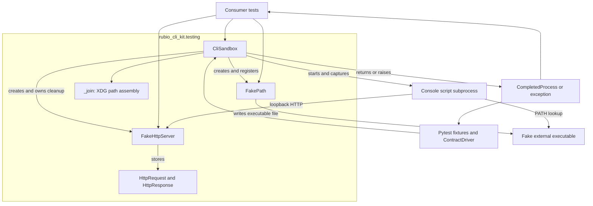
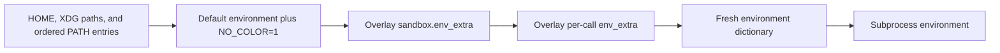
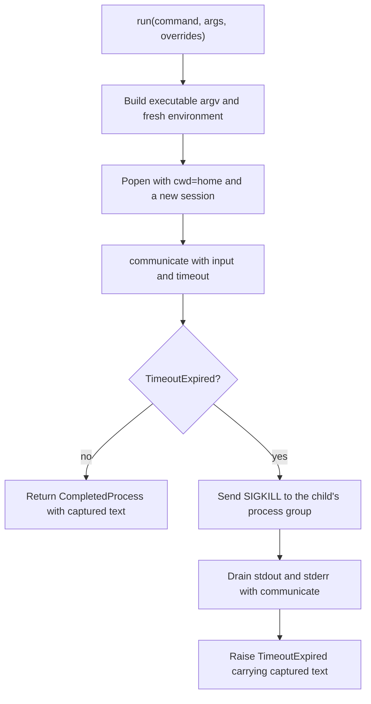
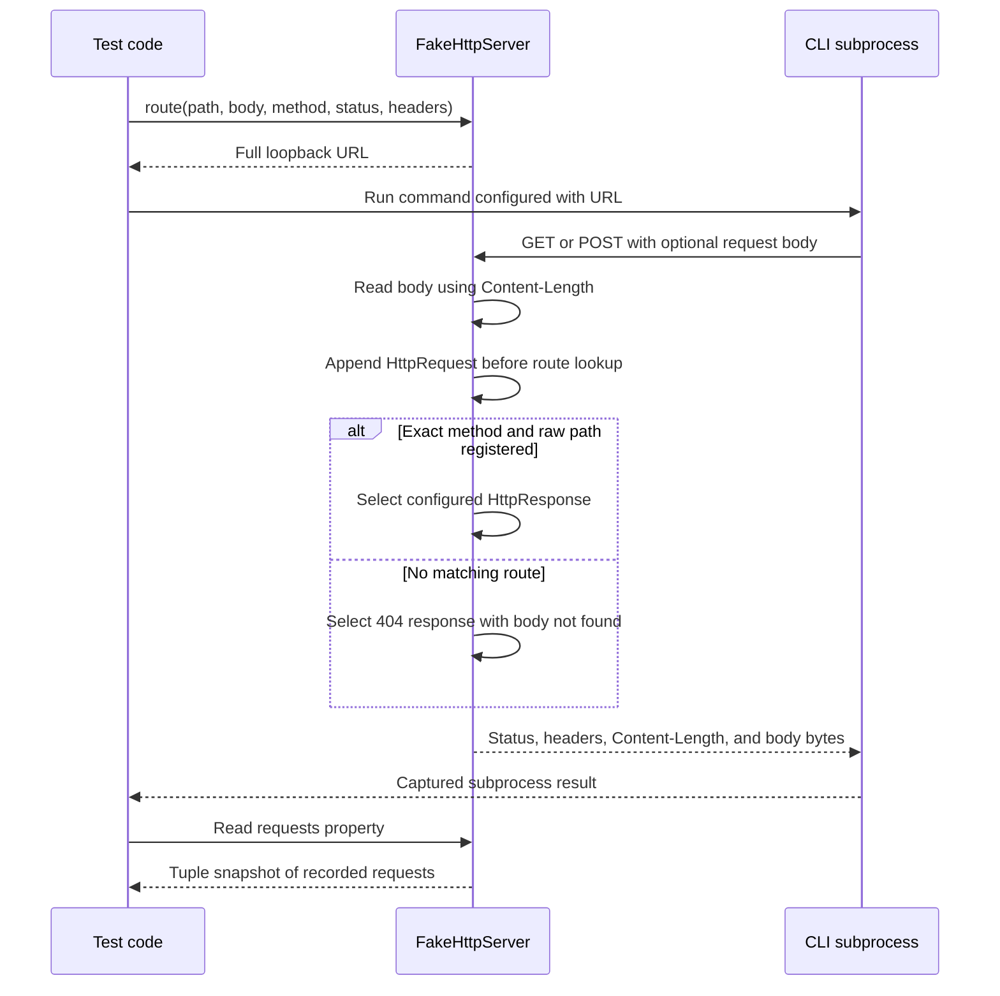

# Testing utilities

The `rubio-cli-kit_testing` module provides controlled subprocess environments
and local fakes for CLI contract tests and consumer-specific integration tests.
It runs actual console scripts, captures their observable behavior, and lets
tests replace external executables and HTTP services without importing command
callbacks into the test process.

The implementation lives in `src/rubio_cli_kit/testing.py`. Import its public
helpers from `rubio_cli_kit.testing`. The module uses only Python's standard
library and can be used directly without pytest.

## Scope and system integration

This module owns the execution mechanics:

- A sandbox-local HOME, XDG directory layout, and controlled subprocess PATH.
- Console-script execution with text output capture and process-group timeout
  handling.
- Shell-script substitutes for external programs, including argument recording.
- A loopback HTTP server with fixed responses and captured requests.
- Explicit cleanup callbacks for resources created during test setup.

It does not decide which CLI behaviors are correct. The
[contract harness](rubio-cli-kit_contract-harness.md) supplies pytest fixtures,
scenario descriptions, generated tests, and assertions. Consumer tests can use
these same utilities for behavior outside the shared contract.

The [runtime module](rubio-cli-kit_runtime.md) implements the CLI conventions
being exercised, including output, exit codes, logging, and XDG resolution.
The testing utilities do not import that runtime; the command under test may
use it in its own process. See the [system overview](overview.md) for the
broader package design and
[repository tooling](rubio-cli-kit_repository-tooling.md) for build and CI
policy.

## Architecture and dependencies



The diagram combines component dependencies with runtime interactions. The
console script is a separate process, while the HTTP server runs inside the
test process on a background thread.

### Component map

| Component | Responsibility |
| --- | --- |
| `CliSandbox` | Build environments, run processes, and manage callbacks. |
| `FakePath` | Write shell executables into a chosen directory. |
| `FakeHttpServer` | Serve fixed HTTP routes and record handled requests. |
| `HttpRequest` | Store method, raw path, body bytes, and request headers. |
| `HttpResponse` | Store status, body bytes, and response headers. |
| `_join` | Append path components without filesystem operations. |

### Implementation dependencies

- `subprocess`, `os`, and `signal` provide execution, environments, sessions,
  and process-group termination.
- `shlex` and `stat` support shell-safe generated values and executable bits.
- `http.server` and `threading` provide the local HTTP service.
- `dataclasses` define sandbox state and the small path and HTTP models.
- `pathlib.Path` supplies the path objects passed by callers. Path and
  collection annotations are imported under `TYPE_CHECKING`.

There are no imports from pytest, Typer, Rich, structlog, or other kit modules
in `testing.py`. Pytest integration belongs to
`src/rubio_cli_kit/pytest_plugin.py`; behavioral assertions belong to
`src/rubio_cli_kit/_contract_driver.py`.

## Getting started

When the contract-harness plugin is loaded, tests can request these fixtures:

| Fixture | Value or behavior |
| --- | --- |
| `home` | An empty `tmp_path / "home"` directory. |
| `cli_env` | A `CliSandbox`, closed during fixture teardown. |
| `cli` | The bound `cli_env.run` method. |
| `fake_path` | The sandbox's default fake-executable directory. |
| `fake_http_server` | An independently managed local HTTP server. |

The plugin sets `scripts_dir` to `Path(sys.executable).parent`, so the consumer
console script must be installed beside the interpreter running the tests.
For example, assuming the consumer installs an `acme-tool` script:

```python
from rubio_cli_kit.testing import CliSandbox


def test_help(cli_env: CliSandbox) -> None:
    result = cli_env.run("acme-tool", "--help")

    assert result.returncode == 0, result.stderr
    assert "Usage" in result.stdout
    assert result.stderr == ""
```

With the `cli` fixture, the equivalent call is `cli("acme-tool", "--help")`.
Plugin activation, project participation, and contract-table configuration are
covered by the [contract harness](rubio-cli-kit_contract-harness.md).

Without the plugin, construct `CliSandbox(home=..., scripts_dir=...)` directly,
create the HOME directory yourself, and call `close()` in a `finally` block.
The standalone fake-dependency example below demonstrates that lifecycle.
There is no context-manager interface on these classes.

## CliSandbox

### State and construction

`CliSandbox` is a mutable dataclass with the following constructor fields:

| Field | Type | Default |
| --- | --- | --- |
| `home` | `Path` | Required. |
| `scripts_dir` | `Path` | Required. |
| `path_prepend` | `list[Path]` | New empty list. |
| `env_extra` | `dict[str, str]` | New empty dictionary. |
| `cleanup_callbacks` | `list[Callable[[], None]]` | New empty list. |

`home` is both the default HOME/XDG root and the subprocess working directory.
`scripts_dir` identifies the directory containing the entry point to execute.
Use absolute paths for both: subprocess execution changes the working
directory to `home`, so relative executable paths can resolve unexpectedly.

Construction does not create directories, install scripts, copy configuration,
or modify the parent process environment. Each sandbox receives independent
mutable default collections. Repeated `run()` calls share the same HOME,
filesystem changes, and registered resources; execution does not reset them.

### XDG path construction

Each helper appends its `*parts: str` arguments to a fixed base beneath
`sandbox.home` and returns a `Path`:

| Helper | Base path |
| --- | --- |
| `xdg_config_path(*parts)` | `home / ".config"` |
| `xdg_data_path(*parts)` | `home / ".local" / "share"` |
| `xdg_state_path(*parts)` | `home / ".local" / "state"` |
| `xdg_cache_path(*parts)` | `home / ".cache"` |

For example, prepare application configuration explicitly:

```python
config = cli_env.xdg_config_path("acme-tool", "settings.toml")
config.parent.mkdir(parents=True, exist_ok=True)
config.write_text('mode = "test"\n')
```

The internal `_join(root, parts)` repeatedly applies pathlib's `/` operator.
It does not create, resolve, validate, or confine paths. Absolute components
and `..` retain their normal pathlib semantics; use trusted test inputs.

These helpers always use the sandbox's `home` attribute. Overriding an XDG
environment variable does not change the corresponding helper's result.
For the application's environment-aware XDG lookup, see the
[runtime module](rubio-cli-kit_runtime.md).

### Environment composition

`environ(*, path_prepend=(), env_extra=None)` returns a fresh `dict[str, str]`.
It constructs an environment from scratch rather than copying `os.environ`.

| Default key | Value |
| --- | --- |
| `HOME` | `str(sandbox.home)` |
| `XDG_CONFIG_HOME` | `str(sandbox.xdg_config_path())` |
| `XDG_DATA_HOME` | `str(sandbox.xdg_data_path())` |
| `XDG_STATE_HOME` | `str(sandbox.xdg_state_path())` |
| `XDG_CACHE_HOME` | `str(sandbox.xdg_cache_path())` |
| `NO_COLOR` | `"1"` |
| `PATH` | The ordered search path described below. |

PATH entries are joined using `os.pathsep`, in this order:

- Entries supplied through the current call's `path_prepend`.
- Entries stored in `sandbox.path_prepend`, preserving list order.
- `sandbox.scripts_dir`.
- `SYSTEM_PATH`: `/usr/bin`, `/bin`, `/usr/sbin`, and `/sbin`, in that order.

The resulting defaults are overlaid first with `sandbox.env_extra`, then with
the current call's `env_extra`. Later values replace earlier values:



Per-call additions do not mutate the sandbox's persistent settings. For
example, an application-specific endpoint can be supplied to one invocation:

```python
result = cli_env.run(
    "acme-tool",
    "fetch",
    env_extra={"ACME_API_URL": "http://127.0.0.1:12345/items"},
)
```

Here, `fetch` and `ACME_API_URL` illustrate a consumer-owned command and setting;
they are not features supplied by the kit.

Important consequences of this composition are:

- Parent credentials, proxy settings, `PYTHONPATH`, locale variables, and
  arbitrary PATH additions are not automatically forwarded.
- Required values such as `LANG`, `LC_ALL`, `TZ`, or application credentials
  must be added deliberately when a test depends on them.
- An explicit `PATH` override in `env_extra` replaces the entire constructed
  PATH, including fake directories and `scripts_dir`.
- An explicit `HOME` override changes that environment variable only. It does
  not move the working directory or recompute the other default XDG values.
- Calling `environ()` itself does not create any of the referenced paths.

### Subprocess execution

The public execution signature is:

```python
def run(
    self,
    command: str,
    *args: str,
    path_prepend: Sequence[Path] = (),
    env_extra: Mapping[str, str] | None = None,
    input_text: str | None = None,
    timeout: float = DEFAULT_TIMEOUT_SECONDS,
) -> subprocess.CompletedProcess[str]: ...
```

This is a reference signature. `DEFAULT_TIMEOUT_SECONDS` is `30.0`.

The executable is `str(sandbox.scripts_dir / command)`, followed by the provided
argument strings. The top-level command is not located through PATH. Fake
PATH entries therefore replace programs launched by the CLI, not the initial
CLI entry point. Supplying a different `scripts_dir` is the normal way to
change that entry point's location.

Arguments are passed directly to `subprocess.Popen` without a shell. Spaces,
quotes, glob patterns, and shell operators are literal argument content;
`run("tool", "a b")` passes one argument after the executable. The executable
name and path components are not validated or restricted to the scripts
directory, so they must be trusted test inputs.

Execution uses:

- `cwd=sandbox.home` and the environment returned by `environ()`.
- Separate stdout and stderr pipes with `text=True`.
- A stdin pipe only when `input_text` is not `None`; otherwise stdin is
  inherited rather than replaced with an empty stream.
- `start_new_session=True` to establish a separate session/process group.
- `communicate(input=input_text, timeout=timeout)` to exchange input and drain
  captured output.

An empty `input_text=""` still creates a pipe and closes it after sending no
content, which is useful when the command should observe EOF. Text encoding
and decoding use subprocess defaults; the module does not specify an encoding.



On ordinary completion, the returned `CompletedProcess[str]` contains:

- `args`: the full executable path and argument list.
- `returncode`: the child's exit status.
- `stdout` and `stderr`: separate captured strings.

Nonzero exits do not raise `CalledProcessError`. Tests or the contract driver
must assert the desired return code and output themselves. Beyond subprocess
text-mode newline handling, the sandbox does not normalize output, parse JSON,
or validate CLI contracts.

On timeout, the sandbox sends `SIGKILL` through `os.killpg(process.pid, ...)`,
then drains the pipes and raises a new `subprocess.TimeoutExpired` containing
the captured stdout and stderr. There is no graceful-termination interval.
The final drain has no additional timeout.

A process-group disappearance race is tolerated only when `process.poll()`
confirms that the direct child has exited. Otherwise the `ProcessLookupError`
is re-raised. Other launch and OS errors propagate normally; for example,
a missing executable or working directory can raise `FileNotFoundError`
before output collection begins.

## FakePath

`FakePath(path: Path)` is a frozen dataclass identifying a directory for fake
external binaries. Freezing prevents field reassignment, not filesystem writes.

`sandbox.fake_path(dirname="fake-bin")` returns a `FakePath` rooted at
`sandbox.home / dirname`. It appends that path to `sandbox.path_prepend` if it
is not already present. Repeated calls with the same path do not add duplicate
entries; a newly named directory is appended after existing fake directories.
The directory is created when an executable is written, not by `fake_path()`.

Constructing `FakePath` directly does not register it with any sandbox. Add its
path through `path_prepend` yourself when it should participate in PATH lookup.

### Writing custom executables

`executable(name: str, body: str) -> Path` writes a script with:

- A `#!/bin/sh` shebang.
- The supplied body with trailing whitespace removed, followed by one newline.
- User, group, and other executable bits added to its existing mode.

The base directory is created with `parents=True, exist_ok=True`, and an
existing script at the target path is overwritten. The returned value is the
script path. The body is executable shell code, not escaped data; use it only
with trusted test content. Names are also ordinary path components, not
sanitized command identifiers.

### Recording executable calls

`recording_executable()` creates a script that records arguments, emits fixed
output, and exits with a selected status:

```python
def recording_executable(
    self,
    name: str,
    argv_log: Path,
    *,
    exit_code: int = 0,
    stdout: str = "",
    stderr: str = "",
) -> Path: ...
```

Each invocation appends NUL-delimited fields to `argv_log`:

```text
argument-count\0argument-1\0argument-2\0...
```

The count comes from shell `$#`; the subsequent fields come from `"$@"`.
The executable name, `$0`, is not recorded. The leading count makes multiple
appended invocations distinguishable, including calls with zero arguments or
empty-string arguments. Read the file as bytes rather than splitting lines.

The log filename and configured stdout/stderr are quoted with `shlex.quote`.
Output uses `printf %s`, so no newline is added unless it appears in the supplied
string. Empty output strings emit nothing. The log's parent directory must
already exist; only the fake-binary directory is created automatically. Prefer
an absolute log path because the script resolves relative paths in its working
directory. Concurrent writes to a shared log have no explicit synchronization.

### Standalone fake-dependency example

This complete test creates a small stand-in for an installed CLI. The top-level
script is executed from `scripts_dir`; its `helper` dependency is resolved
through the fake PATH directory:

```python
from pathlib import Path

from rubio_cli_kit.testing import CliSandbox, FakePath


def test_fake_dependency(tmp_path: Path) -> None:
    home = tmp_path / "home"
    home.mkdir()
    scripts_dir = tmp_path / "scripts"
    FakePath(scripts_dir).executable(
        "example-cli",
        'helper status "two words"',
    )
    sandbox = CliSandbox(home=home, scripts_dir=scripts_dir)
    argv_log = home / "helper.argv"

    try:
        sandbox.fake_path().recording_executable(
            "helper",
            argv_log,
            stdout="ready\n",
        )
        result = sandbox.run("example-cli")

        assert result.returncode == 0, result.stderr
        assert result.stdout == "ready\n"
        assert result.stderr == ""
        assert argv_log.read_bytes().split(b"\0") == [
            b"2",
            b"status",
            b"two words",
            b"",
        ]
    finally:
        sandbox.close()
```

An application that invokes an external program by an absolute path will not
use this substitution. Likewise, PATH fakes do not affect in-process library
calls. Temporary-directory ownership, not `FakePath`, removes generated files.

## FakeHttpServer and HTTP records

### Startup and data models

`FakeHttpServer()` immediately creates a `ThreadingHTTPServer` bound to
`127.0.0.1` on port `0`, letting the OS choose an available port. It starts
`serve_forever()` on a daemon thread and suppresses the handler's ordinary
request-log output.

The server stores two frozen dataclass models:

| Model | Fields |
| --- | --- |
| `HttpRequest` | `method`, `path`, `body`, `headers` |
| `HttpResponse` | `status`, `body`, `headers` |

`HttpRequest.method` and `.path` are strings; `.body` is bytes.
`HttpResponse.status` is an integer, and `.body` is bytes. Both models annotate
headers as `Mapping[str, str]`. Frozen dataclasses prevent field reassignment,
but do not make a supplied header mapping deeply immutable.

### Route registration and matching

Register a fixed response with:

```python
def route(
    self,
    path: str,
    body: str | bytes,
    *,
    method: str = "GET",
    status: int = 200,
    headers: Mapping[str, str] | None = None,
) -> str: ...
```

Registration performs the following operations:

- Uppercase the method and reject anything outside `GET` and `POST`.
  `SUPPORTED_HTTP_METHODS` contains exactly those two methods.
- Prefix the path with `/` if it does not already start with one.
- Encode a string body as UTF-8; retain a bytes body unchanged.
- Store an `HttpResponse` under the exact `(method, normalized_path)` key.
- Return the full loopback URL for that path.

Registering the same key again replaces its response. Different methods can
have different responses at the same path. An unsupported registration raises
`ValueError`, with a message such as
`unsupported HTTP method 'PUT'; expected one of: GET, POST`.

`url(path="/") -> str` constructs a URL without registering a route. It applies
the same leading-slash rule and returns
`http://127.0.0.1:<assigned-port><normalized-path>`.

Matching uses `BaseHTTPRequestHandler.path` unchanged, including its query
string. `/items`, `/items/`, and `/items?limit=1` are distinct keys. There is no
query parsing, URL encoding, wildcard matching, callback dispatch, or response
queue. Configure routes before starting the client operation.

### Request and response flow



For each handled GET or POST, the server reads exactly the declared
`Content-Length`, or no body when that header is absent or empty. It records
the method, raw request path, body bytes, and a dictionary of header items.
An unmatched request is still recorded and receives status `404`, body
`b"not found"`, and no route-specific headers.

The response includes the configured headers and an automatically calculated
`Content-Length`, in addition to headers generated by the standard handler.
Do not supply your own `Content-Length`, as that would add a duplicate header.

The `requests` property returns a new tuple snapshot of the accumulated request
list. There is no public clear/reset method. The header dictionary is an
ordinary mapping, not a case-insensitive HTTP header wrapper. Inspect captured
requests after the relevant client operation completes. Since request handling
is threaded and there is no explicit application-level synchronization, tests
should not depend on a deterministic order for concurrent requests.

Only GET and POST have custom handlers. Other incoming methods use the base
handler's unsupported-method behavior, normally status `501`, and are not
captured by this module's request-recording function. This is different from
registering an unsupported method, which raises `ValueError` immediately.

### Subprocess HTTP example

This example uses the current interpreter as a small HTTP client, avoiding any
assumption about a consumer's option names. In a consumer test, replace that
invocation with the installed console script and pass the returned endpoint
through the option or environment variable that the application actually uses.

```python
import sys
from pathlib import Path

from rubio_cli_kit.testing import CliSandbox


def test_http_transport(cli_env: CliSandbox) -> None:
    server = cli_env.fake_http_server()
    endpoint = server.route(
        "/events?source=test",
        '{"accepted": true}\n',
        method="POST",
        status=201,
        headers={"Content-Type": "application/json"},
    )
    client_code = (
        "import sys, urllib.request\n"
        "request = urllib.request.Request(\n"
        "    sys.argv[1], data=b'payload', method='POST'\n"
        ")\n"
        "with urllib.request.urlopen(request) as response:\n"
        "    print(response.status)\n"
        "    print(response.read().decode(), end='')\n"
    )
    result = cli_env.run(
        Path(sys.executable).name,
        "-c",
        client_code,
        endpoint,
    )

    assert result.returncode == 0, result.stderr
    assert result.stdout == '201\n{"accepted": true}\n'
    (request,) = server.requests
    assert request.method == "POST"
    assert request.path == "/events?source=test"
    assert request.body == b"payload"
```

Because the server was created through `cli_env.fake_http_server()`, its
`close()` callback is registered with the sandbox and runs at fixture teardown.
The separate `fake_http_server` fixture is also available when a test does not
need sandbox-owned server cleanup.

## Resource lifetime and cleanup

`add_cleanup(callback: Callable[[], None])` appends a zero-argument callback.
`CliSandbox.close()` executes callbacks in reverse registration order, so later
resources are released before earlier ones.

Cleanup follows this policy:

- Attempt every registered callback even if an earlier callback raises an
  ordinary `Exception`.
- Collect those exceptions in callback execution order.
- Clear the callback list after all callbacks have been attempted.
- If errors occurred, raise one `RuntimeError` whose message begins with
  `CliSandbox cleanup failed:` followed by a space. Exception messages are
  separated by a semicolon and a space.

Failed callbacks are not retained for retry. A second `close()` has no callbacks
to execute unless new ones were registered. `BaseException` subclasses such as
`KeyboardInterrupt` are not included in the exception-aggregation policy.

Resource ownership depends on how a resource was obtained:

| Creation path | Cleanup owner |
| --- | --- |
| `cli_env` fixture | Plugin calls `sandbox.close()` in `finally`. |
| `sandbox.fake_http_server()` | Sandbox registers `server.close`. |
| `fake_http_server` fixture | Plugin closes that server in `finally`. |
| Direct `FakeHttpServer()` | Caller must call `close()`. |
| Direct `CliSandbox(...)` | Caller must call `close()`. |
| Fake executable files and HOME | Caller or temporary-directory fixture. |

`FakeHttpServer.close()` calls the underlying server's `shutdown()`, joins its
serving thread with a five-second timeout, and then calls `server_close()`.
The join timeout applies to that thread-join step, not as an overall deadline
for all shutdown operations.

Sandbox cleanup does not delete HOME, remove fake executables, reset persistent
environment/PATH settings, or disable subsequent method calls. It is a callback
registry, not a filesystem rollback or a general background-process supervisor.

## Isolation limits and operational requirements

The environment is hermetic in the sense of controlled HOME, XDG roots, and
explicit environment construction. It is not a security boundary or a fully
isolated operating system:

- The subprocess runs as the test user and can access other filesystem paths
  and the network. Only applications that honor the configured paths are kept
  within the intended HOME/XDG layout.
- System executables remain available through `SYSTEM_PATH`; PATH control is
  not an allowlist of permitted programs.
- Shell fakes depend on `/bin/sh` and POSIX executable permissions. Subprocess
  timeout handling depends on sessions, `os.killpg`, and `SIGKILL`. The current
  implementation therefore targets POSIX environments, not native Windows.
- Timeout termination reaches processes remaining in the child's process
  group. Descendants that deliberately detach are not guaranteed to be killed;
  descendants retaining pipe descriptors can also delay final output draining.
- Successful process completion does not trigger a sweep for surviving
  background processes. Register cleanup for resources outside the ordinary
  invocation lifetime.
- Captured subprocess output and HTTP request history are buffered in memory.
  These helpers are intended for bounded test workloads, not streaming or
  load-testing scenarios.
- The HTTP fake is plain HTTP on IPv4 loopback. It supplies no TLS, chunked
  request decoding, protocol-fault scripting, or general HTTP mocking layer.
  Its request reader assumes a usable `Content-Length` when a body is present.

Keep test code, executable bodies, names, and path components trusted. The
helpers intentionally provide convenient test setup rather than validating
untrusted scenarios or enforcing filesystem confinement.

## Repository test integration

The repository's `pyproject.toml` declares Python `>=3.14.6`, registers
`rubio_cli_kit.pytest_plugin` through the `pytest11` entry-point group, and puts
pytest in the development dependency group. Importing the testing utilities
directly does not require pytest, but using the plugin fixtures does. Normal
plugin discovery also requires an installed distribution and enabled plugin
autoload, or explicit plugin loading by the runner.

The same artifact configures pytest to discover ordinary tests under `tests`
and enables `--strict-markers`. Synthetic contract collection is handled by the
[contract harness](rubio-cli-kit_contract-harness.md), not by `testing.py`.

Run the repository suite with:

```bash
mise run test
```

`mise.toml` defines that task as:

```bash
uv run --frozen pytest --junitxml=reports/test/junit.xml
```

The lifecycle workflow in `.github/workflows/test-gate.yml` runs defined tasks
on pull requests and merge groups. For test tasks it requires JUnit XML under
`reports/test/`, at least one test case, and no reported failures or errors.
The testing utilities return results or raise exceptions; pytest and the task
runner produce that report. See
[repository tooling](rubio-cli-kit_repository-tooling.md) for setup, tool pins,
and the complete CI lifecycle rather than duplicating those procedures here.

## Troubleshooting and maintenance

### Common failures

- **The command cannot be launched:** check that HOME exists and that the
  console script is installed in `scripts_dir`. Adding a directory to PATH
  does not change the initial executable chosen by `run()`.
- **A fake binary is ignored:** check PATH order, any explicit `PATH` override,
  and whether the application invokes an absolute executable path. Directly
  constructed `FakePath` objects are not automatically prepended.
- **Configuration is missing:** create the XDG parent directory before writing
  files. Check for environment overrides that disagree with sandbox path
  helpers, and remember that the parent user's configuration is not inherited.
- **An HTTP request gets 404:** compare the method and full raw path, including
  the query string and trailing slash, against the registered route.
- **Argument-log assertions fail:** decode the NUL-delimited format, account for
  the leading argument count, and do not expect an executable-name field.
- **The test times out:** inspect the raised exception's captured output and
  error streams, then check for missing stdin, required environment values, or
  descendants that keep pipes open. Increasing the timeout may hide a setup
  problem rather than fix it.
- **Teardown raises `RuntimeError`:** inspect every message in the aggregated
  cleanup failure. Other callbacks were still attempted, but failed callbacks
  were removed along with the rest of the callback list.

### Invariants to preserve when extending the module

When changing these utilities, preserve or explicitly revise the following
behaviors and their tests:

- Environment construction excludes implicit parent-environment inheritance
  and gives per-call overrides final precedence.
- Top-level executable selection is separate from dependency PATH lookup.
- Stdout and stderr remain separate text channels; nonzero exits remain
  inspectable results rather than automatic assertion failures.
- Timeout handling terminates the process group and preserves captured output
  in the raised exception.
- Recorded shell arguments retain count, boundaries, whitespace, and empty
  arguments through the NUL-delimited format.
- HTTP routing remains explicit about supported methods, exact raw-path
  matching, unmatched responses, and request-capture semantics.
- Resource cleanup remains LIFO and attempts all callbacks after ordinary
  exceptions before reporting an aggregate failure.

Keep contract policy and pytest collection changes in the
[contract harness](rubio-cli-kit_contract-harness.md), and keep application
runtime behavior in the [runtime module](rubio-cli-kit_runtime.md).
